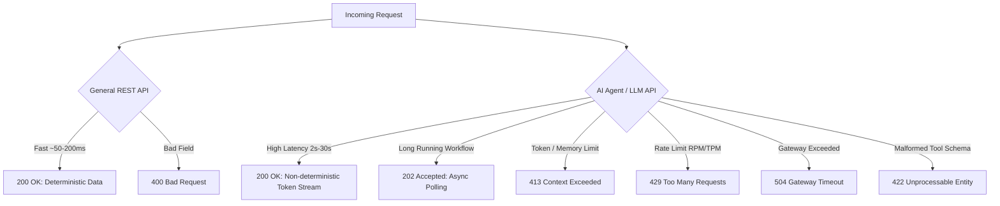

# HTTP Status Codes Cheat Sheet for API & AI Agent Automation

This reference guide categorizes standard HTTP status codes for **General Web & REST APIs** as well as specialized behaviors encountered in **AI Agents, LLM Services, and Event-Driven / Tool-Calling Architectures** (such as Zinier, OpenAI, Anthropic, LangChain, MCP).

---

## Quick Reference Summary

| Category | Range | Meaning | Typical Agent / Automation Impact |
| :--- | :--- | :--- | :--- |
| **2xx** | `200 - 226` | **Success** | Request processed successfully; agent executes next plan step. |
| **3xx** | `300 - 308` | **Redirection** | Endpoint moved; Playwright/REST Assured auto-follows redirects. |
| **4xx** | `400 - 451` | **Client / Caller Error** | Payload/Auth/Quota issue; agent should self-heal or fail prompt. |
| **5xx** | `500 - 511` | **Server / Upstream Error** | Provider outage/model timeout; requires backoff & circuit breakers. |

---

## 1. 2xx Series: Success

| Status Code | Reason Phrase | Importance | General Web & REST API Behavior | AI Agent & Tool-Calling Impact (LLMs / Zinier) |
| :--- | :--- | :--- | :--- | :--- |
| **`200`** | **OK** | ⭐ **CRITICAL** | Standard response for successful `GET`, `PUT`, `PATCH`, or `DELETE`. Returns requested entity in body. | LLM inference completed; returns completion tokens, embeddings, or agent reasoning output. |
| **`201`** | **Created** | ⭐ **CRITICAL** | Successful resource creation via `POST`. Accompanied by a `Location` header pointing to new resource. | Agent executed a tool action (e.g., created a Work Order, booked a technician in Zinier). |
| **`202`** | **Accepted** | ⭐ **CRITICAL (Agent Async)** | Request accepted for background processing, but not yet complete. Often provides a poll URL or job ID. | **Ubiquitous in Agent / Batch LLM jobs**: Long-running scheduling optimizations, document RAG ingestion, or async agent loops. |
| **`204`** | **No Content** | ⭐ **IMPORTANT** | Action succeeded; no body returned (common in `DELETE` or state-toggle operations). | Agent deleted a cache key, cancelled a pending tool call, or cleared session state. |
| `206` | Partial Content | Minor | Response fulfilling `Range` headers (e.g. streaming large binary media/files). | Chunked download of large embedding index or vector database snapshot. |

> [!TIP]
> **SDET Automation Tip for `202 Accepted`:**
> Never write simple assertions expecting immediate state changes on `202`. Implement an **exponential backoff polling loop** (or listen on a WebSocket/SSE event) asserting against the job status endpoint until state reaches `COMPLETED` or `FAILED`.

---

## 2. 4xx Series: Client & Agent Caller Errors

4xx errors represent client-side failures. For AI agents, these often mean bad prompts, tool argument schema mismatches, expired tokens, or rate-limit saturation.

| Status Code | Reason Phrase | Importance | General Web & REST API Behavior | AI Agent & Tool-Calling Impact (LLMs / Zinier) |
| :--- | :--- | :--- | :--- | :--- |
| **`400`** | **Bad Request** | ⭐ **CRITICAL** | Malformed JSON, invalid query params, or missing required body fields. | **Agent Tool-Calling Schema Failure**: Agent hallucinations generating malformed JSON arguments for a tool definition. |
| **`401`** | **Unauthorized** | ⭐ **CRITICAL** | Request lacks valid authentication credentials (missing/expired Bearer token, invalid API key). | LLM API key invalid (`sk-...`), expired OAuth2 access token for upstream tool integration (e.g. CRM/ERP). |
| **`403`** | **Forbidden** | ⭐ **CRITICAL** | Authenticated user lacks RBAC permissions to access the requested resource. | Agent attempted to invoke a restricted tool action (e.g., technician agent trying to access finance ledger). |
| **`404`** | **Not Found** | ⭐ **IMPORTANT** | Endpoint URL does not exist or target resource ID not found. | Vector document ID missing, or agent hallucinated an invalid API tool endpoint/ID. |
| **`409`** | **Conflict** | ⭐ **IMPORTANT** | State conflict (e.g. duplicate unique key, double-booking a slot, optimistic lock failure). | **Scheduling Conflicts**: AI scheduler attempted to assign a technician who is already booked for that exact time slot. |
| **`413`** | **Payload Too Large** | ⭐ **CRITICAL (Agent Context)** | Request payload exceeds maximum allowable server bytes. | **Context Window Exceeded**: Prompt + conversation history + retrieved RAG chunks exceed model context length (e.g. >128k tokens). |
| **`415`** | **Unsupported Media Type**| Minor | Content-Type header mismatch (e.g., sent XML instead of `application/json`). | Multimodal failure: submitting an unsupported image format (e.g., TIFF instead of PNG/JPEG) to a vision model. |
| **`422`** | **Unprocessable Entity**| ⭐ **CRITICAL (Pydantic / FastAPI)** | Syntactically valid JSON, but violates business validation rules or typing constraints. | **Pydantic Validation Error**: Structured outputs or function calling arguments failed schema type constraints (e.g. string passed when integer expected). |
| **`429`** | **Too Many Requests** | ⭐ **CRITICAL (AI Quotas)** | Client exceeded rate limits (RPM: Requests Per Min, or TPM: Tokens Per Min). Contains `Retry-After` header. | **High Traffic LLM / Agent Bottleneck**: Hitting OpenAI, Anthropic, or internal model serving tier quota. Agent MUST implement jittered exponential backoff. |

---

## 3. 5xx Series: Server & Upstream Errors

5xx errors signify infrastructure, model serving, or distributed microservice failures.

| Status Code | Reason Phrase | Importance | General Web & REST API Behavior | AI Agent & Tool-Calling Impact (LLMs / Zinier) |
| :--- | :--- | :--- | :--- | :--- |
| **`500`** | **Internal Server Error** | ⭐ **CRITICAL** | Unhandled exception or crash in backend server code. | Uncaught model inference failure, CUDA Out of Memory (OOM) on GPU server, or unhandled exception in agent execution loop. |
| `501` | Not Implemented | Minor | Server does not support the HTTP verb or feature requested. | Tool capability advertised by agent is not yet supported by backend gateway. |
| **`502`** | **Bad Gateway** | ⭐ **CRITICAL** | API Gateway / Reverse Proxy (Nginx, Kong) received an invalid response from upstream service. | Model serving instance (vLLM, Triton, or OpenAI backend) crashed while handling the inference request. |
| **`503`** | **Service Unavailable** | ⭐ **CRITICAL (Model Overload)** | Server is down for maintenance or temporarily overloaded with traffic. | **Model Capacity Overload**: AI provider has no available GPU capacity to process the prompt (`"The server is currently overloaded. Please try again later"`). |
| **`504`** | **Gateway Timeout** | ⭐ **CRITICAL (LLM Latency)** | Gateway timed out waiting for upstream response (exceeded proxy timeout limit). | **Long Inference / Deep Reasoning Latency**: Model generation took longer than gateway timeout (e.g., 60s proxy timeout, but LLM took 75s to complete response). |

---

## 4. Key Differences: General Web vs. AI Agent APIs

### Critical Nuances for Interview Discussions:

1. **`200 OK` Streaming vs Buffered:**
   - In standard REST, `200 OK` returns the complete JSON payload at once.
   - In Agent / LLM APIs, `200 OK` is frequently returned with `Transfer-Encoding: chunked` and `Content-Type: text/event-stream` (SSE - Server Sent Events). Test automation must validate stream stability and token assembly.

2. **`429 Too Many Requests` (RPM vs TPM):**
   - Traditional APIs throttle by **Requests Per Minute (RPM)**.
   - AI APIs throttle by **both RPM AND Tokens Per Minute (TPM)**. A single massive prompt with thousands of tokens can immediately trigger a `429`, even if it is only the first request of the minute!

3. **`422 Unprocessable Entity` in Tool Calling:**
   - LLMs output text that is parsed into tool function arguments. When the model hallucinates an invalid argument type (e.g. `technician_id: "none"` instead of `integer`), modern frameworks (Pydantic / FastAPI) respond with `422`, requiring the agent to have an error-correction feedback loop.

4. **`504 Gateway Timeout` vs `500 OOM`:**
   - Slow reasoning models (o1/o3, deep RAG pipelines) frequently trigger `504` at API gateways (Nginx/Kong/Envoy) if gateway timeouts are configured with standard 30s limits.
   - GPU memory spikes during long contexts frequently crash worker processes, converting directly into `502 Bad Gateway` or `500 Internal Server Error`.
