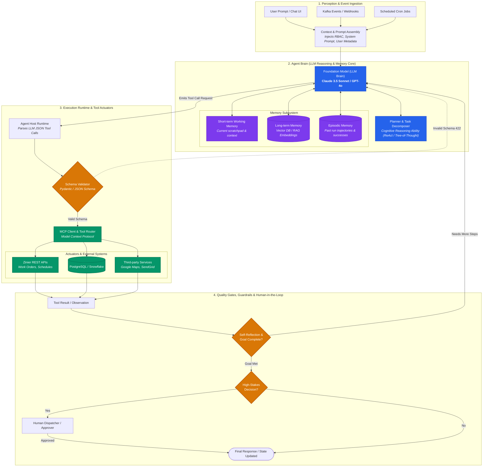
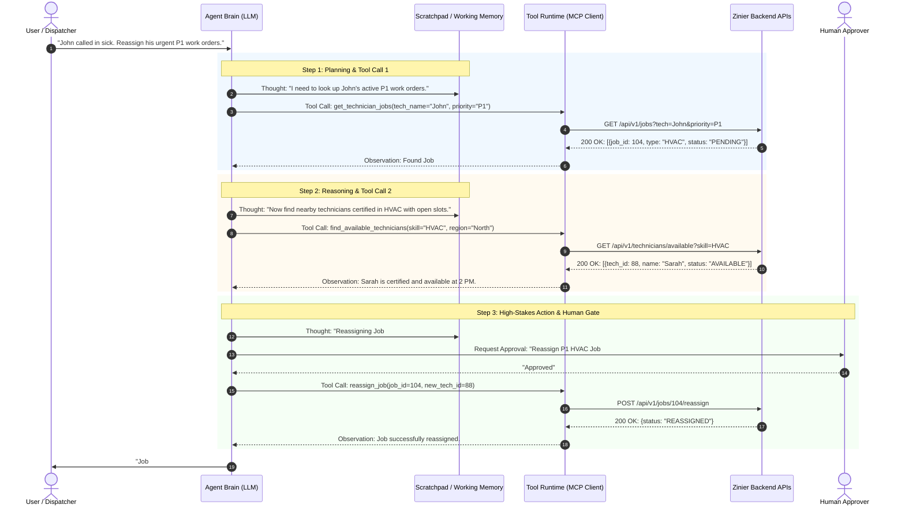
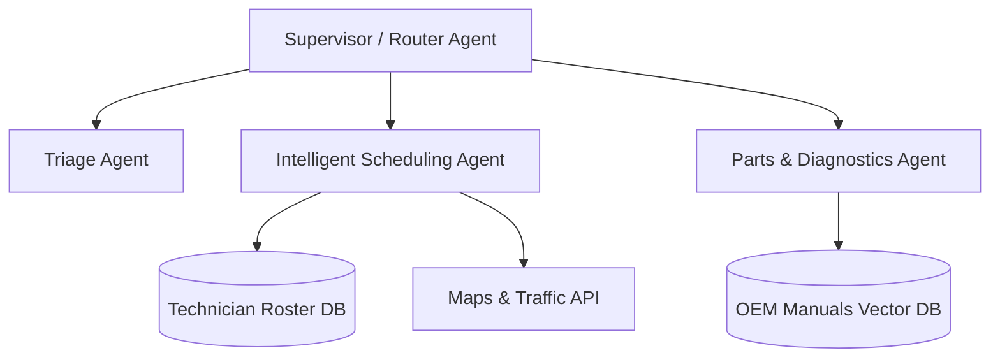
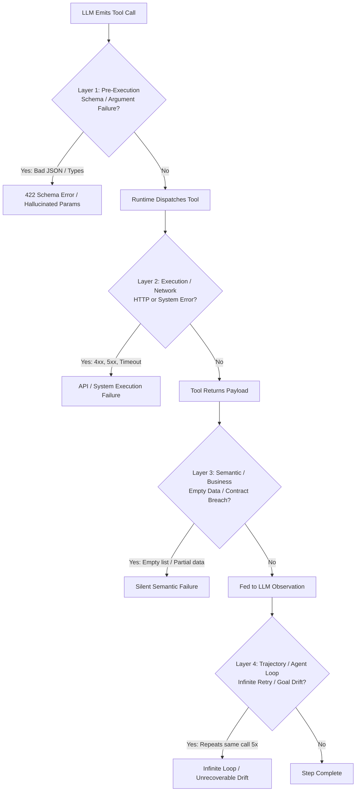
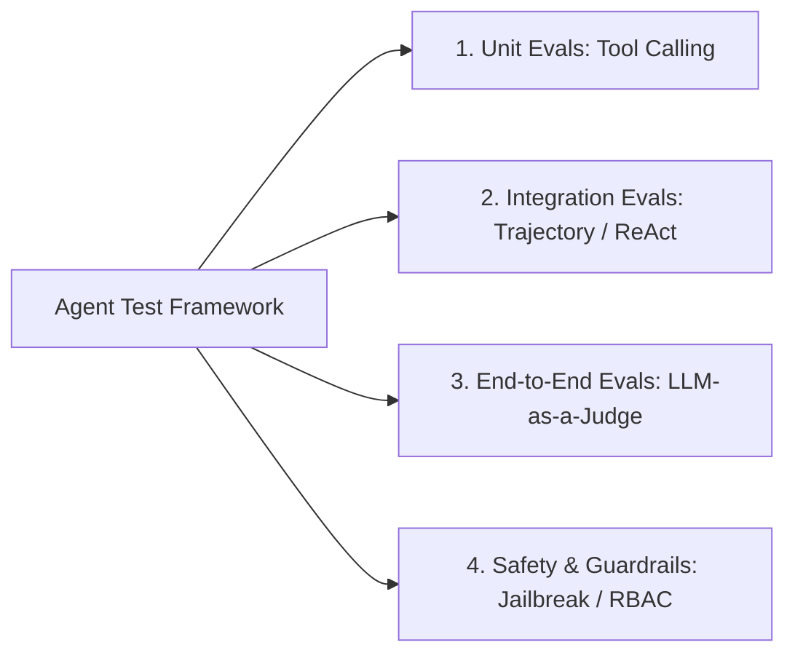

# Agentic AI Architecture: Complete Guide for SDETs & AI Quality Engineers

This document breaks down **Agentic AI Architecture** from fundamentals to advanced design patterns, tool integration (MCP), failure modes, and test/validation strategies. It is specifically tailored for testing autonomous systems like **Zinier's field-service AI agents** and enterprise platforms (ServiceNow, Gainsight).

---

## 1. What is Agentic AI vs. Traditional LLM / RAG?

| Dimension | Traditional LLM (Prompt/Response) | RAG (Retrieval-Augmented Gen) | Agentic AI |
| :--- | :--- | :--- | :--- |
| **Autonomy** | Zero. Static 1-shot answer. | Low. Fetches context and answers. | **High. Decomposes goals into multi-step actions.** |
| **Execution** | Passive text generator. | Passive summarizer/answerer. | **Active executor. Calls APIs, queries DBs, executes code.** |
| **Feedback Loop**| None. Single-turn. | None. Single pass retrieve $\rightarrow$ generate. | **Continuous: Observe $\rightarrow$ Reason $\rightarrow$ Act $\rightarrow$ Evaluate loop.** |
| **State** | Stateless. | Stateless per query. | **Stateful: Manages memory, plan progress, scratchpads.** |
| **Deterministic vs Non** | Non-deterministic text. | Grounded text retrieval. | **Non-deterministic reasoning driving deterministic tool calls.** |

---

## 2. Core Architecture: The 5 Building Blocks of an AI Agent

### 2.1 System Architecture Diagram

### 2.2 Deep Dive into the 5 Pillars

#### 1. Perception (Input & Trigger Layer)
* Ingests user prompts, system webhooks, Kafka events, or schedule triggers.
* Standardizes environment data, user roles (RBAC), and session metadata before feeding into the context window.

#### 2. The Brain (Reasoning Engine - LLM)
* Uses foundation models (e.g., Claude 3.5 Sonnet, GPT-4o, Gemini 1.5 Pro) with system prompts instructing role, guardrails, and allowed operations.
* **Reasoning Frameworks**:
  * **ReAct (Reason + Act)**: The agent outputs: `Thought` $\rightarrow$ `Action` $\rightarrow$ `Observation` $\rightarrow$ `Thought` $\rightarrow$ `Final Answer`.
  * **Plan-and-Solve / Tree of Thoughts**: Pre-plans a sequence of steps, executes them, and dynamically updates the plan if a step fails.

> [!IMPORTANT]
> **Key Interview Distinction: Is the "Planner / Decomposer" a Tool or a Model Ability?**
> - **It is an *internal cognitive ability of the reasoning model***, guided by prompting paradigms (ReAct, Chain-of-Thought, Tree-of-Thought). It runs inside the LLM token generation loop.
> - **Tools**, by contrast, are **external functions/APIs** (`query_db()`, `assign_ticket_api()`, Google Maps) executed by external backend code.
> - *Exception (Hybrid Systems):* The LLM decomposes high-level business goals, but can delegate NP-hard combinatorial optimization (like multi-technician route scheduling) to an external deterministic solver tool (e.g., Google OR-Tools).

#### 3. Memory Architecture
* **Short-Term / Working Memory**: Current session scratchpad, conversation history, and immediate tool call outputs inside the prompt context window.
* **Long-Term Memory**: Vector database (Pinecone, Chroma, Qdrant) storing past user preferences, historical work order resolutions, or organizational domain knowledge.
* **Episodic Memory**: Past execution trajectories used by the agent to learn from previous successes or failures.

#### 4. Planning & Decomposition
* Breaks a complex, ambiguous user objective (*"Reschedule all delayed high-priority HVAC work orders in North Region"*) into discrete sub-tasks:
  1. Query active work orders with status `DELAYED` and priority `P1`.
  2. Find available HVAC-certified technicians in North Region.
  3. Validate shift schedules & travel time constraints.
  4. Call scheduling API to update work orders.
  5. Notify technicians via SMS/Push.

#### 5. Tools & Actuators (Action Space)
* APIs, database queries, bash commands, browser automation, or **Model Context Protocol (MCP)** endpoints that allow the agent to affect the outside world.

---

## 3. Tool Execution & Runtime Sequence (The ReAct Loop)

Agents don't execute actions directly; they emit **structured tool call requests** (JSON schema) that an execution runtime invokes.

### 3.1 Runtime Sequence Diagram: Autonomous Field Dispatch with Human-in-the-Loop

### Why MCP (Model Context Protocol) Matters:
* **Decouples Tools from Agents**: Standardized JSON-RPC protocol developed by Anthropic.
* Instead of hardcoding 50 API clients inside your agent, the agent connects to an **MCP Server** that exposes available `Tools`, `Resources` (data), and `Prompts` dynamically.
* **In SDET testing**: You can mock an entire MCP server during integration testing to verify how the agent behaves under tool errors, timeouts, or unexpected payloads.

---

## 4. Multi-Agent Architectures (Orchestration Patterns)

Complex enterprise platforms do not use a single monolithic agent. They use specialized multi-agent teams:

1. **Supervisor / Hierarchical Pattern**: A lead agent delegates sub-tasks to specialized sub-agents and synthesizes their outputs.
2. **Sequential / Pipeline Pattern**: Output of Agent A becomes input of Agent B (e.g., Triage Agent $\rightarrow$ Estimator Agent $\rightarrow$ Dispatch Agent).
3. **Collaborative / Peer Pattern**: Agents communicate via a shared message bus or shared state graph (e.g., LangGraph, AutoGen, CrewAI).

---

### 5.1 How to Detect Tool Failures in an Agent Execution Trace

In autonomous agents, a tool failure does not always crash the host program—the agent might catch the error, hallucinate a fake response, or loop infinitely. Detecting failures requires inspecting the **execution trace** across 4 distinct layers:

#### The 4 Layers of Trace Failure Detection:
1. **Layer 1: Schema / Argument Hallucination**:
   - The LLM outputs invalid JSON or parameter types that violate the tool's Pydantic contract (e.g. `tech_id: "John"` instead of `int`).
   - *Detection in Trace:* Pre-execution validation span marked as `status=ERROR` with `error_type=ValidationError`.
2. **Layer 2: Network & API Gateway Errors**:
   - The tool executes via HTTP/REST or MCP, but upstream services return `4xx`, `5xx`, or timeout.
   - *Detection in Trace:* Distributed span (OpenTelemetry / LangSmith) reports HTTP status $\ge 400$ or unhandled `TimeoutException`.
3. **Layer 3: Silent Semantic Failures**:
   - The tool returns HTTP 200 OK, but the payload is empty (`{"technicians": []}`) or lacks required data.
   - *Detection in Trace:* Evaluator inspects tool observation payloads for null/empty values and missing keys.
4. **Layer 4: Trajectory & Infinite Loop Failures**:
   - The agent encounters an error and repeats the exact same tool call with identical inputs across subsequent steps without learning.
   - *Detection in Trace:* Trajectory deduplication check: flag when consecutive steps have identical `tool_name` and `arguments`.

> [!TIP]
> **SDET Golden Interview Insight: Tool Failure vs. Agent Failure**
> In agentic evaluation, distinguish between **Tool Failure** and **Agent Failure**:
> - If a tool returns `404 Not Found` or `500 Server Error`, but the agent reads the observation, **self-corrects** (e.g., switches to a backup API or alternate query), and achieves the goal, the test **PASSES** under **Agent Resilience Testing**.
> - The test **FAILS** only if the agent hallucinates success despite the failure, gets stuck in an infinite retry loop, or crashes.

## 6. How to Test Agentic AI: The Quality Framework

### 1. Tool-Calling Unit Tests (Deterministic)
* Assert that given specific user intents, the LLM emits the **correct tool name** and **valid argument schema** (validating against Pydantic / JSON Schema contracts).

### 2. Trajectory & Reasoning Evaluation (Intermediate Steps)
* Don't just assert the final outcome; assert the **execution path**:
  * Did the agent call the minimal set of tools without redundant calls?
  * Metric: **Tool Call Precision & Recall** and **Trajectory Efficiency** ($\text{Optimal Steps} / \text{Actual Steps}$).

### 3. Golden Trajectory Datasets
* Curate a benchmark suite of 100-200 scenarios with known ground truth steps.
* Run in CI/CD before any prompt or model version update.

### 4. Human-in-the-Loop (HITL) Validation
* For high-stakes workflows (e.g., canceling a contract, assigning overtime pay), assert that the agent **pauses execution**, stores state in DB, and requests human confirmation before executing the tool.

---

## 7. How to Explain This in Your Interview with Keerthivasan

> **Interviewer Question:** *"Can you explain the architecture of an AI agent and how you would test an autonomous scheduling agent at Zinier?"*

### **Your Structured Answer:**
1. **Architecture Overview:**
   > *"An agentic system consists of five core components: the **Perception layer** that ingests work order events; the **Brain (LLM)** running a reasoning loop like ReAct; the **Memory system** managing short-term context and long-term vector embeddings; a **Planner** that decomposes high-level goals into step-by-step sub-tasks; and **Tools/Actuators** connected via REST APIs or MCP to take real actions in Zinier's backend."*

2. **The Agent Execution Loop:**
   > *"The agent operates in a continuous **Observe-Reason-Act** cycle. For example, to schedule an emergency HVAC repair, it reasons about required technician skills, calls `query_technicians()`, observes who is available and nearest, applies business constraints (shift limits, travel time), and either executes `assign_ticket()` or routes to a human dispatcher if constraints conflict."*

3. **My Quality Engineering Strategy:**
   > *"I test agents at three levels:
   > 1. **Contract & Schema Level:** Strict Pydantic/JSON validation on tool call arguments to catch argument hallucination.
   > 2. **Trajectory & Efficiency Testing:** Using benchmark golden datasets in CI to evaluate whether the agent follows the optimal path without infinite loops or redundant API hits.
   > 3. **Constraint & Safety Gates:** Asserting hard business constraints (no double-booking, shift rules) via deterministic rule engines, while using calibrated LLM-as-a-Judge for semantic quality and upstream PII/RBAC gates."*
