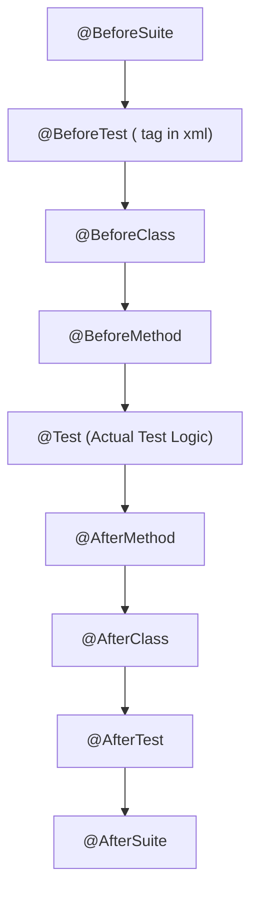

# TestNG Master Guide: Architecture, Annotations, Execution & Interview Prep

**Target:** SDET-2 Interview @ Zinier (Interviewer: Keerthivasan Venkatraman)  
**Context:** Automation frameworks (REST Assured, Selenium, Hybrid Frameworks, CI/CD)

---

## 1. TestNG Core Architecture & Execution Lifecycle

TestNG (**Test Next Generation**) is a Java testing framework inspired by JUnit and NUnit, introducing advanced features like data providers, parallel test execution, flexible configuration annotations, and dependency grouping.

### Execution Order Lifecycle

When a full test suite runs, TestNG executes annotations in this strict hierarchy:



```java
// Execution sequence demonstration
public class LifecycleDemo {
    @BeforeSuite  public void bs() { System.out.println("1. BeforeSuite (Global DB setup/Env setup)"); }
    @BeforeTest   public void bt() { System.out.println("2. BeforeTest (<test> tag in testng.xml)"); }
    @BeforeClass  public void bc() { System.out.println("3. BeforeClass (Init Page Objects/Driver)"); }
    @BeforeMethod public void bm() { System.out.println("4. BeforeMethod (Runs before EACH @Test)"); }
    
    @Test         public void test1() { System.out.println("5. Test Execution: test1"); }
    @Test         public void test2() { System.out.println("5. Test Execution: test2"); }

    @AfterMethod  public void am() { System.out.println("6. AfterMethod (Runs after EACH @Test - cleanup)"); }
    @AfterClass   public void ac() { System.out.println("7. AfterClass (Quit driver)"); }
    @AfterTest    public void at() { System.out.println("8. AfterTest"); }
    @AfterSuite   public void as() { System.out.println("9. AfterSuite (Flush reports/Clean DB)"); }
}
```

> [!IMPORTANT]
> **Difference between `@BeforeTest` and `@BeforeMethod`:**
> - `@BeforeMethod`: Runs before **every single `@Test` method** in that class (e.g., launch fresh browser tab or reset auth tokens).
> - `@BeforeTest`: Runs once before any test method belonging to the `<test>` tag inside `testng.xml`.

---

## 2. Key Annotations Deep Dive

| Annotation | Purpose & Real-world SDET Use Case |
| :--- | :--- |
| **`@Test`** | Marks a method as part of the test execution. Supports attributes: `priority`, `dependsOnMethods`, `dataProvider`, `groups`, `timeout`, `invocationCount`, `retryAnalyzer`. |
| **`@DataProvider`** | Supplies data to a test method. Returns `Object[][]` or `Iterator<Object[]>`. |
| **`@Parameters`** | Injects parameters defined in `testng.xml` (e.g. `browser`, `environment`, `baseUrl`). |
| **`@Listeners`** | Hooks into TestNG events (test pass, fail, skip, start) for custom logging, reporting, and screenshot capture. |

### Powerful `@Test` Attributes:
```java
// Priority (Default is 0. Negative numbers run first: -1 -> 0 -> 1)
@Test(priority = 1)

// Invocation Count & Thread Pool (Built-in load/stress testing!)
@Test(invocationCount = 10, threadPoolSize = 3) // Runs 10 times across 3 parallel threads

// Timeout (Fails test if it takes longer than specified ms)
@Test(timeOut = 5000) // 5 seconds max

// Depends on methods / groups (Hard vs Soft dependency)
@Test(dependsOnMethods = {"loginTest"}, alwaysRun = false) // If login fails, skip this test
```

---

## 3. Data Providers: Data-Driven Automation

### 1. Basic 2D Object Array (`Object[][]`)
```java
@DataProvider(name = "loginCredentials")
public Object[][] getLoginData() {
    return new Object[][] {
        {"standard_user", "secret_pass", true},
        {"locked_out_user", "secret_pass", false},
        {"invalid_user", "wrong_pass", false}
    };
}

@Test(dataProvider = "loginCredentials")
public void testLogin(String username, String password, boolean expectedSuccess) {
    // REST Assured or Selenium login validation
}
```

### 2. Parallel Data Provider (`parallel = true`)
By default, data provider runs rows sequentially. Setting `parallel = true` executes all data rows concurrently!
```java
@DataProvider(name = "workOrderData", parallel = true)
public Object[][] getWorkOrders() {
    return new Object[][] {
        {"WO-101", "P1"},
        {"WO-102", "P2"},
        {"WO-103", "P3"}
    };
}
```

---

## 4. `testng.xml` Configuration & Parallel Execution

The `testng.xml` suite file controls test suites, parameters, grouping, and parallel execution.

### Complete `testng.xml` Example:
```xml
<?xml version="1.0" encoding="UTF-8"?>
<!DOCTYPE suite SYSTEM "https://testng.org/testng-1.0.dtd">
<suite name="Enterprise Automation Suite" parallel="tests" thread-count="4" verbose="2">

    <!-- Global Suite Parameter -->
    <parameter name="environment" value="staging" />

    <!-- Listeners for Reporting & Retries -->
    <listeners>
        <listener class-name="com.zinier.listeners.CustomTestListener" />
        <listener class-name="com.zinier.listeners.AnnotationTransformer" />
    </listeners>

    <!-- Test 1: Chrome Execution with Smoke Group -->
    <test name="Chrome Smoke Suite">
        <parameter name="browser" value="chrome" />
        <groups>
            <run>
                <include name="smoke" />
                <exclude name="wip" />
            </run>
        </groups>
        <classes>
            <class name="com.zinier.tests.AuthenticationTest" />
            <class name="com.zinier.tests.WorkOrderTest" />
        </classes>
    </test>

    <!-- Test 2: Firefox Regression Suite -->
    <test name="Firefox Regression Suite">
        <parameter name="browser" value="firefox" />
        <groups>
            <run>
                <include name="regression" />
            </run>
        </groups>
        <packages>
            <package name="com.zinier.tests.api.*" />
        </packages>
    </test>

</suite>
```

### Parallel Execution Modes:
* **`parallel="methods"`**: Every `@Test` method runs in a separate thread.
* **`parallel="classes"`**: All test methods in class A run in thread 1, all in class B run in thread 2.
* **`parallel="tests"`**: Each `<test>` block in `testng.xml` runs in its own thread (recommended for cross-browser testing).

---

## 5. Listeners & Flaky Test Retry Mechanism

### 1. `ITestListener` (Reporting & Screenshot on Failure)
```java
public class CustomTestListener implements ITestListener {
    @Override
    public void onTestFailure(ITestResult result) {
        String testName = result.getMethod().getMethodName();
        System.out.println("❌ Test Failed: " + testName);
        System.out.println("Failure Reason: " + result.getThrowable().getMessage());
        // Call helper to capture screenshot or save REST Assured response body
    }

    @Override
    public void onTestSuccess(ITestResult result) {
        System.out.println("✅ Test Passed: " + result.getMethod().getMethodName());
    }
}
```

### 2. Flaky Test Auto-Retry (`IRetryAnalyzer` + `IAnnotationTransformer`)
Instead of manually putting `retryAnalyzer` on every `@Test`, we dynamically apply it to all tests.

#### A. Retry Analyzer Logic:
```java
public class RetryAnalyzer implements IRetryAnalyzer {
    private int retryCount = 0;
    private static final int MAX_RETRY_COUNT = 2; // Retry up to 2 times

    @Override
    public boolean retry(ITestResult result) {
        if (retryCount < MAX_RETRY_COUNT) {
            retryCount++;
            System.out.println("🔄 Retrying test [" + result.getName() + "] - Attempt #" + retryCount);
            return true; // Re-run test
        }
        return false; // Stop retrying
    }
}
```

#### B. Annotation Transformer (Auto-apply to all tests):
```java
public class AnnotationTransformer implements IAnnotationTransformer {
    @Override
    public void transform(ITestAnnotation annotation, Class testClass, 
                          Constructor testConstructor, Method testMethod) {
        annotation.setRetryAnalyzer(RetryAnalyzer.class);
    }
}
```

---

## 6. Assertions: Hard Assert vs Soft Assert

```java
// 1. HARD ASSERT (Test execution stops immediately on failure)
Assert.assertEquals(actualStatusCode, 200, "Status code mismatch!");
Assert.assertTrue(isUserActive, "User is not active!"); // Never reached if line above fails

// 2. SOFT ASSERT (Executes all validations, collects failures, asserts at the end)
SoftAssert softAssert = new SoftAssert();

softAssert.assertEquals(response.statusCode(), 200, "Wrong status!");
softAssert.assertEquals(response.jsonPath().getString("status"), "SUCCESS", "Wrong status body!");
softAssert.assertTrue(response.jsonPath().getInt("order_id") > 0, "Invalid ID!");

// 💡 CRITICAL: Must call assertAll(), otherwise the test will PASS even with failures!
softAssert.assertAll();
```

---

## 7. High-Yield Interview Questions for Keerthivasan

### Q1: "What is the difference between `dependsOnMethods` and `priority`?"
* **Answer:**
  * `priority` determines the **execution sequence** (e.g., run test A before test B), but if test A fails, test B will still execute.
  * `dependsOnMethods` establishes a **hard dependency**. If test A fails, test B is **SKIPPED** (not executed), preventing cascade failures and saving execution time.

### Q2: "How do you achieve thread safety in parallel execution with TestNG?"
* **Answer:**
  * In parallel execution (`parallel="methods"` or `parallel="classes"`), shared static variables cause race conditions.
  * We use **`ThreadLocal`** to isolate `WebDriver` or REST Assured `RequestSpecification` instances per thread:
    ```java
    public class DriverFactory {
        private static ThreadLocal<WebDriver> driver = new ThreadLocal<>();
        public static WebDriver getDriver() { return driver.get(); }
        public static void setDriver(WebDriver d) { driver.set(d); }
        public static void quitDriver() { driver.get().quit(); driver.remove(); }
    }
    ```

### Q3: "How does TestNG differ from JUnit 5?"
* **Answer:**
  * TestNG has native support for `dependsOnMethods`, parameterization via XML, parallel execution modes without third-party plugins, and built-in `invocationCount` for concurrency testing.
  * TestNG data providers are integrated directly via `@DataProvider(parallel = true)`, whereas JUnit 5 uses `@ParameterizedTest` with `@MethodSource` or `@CsvSource`.

### Q4: "A test is flaky due to environment latency. How do you handle it in CI/CD?"
* **Answer:**
  * Implement an `IRetryAnalyzer` (max 1 or 2 retries) paired with an `IAnnotationTransformer`.
  * In the listener, mark the initial failure as `SKIPPED` or `FLAKY` rather than failing the whole build, and report flaky test metrics to Datadog/Grafana to track test health over time.

