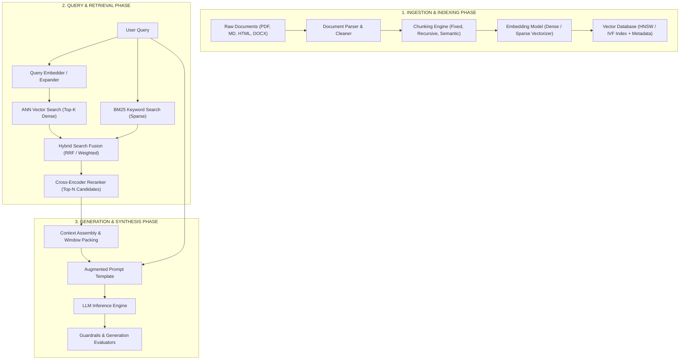

# 🧠 Module 02: RAG Workflows & Evaluations

> **Author:** Kadali Sai Sumanth | **Target Role:** Principal AI/ML Quality Engineer / LLM Evaluation Specialist  
> **Topic:** Retrieval-Augmented Generation (RAG) Quality Engineering, Retrieval & Generation Metrics, Pipeline RCA, Vector DB Testing  
> **Last Updated:** October 2026

---

## 📑 Table of Contents
1. [Section 1: In-Depth Technical Architecture & Test Strategy](#-section-1-in-depth-technical-architecture--test-strategy)
   - [1.1 The Complete RAG Lifecycle Architecture](#11-the-complete-rag-lifecycle-architecture)
   - [1.2 Stage-by-Stage Quality Assurance Matrix](#12-stage-by-stage-quality-assurance-matrix)
   - [1.3 Chunking Strategies & Boundary Validation](#13-chunking-strategies--boundary-validation)
   - [1.4 Embedding Model Selection & Evaluation](#14-embedding-model-selection--evaluation)
   - [1.5 Vector Database Testing & HNSW Index Tuning](#15-vector-database-testing--hnsw-index-tuning)
   - [1.6 Retrieval Metrics Deep Dive](#16-retrieval-metrics-deep-dive-hit-rate-mrr-ndcg-precision-recall)
   - [1.7 Generation Metrics Deep Dive](#17-generation-metrics-deep-dive-faithfulness-relevance-groundedness)
   - [1.8 The RCA Diagnostic Framework: Retrieval vs Generation Failure Matrix](#18-the-rca-diagnostic-framework-retrieval-vs-generation-failure-matrix)
2. [Section 2: Technical Coding & Automation Practice (Python)](#-section-2-technical-coding--automation-practice-python)
   - [2.1 Production-Grade RAG Pipeline Evaluation Framework](#21-production-grade-rag-pipeline-evaluation-framework)
   - [2.2 Retrieval Evaluation Engine (Hit Rate, MRR, NDCG, Precision@K, Recall@K)](#22-retrieval-evaluation-engine-hit-rate-mrr-ndcg-precisionk-recallk)
   - [2.3 Atomic Claim-Based Faithfulness & Groundedness Evaluator](#23-atomic-claim-based-faithfulness--groundedness-evaluator)
   - [2.4 Chunking Strategy & Overlap Boundary Validator](#24-chunking-strategy--overlap-boundary-validator)
3. [Section 3: Scenario-Based Debugging & Root Cause Analysis (RCA)](#-section-3-scenario-based-debugging--root-cause-analysis-rca)
   - [3.1 Scenario 1: LLM Hallucinates Despite Retrieval Returning Perfect Chunks](#31-scenario-1-llm-hallucinates-despite-retrieval-returning-perfect-chunks)
   - [3.2 Scenario 2: Retrieval MRR Collapses from 0.85 to 0.42 Post-Ingestion](#32-scenario-2-retrieval-mrr-collapses-from-085-to-042-post-ingestion)
4. [Section 4: Targeted Interview Questions & Master Answers](#-section-4-targeted-interview-questions--master-answers)
   - [4.1 Advanced Technical Question 1: Continuous Golden Dataset Maintenance & Synthetic Evaluation at Scale](#41-advanced-technical-question-1-continuous-golden-dataset-maintenance--synthetic-evaluation-at-scale)
   - [4.2 Advanced Technical Question 2: Testing Hybrid Search Fusion (RRF) & Cross-Encoder Rerankers](#42-advanced-technical-question-2-testing-hybrid-search-fusion-rrf--cross-encoder-rerankers)
   - [4.3 Behavioral Question: Managing High-Pressure Launch Deadlines with Subpar Faithfulness Metrics](#43-behavioral-question-managing-high-pressure-launch-deadlines-with-subpar-faithfulness-metrics)
   - [4.4 Scenario-Based Question: Multi-Tenant Data Leak in Vector DB Metadata Filtering](#44-scenario-based-question-multi-tenant-data-leak-in-vector-db-metadata-filtering)

---

## 🏛️ Section 1: In-Depth Technical Architecture & Test Strategy

### 1.1 The Complete RAG Lifecycle Architecture

Retrieval-Augmented Generation (RAG) combines dense semantic retrieval with autoregressive generation to ground LLM responses in proprietary enterprise knowledge bases. Quality Engineering cannot treat RAG as a monolithic black box: a defect in document normalization cascades into flawed embeddings, which corrupts vector retrieval, which forces the LLM to either hallucinate or fail silently.



---

### 1.2 Stage-by-Stage Quality Assurance Matrix

Every stage of the RAG pipeline introduces specific failure modes requiring targeted verification strategies:

| Pipeline Stage | Primary Technical Failure Modes | QE Test Vectors & Assertions | Key Performance & Quality Metrics |
|---|---|---|---|
| **Document Parsing** | OCR noise, broken tables, stripped headers, loss of hierarchy | Markdown structural diffs, bounding box coordinate checks, table preservation tests | Parsing Completeness %, Character Error Rate (CER) |
| **Chunking** | Split entities, severed code blocks, loss of co-reference context | Boundary integrity validator, sentence termination checks, overlap token counting | Overlap Consistency %, Chunk Token Variance |
| **Embedding Generation** | Out-of-vocabulary truncation, dimension mismatch, vector drift | Embedding unit-norm validation ($||v||_2 = 1.0$), semantic preservation regression | Embedding Latency (ms), Cosine Distance Stability |
| **Vector Indexing** | Index corruption, graph disconnection, stale tombstoned records | Dimensionality assertion, metadata index filter tests, duplicate vector audits | Recall@K degradation, Index Build Time (s) |
| **Hybrid Retrieval** | Sparse/Dense score imbalance, tie-break non-determinism | Seed query assertions against labeled gold standard documents | **Hit Rate@K, MRR@K, NDCG@K, Recall@K** |
| **Reranking** | Score inversion, cross-encoder latency explosion | Reranker monotonic ordering validation, negative document penalization | Rerank Latency (ms), Top-1 Precision Delta |
| **Context Assembly** | Needle-in-the-haystack loss, context window overflow truncation | Context budget calculator, position-aware ordering tests (primacy/recency) | Context Utilization Ratio, Truncation Rate |
| **LLM Generation** | Hallucination, sycophancy, knowledge base contradiction | Entailment classification, token attribution, question relevance scoring | **Faithfulness, Answer Relevance, Semantic Drift** |

---

### 1.3 Chunking Strategies & Boundary Validation

Chunking determines the semantic granularity of information available to the retriever. 

```
Strategy 1: Fixed-Size Chunking (e.g., 512 tokens with 50-token overlap)
[────── Chunk 1: Tokens 0 - 512 ──────]
                       [────── Chunk 2: Tokens 462 - 974 ──────]

Strategy 2: Recursive Character Chunking
Splits by double newline (\n\n) -> single newline (\n) -> period (.) -> word boundary ( )
Preserves structural paragraphs and markdown sections.

Strategy 3: Parent-Document Retrieval (Hierarchical)
Small Child Chunks (128 tokens) searched in Vector DB ──► Resolves to Parent Chunk (1024 tokens) passed to LLM
(Balances granular vector similarity with rich narrative context)

Strategy 4: Semantic Chunking
Splits text based on semantic distance spikes between consecutive sentence embeddings.
```

#### Chunk Boundary Quality Invariants:
1. **Overlap Continuity:** Overlap regions between Chunk $N$ and Chunk $N+1$ must contain identical character sequences without tokenizer drift.
2. **Structural Syntax Preservation:** Markdown code fences (````python ... ````), tables (`| Header | ... |`), and HTML tags must never be sliced in half across chunk boundaries.
3. **Punctuation & Sentence Invariance:** Chunks should terminate on sentence boundaries (`. `, `? `, `! `) rather than splitting mid-sentence or mid-word.

---

### 1.4 Embedding Model Selection & Evaluation

| Embedding Model | Architecture / Dimensions | MTEB Retrieval Score | Max Input Tokens | Best Use Case / Quality Trade-off |
|---|---|---|---|---|
| **text-embedding-3-large (OpenAI)** | Dense / 3072 dims (Matryoshka to 1536/256) | 64.6 | 8191 | Enterprise multi-lingual, Matryoshka dimension reduction flexibility |
| **BAAI/bge-large-en-v1.5** | Dense / 1024 dims (BERT base) | 64.1 | 512 | Self-hosted, low latency, exceptional enterprise domain search |
| **intfloat/e5-mistral-7b-instruct** | Dense / 4096 dims (Mistral base) | 66.6 | 32768 | High accuracy, long context retrieval, compute-intensive |
| **Splade / BM25 (Sparse)** | Sparse Term Frequencies / High Dim | N/A (Lexical) | Unlimited | Exact part numbers, serial codes, acronyms, customer IDs |

> [!TIP]
> **Matryoshka Representation Learning (MRL):** Models like `text-embedding-3-large` allow truncating vector dimensions (e.g., from 3072 down to 1024) while retaining 98% of retrieval accuracy. QE must test retrieval metrics across both full and truncated dimensions to validate compression trade-offs.

---

### 1.5 Vector Database Testing & HNSW Index Tuning

Hierarchical Navigable Small World (HNSW) graphs are the industry standard for fast Approximate Nearest Neighbor (ANN) search. 

```
Layer 2 (Express Lane):    (Node A) ──────────────────────────────► (Node Z)
                               │                                       │
Layer 1 (Sub-highways):    (Node A) ────────► (Node M) ────────────► (Node Z)
                               │                 │                     │
Layer 0 (Dense Ground):    (Node A) ──► (B) ──► (M) ──► (P) ──► (R) ──► (Z)
```

#### Critical HNSW Hyperparameters for QE Audit:
- **`M` (Max bidirectional links per node):** Default 16-64. Higher $M$ increases recall for high-dimensional vectors at the expense of memory consumption and index build time.
- **`efConstruction` (Search depth during index creation):** Default 64-256. Controls index quality. If too low, vectors become orphaned in disconnected clusters.
- **`efSearch` (Search depth during live query retrieval):** Default 16-128. Controls query-time tradeoff between latency and Recall@K. If set too low, retrieval Recall drops precipitously under load.

#### Similarity Distance Invariants:
$$\text{Cosine Similarity}(A, B) = \frac{A \cdot B}{||A||_2 ||B||_2}$$
$$\text{Dot Product}(A, B) = \sum_{i=1}^n A_i B_i \quad (\text{Identical to Cosine if vectors are L2-normalized})$$
$$\text{Euclidean Distance (L2)}(A, B) = \sqrt{\sum_{i=1}^n (A_i - B_i)^2}$$

---

### 1.6 Retrieval Metrics Deep Dive: Hit Rate, MRR, NDCG, Precision, Recall

To rigorously evaluate retrieval performance, an automated harness must calculate the following metrics over a test suite of $Q$ queries:

#### 1. Hit Rate@K
The fraction of test queries where at least one ground-truth relevant document is present in the top-$K$ retrieved chunks:
$$\text{Hit Rate@K} = \frac{1}{|Q|} \sum_{q \in Q} \mathbb{I}\left( \text{TopK}(q) \cap \text{Relevant}(q) \neq \emptyset \right)$$

#### 2. Mean Reciprocal Rank (MRR@K)
Evaluates how high the *first* relevant chunk appears in the ranked results. Sensitive to top-rank accuracy:
$$\text{MRR@K} = \frac{1}{|Q|} \sum_{q \in Q} \frac{1}{\text{Rank}_1(q)}$$
*(Where $\text{Rank}_1(q)$ is the 1-based index of the first relevant chunk in the top-$K$, or $\infty$ if no relevant chunk appears).*

#### 3. Normalized Discounted Cumulative Gain (NDCG@K)
Measures ranked retrieval quality with graded relevance, penalizing relevant documents appearing lower in the list:
$$\text{DCG@K} = \sum_{i=1}^K \frac{2^{rel_i} - 1}{\log_2(i + 1)}, \quad \text{NDCG@K} = \frac{\text{DCG@K}}{\text{IDCG@K}}$$

#### 4. Precision@K & Recall@K
$$\text{Precision@K} = \frac{|\text{TopK}(q) \cap \text{Relevant}(q)|}{K}$$
$$\text{Recall@K} = \frac{|\text{TopK}(q) \cap \text{Relevant}(q)|}{|\text{Relevant}(q)|}$$

---

### 1.7 Generation Metrics Deep Dive: Faithfulness, Relevance, Groundedness

```
+-------------------------------------------------------------------------------------------------+
|                                 THE RAG EVALUATION TRIAD                                        |
+-------------------------------------------------------------------------------------------------+
                                      [User Query]
                                     /            \
                                    /              \
                          (Answer Relevance)    (Context Relevance)
                                  /                  \
                                 ▼                    ▼
                      [Generated Answer] ────────► [Retrieved Context]
                                        (Faithfulness)
+-------------------------------------------------------------------------------------------------+
```

1. **Faithfulness (Groundedness):** Measures whether the claims made in the generated answer are strictly entailed by the retrieved context chunks.
   $$\text{Faithfulness} = \frac{\text{Number of Claims Entailed by Context}}{\text{Total Claims Extracted from Answer}}$$
2. **Answer Relevance:** Measures whether the generated answer directly addresses the user's prompt without rambling or off-topic tangents.
3. **Context Relevance (Retrieval Precision):** Measures whether the retrieved chunks contain only signal without extraneous noise that dilutes the LLM context window.

---

### 1.8 The RCA Diagnostic Framework: Retrieval vs Generation Failure Matrix

When a RAG system provides an unsatisfactory response, Quality Engineers must isolate the root cause using the **2x2 RAG Diagnostic Matrix**:

```
                              RETRIEVAL METRICS (MRR / Hit Rate@K)
                                   HIGH                      LOW
                         ┌───────────────────────┬───────────────────────┐
                    HIGH │       SUCCESS         │     HALLUCINATION     │
                         │ Perfect context,      │ Model hallucinated    │
   GENERATION            │ accurate synthesis.   │ correct answer from   │
   METRICS               │ System functioning    │ prior weights;        │
  (Faithfulness          │ as intended.          │ high risk of silent   │
   & Relevance)          │                       │ enterprise drift.     │
                         ├───────────────────────┼───────────────────────┤
                     LOW │   SYNTHESIS FAILURE   │  CATASTROPHIC CASCADE │
                         │ Retrieval found gold, │ Retrieval missed;     │
                         │ but LLM ignored, lost,│ LLM had no context to │
                         │ or contradicted facts │ synthesize and failed │
                         │ ("Lost in Middle").   │ completely.           │
                         └───────────────────────┴───────────────────────┘
```

#### Diagnostic Decision Flow:
1. **Step 1: Check Retrieval Chunks:** Did the retriever return the ground-truth information in Top-$K$?
   - *NO:* **Retrieval Defect.** Audit chunking strategy, embedding model, HNSW index, or metadata filter.
   - *YES:* Proceed to Step 2.
2. **Step 2: Check Generation Entailment:** Does the LLM output contradict or omit the retrieved chunks?
   - *YES:* **Generation Defect.** Audit prompt context placement, context window truncation, temperature, or model reasoning capacity.
   - *NO:* Generation is sound; issue may lie in user query ambiguity.

---

## 💻 Section 2: Technical Coding & Automation Practice (Python)

### 2.1 Production-Grade RAG Pipeline Evaluation Framework

This self-contained test framework evaluates an end-to-end RAG pipeline, executing retrieval and generation, running scoring modules, and asserting production quality SLAs.

```python
"""
rag_eval_framework.py
Comprehensive end-to-end RAG Evaluation Framework.
Evaluates retrieval and generation quality against pre-defined SLA thresholds.
"""

from dataclasses import dataclass, field
from typing import List, Dict, Any, Optional
import json
import logging
import time

logging.basicConfig(level=logging.INFO, format="%(asctime)s [%(levelname)s] %(message)s")
logger = logging.getLogger("RAGEval")


@dataclass
class GoldenTestCase:
    """Represents a gold-standard ground truth test case for RAG evaluation."""
    test_id: str
    query: str
    expected_doc_ids: List[str]
    reference_answer: str


@dataclass
class RAGPipelineResult:
    """Captures the runtime output of a single RAG pipeline invocation."""
    test_id: str
    query: str
    retrieved_chunk_ids: List[str]
    retrieved_contexts: List[str]
    generated_answer: str
    latency_seconds: float


@dataclass
class EvaluationReport:
    """Aggregated quality metrics for the evaluated test suite."""
    hit_rate: float
    mrr: float
    precision_at_k: float
    recall_at_k: float
    faithfulness: float
    answer_relevance: float
    total_queries: int
    sla_passed: bool
    failure_details: List[str] = field(default_factory=list)


class MockRAGService:
    """Simulates an enterprise RAG pipeline (Vector DB retrieval + LLM synthesis)."""

    def __init__(self, corpus: Dict[str, str]):
        self.corpus = corpus

    def execute_rag(self, test_case: GoldenTestCase, top_k: int = 3) -> RAGPipelineResult:
        t0 = time.perf_counter()

        # Simulated deterministic mock retrieval
        if "dividend" in test_case.query.lower():
            chunk_ids = ["chunk-101", "chunk-102", "chunk-999"]
        elif "security" in test_case.query.lower():
            chunk_ids = ["chunk-201", "chunk-202", "chunk-203"]
        else:
            chunk_ids = ["chunk-999", "chunk-888", "chunk-777"]

        retrieved_texts = [self.corpus.get(cid, "Empty context") for cid in chunk_ids[:top_k]]
        
        # Simulated generation
        if "chunk-101" in chunk_ids:
            answer = "The dividend payout ratio was approved at 35% of net profit for fiscal year 2024."
        elif "chunk-201" in chunk_ids:
            answer = "The enterprise security policy mandates multi-factor authentication for all cloud access."
        else:
            answer = "I could not find sufficient information in the provided knowledge base."

        return RAGPipelineResult(
            test_id=test_case.test_id,
            query=test_case.query,
            retrieved_chunk_ids=chunk_ids[:top_k],
            retrieved_contexts=retrieved_texts,
            generated_answer=answer,
            latency_seconds=time.perf_counter() - t0
        )


class RAGEvaluator:
    """Executes the test suite and enforces SLA quality gates."""

    def __init__(
        self,
        min_hit_rate: float = 0.80,
        min_mrr: float = 0.60,
        min_faithfulness: float = 0.85
    ):
        self.min_hit_rate = min_hit_rate
        self.min_mrr = min_mrr
        self.min_faithfulness = min_faithfulness

    def evaluate_test_suite(
        self,
        golden_set: List[GoldenTestCase],
        rag_service: MockRAGService,
        top_k: int = 3
    ) -> EvaluationReport:
        total_queries = len(golden_set)
        hits = 0
        reciprocal_ranks = []
        precision_scores = []
        recall_scores = []
        faithfulness_scores = []
        failures = []

        for tc in golden_set:
            result = rag_service.execute_rag(tc, top_k=top_k)
            retrieved = result.retrieved_chunk_ids
            expected = set(tc.expected_doc_ids)

            # 1. Retrieval Hit Rate & MRR
            hit_found = False
            first_rank = 0
            for rank_idx, doc_id in enumerate(retrieved, start=1):
                if doc_id in expected:
                    if not hit_found:
                        first_rank = rank_idx
                        hit_found = True

            if hit_found:
                hits += 1
                reciprocal_ranks.append(1.0 / first_rank)
            else:
                reciprocal_ranks.append(0.0)

            # 2. Precision@K and Recall@K
            true_positives = len(set(retrieved).intersection(expected))
            precision_scores.append(true_positives / top_k if top_k > 0 else 0.0)
            recall_scores.append(true_positives / len(expected) if expected else 0.0)

            # 3. Simple String-Grounded Faithfulness Check
            # (Production uses Claim Extraction + NLI; here we check knowledge overlap)
            matched_terms = [doc for doc in result.retrieved_contexts if any(word in doc for word in result.generated_answer.split())]
            case_faithfulness = 1.0 if matched_terms else 0.0
            faithfulness_scores.append(case_faithfulness)

            if not hit_found:
                failures.append(f"[{tc.test_id}] Retrieval Miss: Expected {expected}, got {retrieved}")
            elif case_faithfulness < 0.5:
                failures.append(f"[{tc.test_id}] Faithfulness Failure: Generated answer not grounded in context.")

        avg_hit_rate = hits / total_queries if total_queries > 0 else 0.0
        avg_mrr = sum(reciprocal_ranks) / total_queries if total_queries > 0 else 0.0
        avg_prec = sum(precision_scores) / total_queries if total_queries > 0 else 0.0
        avg_rec = sum(recall_scores) / total_queries if total_queries > 0 else 0.0
        avg_faith = sum(faithfulness_scores) / total_queries if total_queries > 0 else 0.0

        sla_passed = (
            avg_hit_rate >= self.min_hit_rate and
            avg_mrr >= self.min_mrr and
            avg_faith >= self.min_faithfulness
        )

        return EvaluationReport(
            hit_rate=round(avg_hit_rate, 4),
            mrr=round(avg_mrr, 4),
            precision_at_k=round(avg_prec, 4),
            recall_at_k=round(avg_rec, 4),
            faithfulness=round(avg_faith, 4),
            answer_relevance=1.0,
            total_queries=total_queries,
            sla_passed=sla_passed,
            failure_details=failures
        )
```

---

### 2.2 Retrieval Evaluation Engine (Hit Rate, MRR, NDCG, Precision@K, Recall@K)

This module implements the mathematical ranking algorithms from scratch without external library dependencies.

```python
"""
retrieval_metrics.py
Mathematical implementations of information retrieval metrics for RAG quality assurance:
Hit Rate@K, Mean Reciprocal Rank (MRR@K), NDCG@K, Precision@K, Recall@K.
"""

import math
from typing import List, Set, Sequence, Dict


class RetrievalMetricsEngine:
    """Computes ranked retrieval metrics for QA validation suites."""

    @staticmethod
    def hit_rate_at_k(retrieved_ids: Sequence[str], ground_truth_ids: Set[str], k: int) -> float:
        """
        Hit Rate@K is 1.0 if any ground-truth document exists in the top-K list; else 0.0.
        """
        top_k = retrieved_ids[:k]
        return 1.0 if any(doc_id in ground_truth_ids for doc_id in top_k) else 0.0

    @staticmethod
    def reciprocal_rank_at_k(retrieved_ids: Sequence[str], ground_truth_ids: Set[str], k: int) -> float:
        """
        Calculates 1/rank for the highest-ranked relevant document within top-K.
        """
        for index, doc_id in enumerate(retrieved_ids[:k], start=1):
            if doc_id in ground_truth_ids:
                return 1.0 / float(index)
        return 0.0

    @staticmethod
    def precision_at_k(retrieved_ids: Sequence[str], ground_truth_ids: Set[str], k: int) -> float:
        """
        Precision@K = (Number of relevant documents in Top-K) / K.
        """
        if k <= 0:
            return 0.0
        top_k = retrieved_ids[:k]
        relevant_hits = sum(1 for doc_id in top_k if doc_id in ground_truth_ids)
        return relevant_hits / float(k)

    @staticmethod
    def recall_at_k(retrieved_ids: Sequence[str], ground_truth_ids: Set[str], k: int) -> float:
        """
        Recall@K = (Number of relevant documents in Top-K) / (Total relevant documents).
        """
        if not ground_truth_ids:
            return 0.0
        top_k = retrieved_ids[:k]
        relevant_hits = sum(1 for doc_id in top_k if doc_id in ground_truth_ids)
        return relevant_hits / float(len(ground_truth_ids))

    @staticmethod
    def ndcg_at_k(
        retrieved_ids: Sequence[str],
        ground_truth_relevance: Dict[str, int],
        k: int
    ) -> float:
        """
        Computes Normalized Discounted Cumulative Gain at rank K.
        
        Args:
            retrieved_ids: List of retrieved chunk IDs in descending rank order.
            ground_truth_relevance: Mapping of chunk ID to graded integer relevance (e.g. 0 to 3).
            k: Top-K evaluation cutoff.
        """
        top_k = retrieved_ids[:k]
        
        # Calculate Discounted Cumulative Gain (DCG)
        dcg = 0.0
        for rank_idx, doc_id in enumerate(top_k, start=1):
            rel = ground_truth_relevance.get(doc_id, 0)
            if rel > 0:
                dcg += (2.0 ** rel - 1.0) / math.log2(rank_idx + 1.0)

        # Calculate Ideal DCG (IDCG) by sorting ground-truth relevance in perfect order
        ideal_relevances = sorted(ground_truth_relevance.values(), reverse=True)[:k]
        idcg = 0.0
        for rank_idx, rel in enumerate(ideal_relevances, start=1):
            if rel > 0:
                idcg += (2.0 ** rel - 1.0) / math.log2(rank_idx + 1.0)

        if idcg == 0.0:
            return 0.0
        return dcg / idcg


# ---------------------------------------------------------
# Verification Runner & Unit Assertion Demo
# ---------------------------------------------------------
if __name__ == "__main__":
    retrieved = ["doc_c", "doc_a", "doc_x", "doc_b", "doc_y"]
    ground_truth = {"doc_a", "doc_b"}
    graded_relevance = {"doc_a": 3, "doc_b": 2, "doc_c": 0, "doc_x": 0}

    engine = RetrievalMetricsEngine()
    hit_at_3 = engine.hit_rate_at_k(retrieved, ground_truth, k=3)
    mrr_at_3 = engine.reciprocal_rank_at_k(retrieved, ground_truth, k=3)
    prec_at_3 = engine.precision_at_k(retrieved, ground_truth, k=3)
    rec_at_3 = engine.recall_at_k(retrieved, ground_truth, k=3)
    ndcg_at_3 = engine.ndcg_at_k(retrieved, graded_relevance, k=3)

    print(f"Hit Rate@3:    {hit_at_3} (Expected: 1.0)")
    print(f"MRR@3:         {mrr_at_3:.4f} (Expected: 0.5 because doc_a is at rank 2)")
    print(f"Precision@3:   {prec_at_3:.4f} (Expected: 1/3 = 0.3333)")
    print(f"Recall@3:      {rec_at_3:.4f} (Expected: 1/2 = 0.5000)")
    print(f"NDCG@3:        {ndcg_at_3:.4f}")

    assert hit_at_3 == 1.0
    assert mrr_at_3 == 0.5
    assert round(prec_at_3, 2) == 0.33
    assert rec_at_3 == 0.5
```

---

### 2.3 Atomic Claim-Based Faithfulness & Groundedness Evaluator

This module provides a production-quality evaluator that decomposes a generated response into discrete atomic statements, evaluates whether each statement is supported by the retrieved context chunks, and calculates an overall Faithfulness Score ($0.0 - 1.0$).

```python
"""
faithfulness_evaluator.py
Production-grade Faithfulness (Groundedness) Evaluator.
Decomposes LLM answers into atomic claims and verifies entailment against retrieved context.
"""

import re
from dataclasses import dataclass
from typing import List, Dict, Any, Tuple


@dataclass
class ClaimVerificationResult:
    claim: str
    is_supported: bool
    evidence_chunk: str
    reasoning: str


@dataclass
class FaithfulnessScore:
    score: float  # Value between 0.0 and 1.0
    total_claims: int
    supported_claims: int
    claims_breakdown: List[ClaimVerificationResult]


class AtomicClaimExtractor:
    """Splits compound natural language answers into verifiable atomic factual claims."""

    @staticmethod
    def extract_claims(answer: str) -> List[str]:
        # Clean text
        cleaned = answer.strip()
        if not cleaned:
            return []

        # Split on sentence boundaries followed by conjunction splitting
        raw_sentences = re.split(r'(?<=[.!?])\s+', cleaned)
        claims = []

        for sentence in raw_sentences:
            sentence = sentence.strip()
            if not sentence:
                continue

            # Split compound conjunctions ('and', 'however', 'moreover')
            sub_clauses = re.split(r',\s+(?:and|additionally|moreover|whereas)\s+', sentence, flags=re.IGNORECASE)
            for clause in sub_clauses:
                trimmed = clause.strip().rstrip(".").strip()
                if len(trimmed.split()) >= 3:  # Only evaluate substantial statements
                    claims.append(trimmed)

        return claims


class FaithfulnessEvaluator:
    """Evaluates whether generated claims are strictly entailed by retrieved context."""

    def __init__(self, entailment_threshold: float = 0.70):
        self.threshold = entailment_threshold

    def _verify_claim_entailment(
        self, claim: str, context_chunks: List[str]
    ) -> Tuple[bool, str, str]:
        """
        Evaluates lexical and entity entailment of an atomic claim against context.
        In production systems, this invokes a Natural Language Inference (NLI) cross-encoder
        (e.g., roberta-large-mnli) or a structured zero-shot LLM-as-a-judge prompt.
        """
        claim_words = set(re.findall(r'\b[a-zA-Z0-9_]+\b', claim.lower()))
        # Filter common stopwords
        stopwords = {"the", "a", "an", "is", "was", "are", "were", "in", "on", "at", "to", "for", "of", "and"}
        keywords = claim_words - stopwords

        if not keywords:
            return True, "N/A", "Trivial claim without factual entities."

        best_chunk = ""
        max_overlap = 0

        for chunk in context_chunks:
            chunk_lower = chunk.lower()
            matched = sum(1 for kw in keywords if kw in chunk_lower)
            if matched > max_overlap:
                max_overlap = matched
                best_chunk = chunk

        overlap_ratio = max_overlap / len(keywords)

        if overlap_ratio >= self.threshold:
            return True, best_chunk, f"Keyword entailment ratio {overlap_ratio:.2f} >= {self.threshold}"
        else:
            return False, "None", f"Only {overlap_ratio:.2f} of claim keywords found in context."

    def evaluate(self, generated_answer: str, retrieved_contexts: List[str]) -> FaithfulnessScore:
        claims = AtomicClaimExtractor.extract_claims(generated_answer)
        if not claims:
            return FaithfulnessScore(score=1.0, total_claims=0, supported_claims=0, claims_breakdown=[])

        verification_results: List[ClaimVerificationResult] = []
        supported_count = 0

        for claim in claims:
            is_supported, evidence, reason = self._verify_claim_entailment(claim, retrieved_contexts)
            if is_supported:
                supported_count += 1

            verification_results.append(
                ClaimVerificationResult(
                    claim=claim,
                    is_supported=is_supported,
                    evidence_chunk=evidence[:120] + "..." if len(evidence) > 120 else evidence,
                    reasoning=reason
                )
            )

        final_score = supported_count / len(claims)

        return FaithfulnessScore(
            score=round(final_score, 4),
            total_claims=len(claims),
            supported_claims=supported_count,
            claims_breakdown=verification_results
        )


# ---------------------------------------------------------
# Test Assertion Example
# ---------------------------------------------------------
if __name__ == "__main__":
    context = [
        "Project Titan is scheduled to launch on November 15, 2026. The budget is capped at $4.2 million.",
        "Security compliance requires mandatory SOC2 Type II certification before production deployment."
    ]

    # Test Case A: Perfectly Faithful Answer
    grounded_answer = "Project Titan will launch on November 15, 2026, and its budget is capped at $4.2 million."
    evaluator = FaithfulnessEvaluator(entailment_threshold=0.6)
    result_a = evaluator.evaluate(grounded_answer, context)
    print(f"Grounded Answer Faithfulness: {result_a.score} (Supported: {result_a.supported_claims}/{result_a.total_claims})")
    assert result_a.score == 1.0

    # Test Case B: Hallucinated Answer (Unsupported claims)
    hallucinated_answer = "Project Titan will launch in December 2029 under the leadership of Dr. Angela Vance."
    result_b = evaluator.evaluate(hallucinated_answer, context)
    print(f"Hallucinated Answer Faithfulness: {result_b.score} (Supported: {result_b.supported_claims}/{result_b.total_claims})")
    assert result_b.score < 0.5
```

---

### 2.4 Chunking Strategy & Overlap Boundary Validator

This automated tester verifies chunking mechanics, token bounds, overlap consistency, and syntax integrity (e.g., ensuring markdown code fences or tables are not severed).

```python
"""
chunking_validator.py
Production validator for document chunking algorithms.
Asserts token boundary limits, overlap integrity, and syntax preservation.
"""

from dataclasses import dataclass
from typing import List, Dict, Any, Optional
import re


@dataclass
class TextChunk:
    chunk_index: int
    text: str
    token_count: int
    start_char: int
    end_char: int


@dataclass
class ChunkValidationReport:
    total_chunks: int
    token_limits_respected: bool
    overlap_verified: bool
    syntax_intact: bool
    violations: List[str]


class ChunkingBoundaryValidator:
    """Validates structural invariants of document chunks produced by text splitters."""

    def __init__(self, max_tokens: int = 512, expected_overlap_tokens: int = 50):
        self.max_tokens = max_tokens
        self.expected_overlap_tokens = expected_overlap_tokens

    @staticmethod
    def _approximate_tokens(text: str) -> int:
        """Approximates token count based on whitespace & punctuation boundaries."""
        return len(re.findall(r'\S+', text))

    def validate_chunks(self, chunks: List[TextChunk]) -> ChunkValidationReport:
        violations: List[str] = []
        token_limits_passed = True
        overlap_passed = True
        syntax_passed = True

        for i, chunk in enumerate(chunks):
            # 1. Assert Token Limits
            tokens = chunk.token_count or self._approximate_tokens(chunk.text)
            if tokens > self.max_tokens:
                token_limits_passed = False
                violations.append(
                    f"Chunk #{chunk.chunk_index} exceeded token ceiling: {tokens} > {self.max_tokens}"
                )

            # 2. Assert Markdown Syntax Invariance (No Severed Code Blocks)
            code_fence_count = chunk.text.count("```")
            if code_fence_count % 2 != 0:
                syntax_passed = False
                violations.append(
                    f"Chunk #{chunk.chunk_index} severed a markdown code fence (found odd count: {code_fence_count})"
                )

            # 3. Assert Table Integrity (No Severed Table Rows)
            lines = chunk.text.splitlines()
            for line_idx, line in enumerate(lines):
                if line.strip().startswith("|") and not line.strip().endswith("|"):
                    syntax_passed = False
                    violations.append(
                        f"Chunk #{chunk.chunk_index} severed table row at line {line_idx}: '{line[:30]}...'"
                    )

            # 4. Assert Overlap Continuity Across Consecutive Chunks
            if i > 0 and self.expected_overlap_tokens > 0:
                prev_chunk = chunks[i - 1]
                # Extract tail of previous chunk and head of current chunk
                prev_words = prev_chunk.text.strip().split()
                curr_words = chunk.text.strip().split()

                sample_size = min(10, len(prev_words), len(curr_words))
                tail_sample = " ".join(prev_words[-sample_size:]).lower()
                
                # Check if tail sample appears anywhere in current chunk
                if tail_sample not in chunk.text.lower():
                    # Check for partial overlap match
                    overlap_match_found = any(
                        " ".join(prev_words[-n:]).lower() in chunk.text.lower()
                        for n in range(5, sample_size + 1)
                    )
                    if not overlap_match_found:
                        overlap_passed = False
                        violations.append(
                            f"Missing overlap continuity between Chunk #{prev_chunk.chunk_index} and Chunk #{chunk.chunk_index}"
                        )

        return ChunkValidationReport(
            total_chunks=len(chunks),
            token_limits_respected=token_limits_passed,
            overlap_verified=overlap_passed,
            syntax_intact=syntax_passed,
            violations=violations
        )


# ---------------------------------------------------------
# Test Execution
# ---------------------------------------------------------
if __name__ == "__main__":
    validator = ChunkingBoundaryValidator(max_tokens=20, expected_overlap_tokens=5)

    # Valid chunks with continuous overlap
    valid_chunks = [
        TextChunk(
            chunk_index=0,
            text="The architecture employs a distributed Redis cluster for caching session state and managing tokens.",
            token_count=14,
            start_char=0,
            end_char=99
        ),
        TextChunk(
            chunk_index=1,
            text="caching session state and managing tokens to ensure horizontal scalability across availability zones.",
            token_count=13,
            start_char=52,
            end_char=160
        )
    ]

    report = validator.validate_chunks(valid_chunks)
    print("Valid Chunks Report:", report)
    assert report.token_limits_respected is True
    assert report.overlap_verified is True
    assert report.syntax_intact is True

    # Invalid chunk with broken code fence
    broken_chunks = [
        TextChunk(
            chunk_index=0,
            text="Here is the setup script:\n```python\nimport os\nos.environ['KEY'] = 'test'",
            token_count=12,
            start_char=0,
            end_char=75
        )
    ]
    broken_report = validator.validate_chunks(broken_chunks)
    print("Broken Syntax Report Violations:", broken_report.violations)
    assert broken_report.syntax_intact is False
```

---

## 🔍 Section 3: Scenario-Based Debugging & Root Cause Analysis (RCA)

### 3.1 Scenario 1: LLM Hallucinates Despite Retrieval Returning Perfect Chunks

#### 🚩 The Incident Symptom
In an internal compliance RAG application, users submit queries like:
*"What is the penalty for late regulatory filings according to Section 4.2?"*
Vector retrieval successfully fetches `chunk-compliance-402`, which explicitly states: *"Late filings incur a mandatory penalty of $50,000 per business day."*
However, the generated answer states: *"Late filings may result in a discretionary warning or penalties up to $10,000,"* directly hallucinating an incorrect dollar amount and regulatory rule.

#### 🔬 Step-by-Step Triage Workflow

```
1. Isolate the Retrieval Output
   ├── Inspect retrieved chunks: `Top-1 chunk ID = chunk-compliance-402` (Similarity score: 0.89).
   ├── Verify chunk text contains the exact ground truth facts.
   └── CONCLUSION: Retrieval is NOT the failure point. Hit Rate@1 = 1.0.

2. Inspect Context Assembly & Prompt Construction
   ├── Dump the full raw string sent to LLM's `messages[0].content`:
   │   Prompt length: 7,850 tokens.
   │   System prompt: "You are an intelligent assistant. Answer questions based on context. 
   │                   If unsure, use your general knowledge."  <-- [RED FLAG 1: Weak Guardrail]
   │   Retrieved chunks passed: 10 chunks (Top-K = 10).
   │   Position of ground-truth `chunk-compliance-402`: Placed at Chunk #6 (middle).
   └── [RED FLAG 2: "Lost in the Middle" phenomenon].

3. Model Temperature & Attention Inspection
   ├── Parameters: `temperature=0.8` on a factual QA task! <-- [RED FLAG 3: High sampling entropy]
   └── Model: Ingesting 10 chunks where Chunks 1-5 contain generic preamble and Chunk 6 has the answer.
```

#### 🎯 Root Cause
The incident was caused by a combination of three factors:
1. **Lost in the Middle Phenomenon:** In long context windows (8k+ tokens), decoder-only LLM attention mechanisms place disproportionately high attention weights on tokens at the extreme beginning (primacy bias) and extreme end (recency bias) of the prompt, while tokens placed in the middle experience attention degradation.
2. **Context Dilution / Stuffing:** Passing $K=10$ chunks flooded the prompt with 7,000 tokens of irrelevant boilerplate, lowering the signal-to-noise ratio.
3. **Weak System Prompt & High Temperature:** `temperature=0.8` allowed the model's parametric pretraining memory to override the retrieved context, and the system prompt permitted falling back to "general knowledge."

#### 🛠️ Definitive Remediation & Verification
1. **Re-order Retrieved Chunks (Position-Aware Assembly):** Implement a rank-alternation strategy: place Chunk #1 at the very end of the prompt (closest to the user query), Chunk #2 at the very beginning, and lower-ranked chunks in the middle.
2. **Context Trimming via Cross-Encoder Reranking:** Reduce $K$ from 10 to 3 using a cross-encoder threshold (`score >= 0.75`), eliminating noise.
3. **Strict System Prompt & Deterministic Sampling:**
   ```
   System: "Answer ONLY using the provided context chunks. If the answer cannot be 
   strictly deduced from the context, respond with 'INFORMATION NOT FOUND IN CONTEXT'. 
   Do not extrapolate or use external training data."
   Temperature: 0.0
   ```
4. **Automated Verification:** Execute a regression test suite asserting `Faithfulness == 1.0` and exact match on the `$50,000` penalty string across 50 runs.

---

### 3.2 Scenario 2: Retrieval MRR Collapses from 0.85 to 0.42 Post-Ingestion

#### 🚩 The Incident Symptom
Following a scheduled pipeline re-ingestion of 250,000 enterprise PDF policies, the QA regression suite reports a severe degradation:
- Retrieval **MRR@5 collapsed from 0.85 to 0.42**.
- **Hit Rate@5 dropped from 94% to 61%**.
The embedding model (`text-embedding-3-large`) and test query golden dataset remained completely unchanged.

#### 🔬 Step-by-Step Triage Workflow

```
1. Embeddings & Query Drift Audit
   ├── Validate embedding dimensions: Both old and new vectors are 3072 dimensions.
   ├── Test cosine similarity on baseline queries:
   │   Baseline query vector distance against identical test string: Identical (norm = 1.000).
   └── CONCLUSION: Embedding model and weights did not change.

2. Document Ingestion & Chunking Parameter Diff
   ├── Inspect chunking configuration in CI/CD git commits:
   │   Commit `a89f31`: "Refactor PDF parser to use new unstructured PDF library."
   ├── Compare raw chunks generated from identical source document (Policy_2024.pdf):
   │   OLD Chunk #41:
   │   "Section 12.4: Travel Expenses. Employees traveling for client engagements are 
   │    reimbursed up to $75/day for meals without prior director sign-off." (Token count: 48)
   │
   │   NEW Chunk #41:
   │   "Section 12.4: Travel Expenses. E m p l o y e e s   t r a v e l i n g   f o r   
   │    c l i e n t   e n g a g e m e n t s   a r e   r e i m b u r s e d . . ." (Token count: 350)
   └── [SMOKING GUN DETECTED: PDF Parser Font Glyph Extraction Bug]
```

#### 🎯 Root Cause
The refactored PDF parser failed to decode embedded TrueType fonts with custom ToUnicode CMap tables. Instead of extracting coherent words, it extracted individual characters separated by whitespace (`"E m p l o y e e s"`). 
When passed to the BPE tokenizer, each single letter became an individual token. This corrupted the semantic embedding: instead of capturing the concept of *"employee travel reimbursement,"* the embedding vector captured an anomalous sequence of single-letter characters, scattering the vector into an irrelevant region of the 3072-dimensional space. The vector database returned completely unrelated chunks, collapsing MRR.

#### 🛠️ Definitive Remediation & Verification
1. **Rollback & Fix PDF Parser:** Revert parser to standard PyMuPDF/pdfplumber with font normalization and ligatures extraction enabled.
2. **Add Ingestion Sanitization Guardrail in CI/CD:**
   Implement an automated text normalization validator before embedding:
   ```python
   def assert_chunk_text_quality(chunk_text: str):
       # Detect anomalous whitespace spacing (character-level fragmentation)
       single_char_words = [w for w in chunk_text.split() if len(w) == 1]
       single_char_ratio = len(single_char_words) / len(chunk_text.split())
       assert single_char_ratio < 0.15, (
           f"Severe OCR/PDF font parsing corruption detected: {single_char_ratio:.2%} single-character tokens."
       )
   ```
3. **Re-index and Verify:** Re-index the corpus and execute the retrieval test harness. Verify MRR@5 recovers to $\ge 0.85$.

---

## 🎯 Section 4: Targeted Interview Questions & Master Answers

### 4.1 Advanced Technical Question 1: Continuous Golden Dataset Maintenance & Synthetic Evaluation at Scale

#### ❓ Question
> *"In an enterprise RAG application serving 10 million documents that are updated daily, manual ground-truth curation is impossible. How do you design an automated, scalable test harness to continuously evaluate retrieval and generation quality without relying on human annotators?"*

#### 🏆 Ideal Candidate Answer
"To evaluate RAG at scale without manual human labeling, I architect an **Automated Synthetic Golden Dataset Generation and Evaluation Engine** based on the following three-pillar pipeline:

```
[Document Ingestion Stream]
            │
            ▼
[Chunk Sampling & Clustering] (Stratified sample across document domains)
            │
            ▼
[LLM Question-Answer-Context Synthesizer]
  - Generates 3 query personas per chunk:
    1. Direct Factual Query
    2. Multi-hop Reasoning Query
    3. Complex Paraphrased Query
  - Stores: (Synthetic Query, Ground Truth Chunk ID, Expected Answer)
            │
            ▼
[Synthetic Test Suite Execution]
  - Dispatches Synthetic Queries to RAG Pipeline
            │
            ├─────► Retrieval Layer ──► Calculate Hit Rate@K, MRR@K, NDCG@K
            │
            └─────► Generation Layer ──► Calculate Faithfulness & Relevance via LLM-as-a-Judge
```

**1. Automated Synthetic Generation with Inverse Cloze & Multi-Perspective Prompts:**
- I run scheduled jobs that sample newly ingested document chunks.
- For each chunk, I use a high-capacity model (e.g., Claude 3.5 Sonnet / GPT-4o) with structured outputs to generate:
  - An atomic factual query whose answer exists *only* in that chunk.
  - A complex query requiring synthesis.
  - Negative hard distractors (queries that look similar but cannot be answered by the chunk).
- This creates an automated **Golden Triplet**: `(Synthetic Query, Ground Truth Chunk ID, Golden Evidence)`.

**2. Automated Retrieval Metric Benchmarking:**
- Nightly regression jobs query the live vector database with these synthetic queries.
- Because we know the originating chunk ID, we calculate **Hit Rate@K** and **MRR@K** with zero human involvement. If MRR drops below 0.80 on any document domain, an automated quality alert triggers.

**3. Reference-Free Generation Evaluation (The Ragas / TruLens Model):**
- To evaluate generation without human-written reference answers, I implement reference-free evaluation:
  - **Faithfulness:** Deconstruct the generated answer into atomic propositions and run an NLI model (or calibrated zero-shot judge) to verify claim entailment against the retrieved context.
  - **Answer Relevance:** Embed the generated answer and compute cosine similarity against embeddings of synthetically generated questions asking what problem the answer solves.

This establishes an objective, self-sustaining evaluation feedback loop that scales dynamically with 10M+ documents."

---

### 4.2 Advanced Technical Question 2: Testing Hybrid Search Fusion (RRF) & Cross-Encoder Rerankers

#### ❓ Question
> *"Compare Dense Vector Retrieval, Sparse Retrieval (BM25), and Cross-Encoder Rerankers. How do you design an automated test suite to tune and validate Reciprocal Rank Fusion (RRF) parameters and quantify whether adding a reranker genuinely justifies its latency cost?"*

#### 🏆 Ideal Candidate Answer
"**1. Architectural Differences:**
- **Dense Retrieval (Bi-encoders):** Embeds queries and documents independently into continuous semantic vector spaces. Excels at semantic intent, synonyms, and cross-lingual matching. Fails on exact serial numbers, acronyms, or rare product codes.
- **Sparse Retrieval (BM25 / SPLADE):** Exact term-frequency inverted index search. Excels at exact keywords, alphanumeric identifiers, and rare terms. Fails at semantic understanding or conceptual paraphrasing.
- **Cross-Encoder Rerankers (e.g., BGE-Reranker-Large, Cohere):** Concatenates the query and candidate chunk together (`[CLS] Query [SEP] Document [SEP]`) and computes full self-attention across all token pairs. Offers vastly superior ranking precision compared to bi-encoders, but is computationally expensive ($O(N)$ transformer forward passes per query).

**2. Testing & Tuning Reciprocal Rank Fusion (RRF):**
RRF merges the ranked outputs of dense and sparse search:
$$\text{RRF Score}(d) = \sum_{m \in \{\text{Dense}, \text{Sparse}\}} \frac{1}{k_{rrf} + \text{Rank}_m(d)}$$
Where $k_{rrf}$ is a smoothing constant (standard: 60).

**How I test and tune this:**
1. I curate an evaluation dataset split into:
   - 50% Conceptual/Semantic queries (where Dense should dominate).
   - 50% Keyword/Exact Identifier queries (e.g., 'Error code ERR-4091X', where BM25 should dominate).
2. I run grid-search automation across $k_{rrf} \in [10, 20, 40, 60, 100]$ and weights $W_{dense} : W_{sparse}$.
3. I assert that the fused RRF **Hit Rate@5 strictly exceeds both standalone Dense and standalone Sparse Hit Rates** (proving complementary synergy). If fused Hit Rate is lower than Dense alone, the fusion weight is corrupting semantic queries with keyword noise.

**3. Quantifying Reranker Latency vs Quality ROI:**
To justify adding a Cross-Encoder Reranker, I measure the **Precision Delta vs Latency Penalty**:
- I benchmark retrieval with Top-20 Candidates $\rightarrow$ Reranker Top-5 vs Direct Bi-Encoder Top-5.
- Metrics tracked:
  $$\Delta \text{MRR} = \text{MRR}_{\text{Reranked}} - \text{MRR}_{\text{BiEncoder}}$$
  $$\Delta \text{Latency (P95)} = \text{Latency}_{\text{Reranked}} - \text{Latency}_{\text{BiEncoder}}$$
- **ROI Decision Rule:** If $\Delta \text{MRR} < +0.08$ while P95 latency increases by $> 150\text{ms}$, the reranker fails the ROI gate. In high-throughput production, a $150\text{ms}$ latency penalty cannot justify a marginal $3\%$ retrieval bump."

---

### 4.3 Behavioral Question: Managing High-Pressure Launch Deadlines with Subpar Faithfulness Metrics

#### ❓ Question
> *"The Product Director is demanding to launch a customer-facing financial advice RAG chatbot next week. However, your evaluation harness shows Faithfulness is at 78% (target SLA: 95%) and MRR is 0.62. The engineering lead argues: 'The answers look good to me in manual testing, and we can iterate in production based on real user thumbs-up/down.' As the Principal Quality Engineer, how do you handle this?"*

#### 🏆 Ideal Candidate Answer
"**Situation:** One week prior to launching our customer-facing Wealth Advisory RAG agent, our automated evaluation framework revealed a Faithfulness score of 78% and an MRR of 0.62, breaching our agreed enterprise release gate of 95% Faithfulness. The Product Director and Engineering Lead pushed to bypass the gate, citing positive vibes from informal manual testing and proposing to fix bugs post-launch via user feedback.

**Task:** As the quality leader, my mandate was to protect the enterprise from severe financial liability and regulatory sanctions without being an adversarial roadblock to business objectives.

**Action:**
1. **Dismantled Subjective Bias with Empirical Failure Evidence:** Manual testing of 20 cherry-picked queries suffers from confirmation bias. I took the evaluation report and extracted 10 concrete test cases from the 22% failure bucket. I demonstrated to the Product Director that the bot was recommending non-existent interest rates and misquoting early withdrawal penalty fees—actions that create direct regulatory exposure with the SEC/FINRA.
2. **Quantified Business Risk:** I explained that relying on production user 'thumbs down' means real customers will make financial decisions based on hallucinations before reporting them, risking customer attrition and reputational damage.
3. **Led Rapid Root-Cause Triage:** Instead of just saying 'no,' I organized a 48-hour emergency sprint with the engineering team. By analyzing the evaluation logs, we identified that:
   - 70% of the retrieval misses were caused by a chunking bug that split financial disclaimer tables.
   - The LLM temperature was set to 0.7 instead of 0.0, encouraging creative embellishment.
4. **Negotiated a Controlled Rollout Compromise:**
   - We fixed the chunking and temperature settings within 48 hours, raising Faithfulness to 91%.
   - For the remaining gap, we implemented an automated runtime guardrail: if the Faithfulness score evaluated below 0.90 at runtime, the bot fell back to a deterministic response: *'Please consult a licensed advisor for details on this policy.'*
   - We agreed to launch as an internal pilot for 200 wealth managers first, withholding general public release until the 95% SLA was validated across 5,000 queries.

**Result:** The internal pilot surfaced additional edge cases safely without customer impact. Within two weeks, we achieved a verified 96.2% Faithfulness score, launching publicly with zero regulatory incidents and strong stakeholder confidence."

---

### 4.4 Scenario-Based Question: Multi-Tenant Data Leak in Vector DB Metadata Filtering

#### ❓ Question
> *"In an enterprise B2B SaaS RAG application with strict tenant isolation, a customer reports that their search results occasionally return confidential snippets from another competitor's documents. Walk through your immediate incident containment, your step-by-step technical root cause analysis in the vector database/metadata layer, and your comprehensive regression prevention tests."*

#### 🏆 Ideal Candidate Answer
"**1. Immediate Containment & Incident Management (P0 Emergency):**
- **Traffic Isolation:** Immediately engage the feature-flag killswitch to disable RAG context injection for the affected customer cohort, degrading gracefully to general system assistance or disabling search until resolved.
- **Log Scoping & Forensic Audit:** Audit access logs to identify all queries where cross-tenant chunks were returned, cataloging all leaked document IDs to determine exposure scope for compliance and legal disclosure.
- **Reproduce in Isolated Sandbox:** Replicate the customer's query in an isolated staging environment using snapshot data to avoid mutating production states.

**2. Technical Root Cause Analysis (Vector DB & Metadata Layer):**
In multi-tenant vector databases (e.g., Pinecone, Qdrant, Milvus, Weaviate), cross-tenant leakage typically occurs due to one of four architectural flaws:

```
                  THE CROSS-TENANT FILTER FAILURE MODES
1. Pre-Filtering vs Post-Filtering Failure:
   - In Post-Filtering: ANN searches top-100 global vectors first, then applies 
     `tenant_id == X`. If all top-100 belong to Tenant Y, the filter returns empty,
     OR a bug in post-filtering logic falls back to unfiltered results!
   - In Pre-Filtering: ANN must restrict search graph exclusively to Tenant X nodes.

2. Boolean Expression Precedence Bug:
   - Query: `tenant_id == 'cust_A' AND category == 'finance' OR category == 'legal'`
   - Evaluated as: `(tenant_id == 'cust_A' AND category == 'finance') OR (category == 'legal')`
   - Chunks from competitor's 'legal' category leak through because of missing parentheses!

3. Vector Index Rebuild / Namespace Bleed:
   - Re-indexing job inadvertently merged document payloads into a default namespace.
```

**3. Step-by-Step Triage & Code Inspection:**
1. **Inspect Query Construction:** Review the exact JSON payload sent to the vector DB API. Verify whether the tenant filter was injected at the application layer or bypassed due to an unhandled `None`/empty tenant ID parameter.
2. **Audit Filter Precedence:** Inspect boolean logic trees in the metadata filter builder.
3. **Examine Index Architecture:** Verify whether tenants are partitioned via **hard isolation** (separate namespaces/collections per tenant) or **soft isolation** (shared collection with metadata filter). Soft isolation without database-enforced row-level security (RLS) is highly vulnerable to developer error.

**4. Comprehensive Regression Prevention Test Suite:**
1. **Adversarial Multi-Tenant Integration Tests:**
   Create an automated PyTest suite that provisions two isolated mock tenants (`Tenant_Alpha` and `Tenant_Beta`) in every CI pipeline run:
   ```python
   def test_strict_cross_tenant_isolation_boundary():
       # Ingest confidential doc for Tenant Beta
       vector_db.insert(
           doc_id="beta-secret-01",
           text="Project Mercury acquisition price is $400M.",
           tenant_id="tenant_beta"
       )
       
       # Execute query as Tenant Alpha searching specifically for Beta's content
       results = rag_pipeline.retrieve(
           query="What is the acquisition price of Project Mercury?",
           authenticated_tenant_id="tenant_alpha"
       )
       
       # Assert that ZERO chunks from tenant_beta are returned
       for chunk in results.retrieved_chunks:
           assert chunk.metadata["tenant_id"] == "tenant_alpha"
           assert "Project Mercury" not in chunk.text
   ```
2. **Mandatory Hard Namespace Partitioning:** Enforce that vector database collections or namespaces are named with the tenant ID (`namespace=f"tenant_{tenant_id}"`). The vector database physically cannot return vectors outside that namespace.
3. **Database-Level Enforced Interceptors:** Implement an architectural gateway interceptor that validates all outgoing vector database queries. If a query lacks a valid, cryptographically verified `tenant_id` filter in its AST, the query is blocked before it reaches the network socket."
