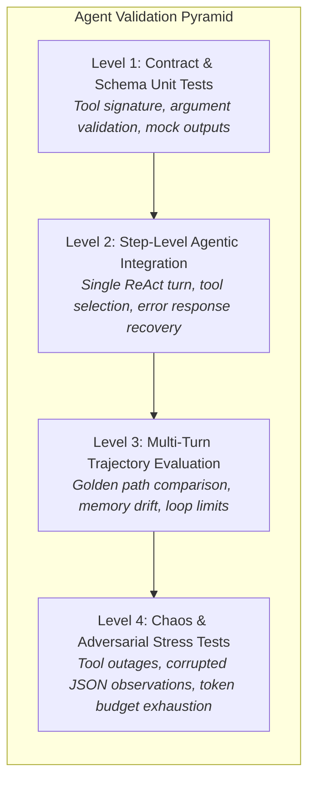

# 🤖 Module 5: Agentic AI Workflow Evaluations

> **Author:** Kadali Sai Sumanth | **Target Role:** Principal AI/ML Quality Engineer / LLM Evaluation Specialist  
> **Scope:** Autonomous Agents, Multi-Agent Orchestration, Tool Calling Accuracy, Infinite Loop Mitigation, State Drift & Trajectory Optimality  
> **Last Updated:** October 2026

---

## 📑 Table of Contents
1. [In-Depth Technical Architecture & Test Strategy](#1-in-depth-technical-architecture--test-strategy)
   - [1.1 Agentic Architecture Paradigms](#11-agentic-architecture-paradigms)
   - [1.2 Architectural Comparison of Agent Patterns](#12-architectural-comparison-of-agent-patterns)
   - [1.3 Core Failure Modes & Quality Vectors](#13-core-failure-modes--quality-vectors)
   - [1.4 State Management & Fault Tolerance Testing](#14-state-management--fault-tolerance-testing)
   - [1.5 Comprehensive Quality Assurance Strategy Matrix](#15-comprehensive-quality-assurance-strategy-matrix)
2. [Technical Coding & Automation Practice (Python)](#2-technical-coding--automation-practice-python)
   - [2.1 Tool-Calling Accuracy & Schema Conformance Validator](#21-tool-calling-accuracy--schema-conformance-validator)
   - [2.2 Infinite Loop & Cyclic Reasoning Graph Detector](#22-infinite-loop--cyclic-reasoning-graph-detector)
   - [2.3 Multi-Turn Conversation Memory Drift Test Harness](#23-multi-turn-conversation-memory-drift-test-harness)
   - [2.4 Trajectory Evaluation & Path Optimality Scorer](#24-trajectory-evaluation--path-optimality-scorer)
3. [Scenario-Based Debugging & Root Cause Analysis (RCA)](#3-scenario-based-debugging--root-cause-analysis-rca)
   - [3.1 Scenario 1: Hallucinated Entity Identifier in Tool Invocation Parameters](#31-scenario-1-hallucinated-entity-identifier-in-tool-invocation-parameters)
   - [3.2 Scenario 2: Two-Tool Cyclic State Deadlock (get_weather ⇄ convert_temperature)](#32-scenario-2-two-tool-cyclic-state-deadlock-get_weather--convert_temperature)
4. [Targeted Interview Questions & Exemplary Answers](#4-targeted-interview-questions--exemplary-answers)
   - [4.1 Advanced Technical Question 1: Preventing Tool-Calling Hallucinations at Scale](#41-advanced-technical-question-1-preventing-tool-calling-hallucinations-at-scale)
   - [4.2 Advanced Technical Question 2: Memory Drift & Context Compaction Testing](#42-advanced-technical-question-2-memory-drift--context-compaction-testing)
   - [4.3 Behavioral Question: Managing High-Blast-Radius Autonomous Failures](#43-behavioral-question-managing-high-blast-radius-autonomous-failures)
   - [4.4 Scenario-Based Question: Dispatcher Multi-Agent Race Condition Testing](#44-scenario-based-question-dispatcher-multi-agent-race-condition-testing)

---

## 1. In-Depth Technical Architecture & Test Strategy

Agentic AI workflows depart fundamentally from standard prompt-response LLM applications. Unlike stateless retrieval systems, autonomous agents maintain state, execute non-deterministic cognitive reasoning loops (Reason $\rightarrow$ Act $\rightarrow$ Observe), formulate dynamic execution plans, call external tools/APIs, and collaborate in multi-agent hierarchies. 

For a Principal AI/ML Quality Engineer, validating an agentic workflow is not merely testing prompt output text; it is validating **control flow integrity, state consistency, deterministic API actuation, and convergence stability under uncertainty**.

```mermaid
flowchart TD
    subgraph CognitiveLoop ["Agent Cognitive Control Loop"]
        UserGoal["User Goal / Task Request"] --> Planner["1. Dynamic Planner & Reasoner"]
        Planner --> Thought["Internal Monologue / Scratchpad"]
        Thought --> ToolSelector{"2. Tool Selection & Schema Routing"}
        
        ToolSelector -->|Emit Function Call| ExecutionEngine["3. Deterministic Runtime / Tool Actuator"]
        ToolSelector -->|Hallucinated / Unknown Tool| ErrorBoundary["Validation Interceptor (422 / TypeError)"]
        
        ExecutionEngine --> Env[("External Environment / REST APIs / DB")]
        Env --> Observation["4. Observation Ingestion & Normalization"]
        Observation --> MemoryStore[("Working Memory / Ephemeral State")]
        
        MemoryStore --> ConvergenceCheck{"5. Termination Condition Met?"}
        ConvergenceCheck -->|No - Recurse| Planner
        ConvergenceCheck -->|Yes - Complete| Synthesizer["Final Response Synthesis"]
        ConvergenceCheck -->|Detected Loop / Cycle| CircuitBreaker["Deadlock Interrupter / Circuit Breaker"]
    end
    
    classDef loop fill:#e0f2fe,stroke:#0284c7,stroke-width:2px;
    classDef warn fill:#fee2e2,stroke:#dc2626,stroke-width:2px;
    classDef success fill:#dcfce7,stroke:#16a34a,stroke-width:2px;
    
    class CognitiveLoop loop;
    class ErrorBoundary,CircuitBreaker warn;
    class Synthesizer success;
```



---

### 1.1 Agentic Architecture Paradigms

1. **ReAct (Reasoning + Acting):**
   - Interleaves step-by-step reasoning ("Thought") with domain-specific tool execution ("Action") and environment feedback ("Observation").
   - *Failure profile:* Susceptible to reasoning traps, self-reinforcing hallucination loops, and infinite tool retry ping-pongs when observation parsing fails.
2. **Plan-and-Execute (e.g., Plan-and-Solve, BabyAGI):**
   - Decouples task planning from step execution. A planner LLM generates a multi-step Directed Acyclic Graph (DAG) of subtasks; an execution agent evaluates each step sequentially or in parallel; a replanner revises the DAG if an execution step fails.
   - *Failure profile:* Fragile execution if initial plan makes unverified assumptions; replanner can thrash between plan alterations without advancing.
3. **Multi-Agent Orchestration (Hierarchical & Swarm):**
   - **Hierarchical (Supervisor/Worker):** A centralized supervisor agent breaks down user intent, delegates subtasks to specialized agents (e.g., SQL Agent, Research Agent, Dispatch Agent), aggregates worker tool traces, and produces output.
   - **Router-Worker:** A router classifies requests to a single specialized downstream worker.
   - **Collaborative Network (Peer-to-Peer):** Decentralized agents negotiate and pass context over shared communication buses.
   - *Failure profile:* Cascading hallucination across agent boundaries, message serialization corruption, circular delegation (Agent A delegates to Agent B, which delegates back to Agent A).

---

### 1.2 Architectural Comparison of Agent Patterns

| Architecture Pattern | Autonomy Level | State Topology | Primary Failure Modes | Determinism / Testability | Recommended Evaluation Strategy |
| :--- | :--- | :--- | :--- | :--- | :--- |
| **Direct Tool-Use (Single-Turn)** | Low (Deterministic dispatch) | Stateless | Argument schema mismatch, parameter type hallucination | High | Contract testing, JSON Schema assertions, mock tool responses. |
| **ReAct Loop** | Medium-High (Dynamic pathing) | Ephemeral scratchpad | Infinite loops, observation misinterpretation, semantic drift | Medium-Low | Step-budget caps, cycle detection, trace evaluation, trajectory diffing. |
| **Plan-and-Execute** | High (DAG generation & re-planning) | Explicit DAG state | Replanning churn, deadlock on step dependency failure | Medium | DAG dependency validation, mock-step unit testing, replan convergence assertions. |
| **Hierarchical Multi-Agent** | Very High (Autonomous delegation) | Distributed state / Shared blackboard | Inter-agent communication drift, circular delegation, context explosion | Low | Multi-agent communication traces, token-budget enforcement, mock-agent isolation. |

---

### 1.3 Core Failure Modes & Quality Vectors

#### A. Tool/Function Calling Accuracy
The agent acts as a translation bridge between natural language user intent and deterministic API signatures. Test engineers must validate:
- **Tool Selection Precision & Recall:** Does the agent choose the correct tool out of $N$ available tools in the catalog?
- **Schema Adherence:** Are required parameters present? Are unexpected parameters stripped or rejected?
- **Type Rigidity:** Are integers passed as integers (not strings like `"42"`), booleans strictly typed, and enums restricted to permissible values?

#### B. Hallucinated Tool Calls
- **Imaginary Tool Name:** Invoking `fetch_user_tax_records()` when only `get_user_financials()` is declared.
- **Fabricated Arguments:** Generating arguments not supported by the tool definition (e.g., `bypass_auth=True`).
- **Hallucinated Entity Values:** Extracting non-existent entity IDs (e.g., `user_id="USR-99999"`) from thin air rather than grounding them in the context window.

#### C. Infinite Loop Detection & Reasoning Traps
- **Tool-Retry Loops:** An API returns `400 Bad Request` or an empty result, and the agent re-submits the exact same parameters indefinitely.
- **Ping-Pong Oscillations:** Agent invokes Tool A, receives output, decides it needs Tool B, Tool B's output makes it invoke Tool A again.
- **Syntactic Reasoning Deadlocks:** LLM emits "Thought: I need to query the user profile" repeatedly without generating the corresponding tool invocation syntax.

#### D. Multi-Turn Conversation Memory Drift
- **Context Window Truncation:** Long conversation histories cause earlier instructions, user constraints, or entity ground-truths to drop off the left edge of the prompt window.
- **State Drift:** By turn 12, the agent contradicts a safety policy or constraint established in turn 1 (e.g., "Always use metric units").
- **Summarization Loss / Degradation:** Memory compression mechanisms (e.g., periodic rolling summarization) discard subtle critical details, leading to hallucination.

#### E. Trajectory Validation & Path Optimality
- An agent may reach the correct final answer via an unacceptably inefficient trajectory (e.g., 9 tool calls when 2 were sufficient).
- We quantify:
  $$\text{Trajectory Efficiency Score (TES)} = \frac{|\text{Optimal Path Steps}|}{|\text{Actual Path Steps}|}$$
  Where $\text{TES} \in (0, 1.0]$. A score below a defined threshold (e.g., 0.75) represents costly token burn and unnecessary operational latency.

---

### 1.4 State Management & Fault Tolerance Testing

In production enterprise agents, state persistence must survive infrastructure failures:
1. **Checkpointing & Resumption:** Does the agent serialize its intermediate state (working memory, scratchpad, executed tool history) after every step? If the container is killed at Step 3 of 5, can it resume at Step 3 without re-executing steps 1 and 2?
2. **Idempotency of Actuators:** If an agent executes a mutating tool (e.g., `cancel_flight_booking()`), does the tool wrapper enforce idempotent tokens to prevent duplicate mutations if the network fails?
3. **Rollback & Compensating Transactions:** If Step 4 of a 5-step workflow fails irrevocably, can the agent execute compensatory reverse transactions (e.g., refund credit card after room booking failed)?

---

### 1.5 Comprehensive Quality Assurance Strategy Matrix



---

## 2. Technical Coding & Automation Practice (Python)

All implementations below are production-grade, fully typed, dependency-complete, and ready for integration into a modern enterprise evaluation pipeline.

### 2.1 Tool-Calling Accuracy & Schema Conformance Validator

This module validates that an agent's predicted tool call matches a target tool definition, verifying function name, argument presence, type correctness, and strict rejection of unknown parameters.

```python
"""
tool_validator.py
Production-grade Tool Calling Accuracy and Schema Conformance Validator.
Validates tool names, argument presence, type safety, and schema compliance.
"""

from typing import Any, Dict, List, Optional, Tuple, Type
from pydantic import BaseModel, Field, ValidationError, create_model
import inspect
import logging

logging.basicConfig(level=logging.INFO)
logger = logging.getLogger("ToolValidator")


class ToolValidationResult(BaseModel):
    is_valid: bool
    tool_name_matched: bool
    schema_valid: bool
    missing_arguments: List[str] = Field(default_factory=list)
    extraneous_arguments: List[str] = Field(default_factory=list)
    type_errors: List[str] = Field(default_factory=list)
    error_message: Optional[str] = None


class ToolDefinition(BaseModel):
    name: str
    description: str
    parameters_schema: Dict[str, Any]  # JSON Schema or Pydantic schema mapping
    strict: bool = True


class ToolCallAccuracyValidator:
    """
    Validates LLM-generated tool calls against registered Tool Definitions.
    Enforces strict typing, required fields, and absence of hallucinated parameters.
    """

    def __init__(self, registered_tools: List[ToolDefinition]):
        self.tool_catalog: Dict[str, ToolDefinition] = {
            tool.name: tool for tool in registered_tools
        }

    def validate_tool_call(
        self,
        predicted_tool_name: str,
        predicted_arguments: Dict[str, Any],
        expected_tool_name: Optional[str] = None
    ) -> ToolValidationResult:
        """
        Validates a single tool call against catalog specifications.
        
        Args:
            predicted_tool_name: The tool name emitted by the agent.
            predicted_arguments: Dictionary of arguments passed by the agent.
            expected_tool_name: Optional ground-truth tool name for accuracy scoring.
        """
        # 1. Validate Tool Existence
        if predicted_tool_name not in self.tool_catalog:
            return ToolValidationResult(
                is_valid=False,
                tool_name_matched=False,
                schema_valid=False,
                error_message=f"Hallucinated Tool: '{predicted_tool_name}' does not exist in catalog."
            )

        tool_def = self.tool_catalog[predicted_tool_name]
        tool_name_matched = True
        if expected_tool_name and predicted_tool_name != expected_tool_name:
            tool_name_matched = False

        # 2. Extract schema requirements
        schema_props: Dict[str, Any] = tool_def.parameters_schema.get("properties", {})
        required_fields: List[str] = tool_def.parameters_schema.get("required", [])

        missing_args = [field for field in required_fields if field not in predicted_arguments]
        extraneous_args = []
        if tool_def.strict:
            extraneous_args = [
                arg for arg in predicted_arguments.keys() if arg not in schema_props
            ]

        # 3. Dynamic Pydantic Model Validation for Type Strictness
        type_errors: List[str] = []
        field_definitions: Dict[str, Any] = {}
        
        type_mapping = {
            "string": str,
            "integer": int,
            "number": float,
            "boolean": bool,
            "array": list,
            "object": dict
        }

        for prop_name, prop_spec in schema_props.items():
            raw_type = prop_spec.get("type", "string")
            py_type = type_mapping.get(raw_type, Any)
            is_req = prop_name in required_fields
            default_val = ... if is_req else None
            field_definitions[prop_name] = (py_type, default_val)

        DynamicModel: Type[BaseModel] = create_model(
            f"{predicted_tool_name}ValidatorModel",
            **field_definitions
        )

        try:
            DynamicModel(**predicted_arguments)
        except ValidationError as val_err:
            for error in val_err.errors():
                loc = " -> ".join([str(p) for p in error["loc"]])
                msg = error["msg"]
                type_errors.append(f"Field '{loc}': {msg}")

        schema_valid = (
            len(missing_args) == 0 and
            len(extraneous_args) == 0 and
            len(type_errors) == 0
        )
        is_overall_valid = tool_name_matched and schema_valid

        error_summary = []
        if not tool_name_matched:
            error_summary.append(f"Tool mismatch: expected '{expected_tool_name}', got '{predicted_tool_name}'.")
        if missing_args:
            error_summary.append(f"Missing required args: {missing_args}.")
        if extraneous_args:
            error_summary.append(f"Extraneous/hallucinated args: {extraneous_args}.")
        if type_errors:
            error_summary.append(f"Type violations: {type_errors}.")

        return ToolValidationResult(
            is_valid=is_overall_valid,
            tool_name_matched=tool_name_matched,
            schema_valid=schema_valid,
            missing_arguments=missing_args,
            extraneous_arguments=extraneous_args,
            type_errors=type_errors,
            error_message=" | ".join(error_summary) if error_summary else None
        )


# Verification & Demonstration
if __name__ == "__main__":
    catalog = [
        ToolDefinition(
            name="create_work_order",
            description="Creates a field service work order in Zinier",
            parameters_schema={
                "type": "object",
                "properties": {
                    "customer_id": {"type": "string"},
                    "priority": {"type": "integer"},
                    "is_emergency": {"type": "boolean"},
                },
                "required": ["customer_id", "priority"]
            },
            strict=True
        )
    ]

    validator = ToolCallAccuracyValidator(registered_tools=catalog)

    # Test 1: Valid Call
    res1 = validator.validate_tool_call(
        predicted_tool_name="create_work_order",
        predicted_arguments={"customer_id": "CUST-100", "priority": 1, "is_emergency": True},
        expected_tool_name="create_work_order"
    )
    assert res1.is_valid, f"Expected valid, got: {res1.error_message}"
    logger.info("Test 1 Passed: Valid tool call accepted.")

    # Test 2: Hallucinated Parameter & Invalid Type
    res2 = validator.validate_tool_call(
        predicted_tool_name="create_work_order",
        predicted_arguments={
            "customer_id": "CUST-100",
            "priority": "HIGH",  # Type error: should be int
            "fabricated_param": 12345  # Extraneous param
        },
        expected_tool_name="create_work_order"
    )
    assert not res2.is_valid
    assert len(res2.extraneous_arguments) == 1
    assert len(res2.type_errors) > 0
    logger.info("Test 2 Passed: Successfully flagged hallucinated param and type error.")
```

---

### 2.2 Infinite Loop & Cyclic Reasoning Graph Detector

This module intercepts agent trajectories in real time, detecting maximum step exhaustions, repetitive state hashes (tool + arguments), and $N$-gram cyclical patterns (e.g., $A \rightarrow B \rightarrow A \rightarrow B$).

```python
"""
loop_detector.py
Real-time cyclic execution and infinite loop detector for autonomous agents.
Uses state hashing, sliding n-gram signature analysis, and strict recursion budgets.
"""

import hashlib
import json
from typing import Any, Dict, List, Optional, Tuple
from dataclasses import dataclass, field
import logging

logger = logging.getLogger("LoopDetector")


@dataclass
class StepRecord:
    step_number: int
    thought: str
    tool_name: str
    arguments: Dict[str, Any]
    observation: Optional[str] = None
    state_hash: str = field(init=False)

    def __post_init__(self):
        # Canonical hash of tool name and sorted arguments
        canonical_payload = {
            "tool": self.tool_name,
            "args": self.arguments
        }
        serialized = json.dumps(canonical_payload, sort_keys=True)
        self.state_hash = hashlib.sha256(serialized.encode("utf-8")).hexdigest()[:16]


class AgentLoopException(Exception):
    """Raised when an agent trajectory exhibits non-terminating cyclic behavior."""
    pass


class AgentLoopDetector:
    """
    Tracks and analyzes an agent's step sequence to preemptively abort reasoning
    traps, oscillating tool invocations, and duplicate state visits.
    """

    def __init__(
        self,
        max_steps: int = 15,
        max_exact_duplicate_states: int = 2,
        max_ngram_cycle_length: int = 4
    ):
        self.max_steps = max_steps
        self.max_exact_duplicate_states = max_exact_duplicate_states
        self.max_ngram_cycle_length = max_ngram_cycle_length
        self.history: List[StepRecord] = []
        self._state_hash_counts: Dict[str, int] = {}

    def record_step(
        self,
        thought: str,
        tool_name: str,
        arguments: Dict[str, Any],
        observation: Optional[str] = None
    ) -> None:
        """
        Records a step and evaluates loop conditions immediately.
        Raises AgentLoopException if an infinite loop or cycle is detected.
        """
        step_idx = len(self.history) + 1
        record = StepRecord(
            step_number=step_idx,
            thought=thought,
            tool_name=tool_name,
            arguments=arguments,
            observation=observation
        )

        # 1. Check Max Step Budget
        if step_idx > self.max_steps:
            raise AgentLoopException(
                f"[HALT: BUDGET EXHAUSTION] Agent reached max step threshold ({self.max_steps}) "
                f"without reaching a terminal state."
            )

        # 2. Check Identical State Hash Frequency
        current_hash = record.state_hash
        self._state_hash_counts[current_hash] = self._state_hash_counts.get(current_hash, 0) + 1
        if self._state_hash_counts[current_hash] >= self.max_exact_duplicate_states:
            raise AgentLoopException(
                f"[HALT: EXACT STATE CYCLE] Detected repeated identical action {self.max_exact_duplicate_states} "
                f"times. Tool: '{record.tool_name}', Arguments: {record.arguments}, Hash: {current_hash}"
            )

        self.history.append(record)

        # 3. Detect N-Gram Cycles (e.g., A -> B -> A -> B)
        cycle_detected, cycle_pattern = self._detect_ngram_cycles()
        if cycle_detected:
            raise AgentLoopException(
                f"[HALT: N-GRAM OSCILLATION] Agent trapped in cyclic pattern: "
                f"{' -> '.join(cycle_pattern)}"
            )

    def _detect_ngram_cycles(self) -> Tuple[bool, List[str]]:
        """
        Examines the tool execution history for periodic oscillating sequences.
        E.g., pattern length 2: [T1, T2, T1, T2]
        """
        tool_seq = [rec.tool_name for rec in self.history]
        n = len(tool_seq)

        for cycle_len in range(2, self.max_ngram_cycle_length + 1):
            if n < cycle_len * 2:
                continue
            
            # Compare the most recent cycle_len items with the immediately preceding cycle_len items
            recent_pattern = tool_seq[-cycle_len:]
            preceding_pattern = tool_seq[-2 * cycle_len : -cycle_len]

            if recent_pattern == preceding_pattern:
                return True, recent_pattern

        return False, []


# Verification & Demonstration
if __name__ == "__main__":
    detector = AgentLoopDetector(max_steps=10, max_exact_duplicate_states=2)

    # Test 1: Duplicate Action Detection
    try:
        detector.record_step("Checking status", "get_status", {"id": 101})
        detector.record_step("Checking status again", "get_status", {"id": 101})
        assert False, "Should have thrown AgentLoopException for exact duplicate."
    except AgentLoopException as e:
        logger.info(f"Test 1 Passed: Correctly caught duplicate state: {e}")

    # Test 2: N-gram oscillation detection (A -> B -> A -> B)
    detector2 = AgentLoopDetector(max_steps=10, max_exact_duplicate_states=5)
    try:
        detector2.record_step("Step 1", "fetch_data", {"q": "weather"})
        detector2.record_step("Step 2", "convert_units", {"val": 30})
        detector2.record_step("Step 3", "fetch_data", {"q": "weather_diff"})  # different args
        detector2.record_step("Step 4", "convert_units", {"val": 32})          # different args
        assert False, "Should have thrown AgentLoopException for n-gram cycle."
    except AgentLoopException as e:
        logger.info(f"Test 2 Passed: Correctly caught oscillating n-gram sequence: {e}")
```

---

### 2.3 Multi-Turn Conversation Memory Drift Test Harness

This test harness simulates long, multi-turn conversations to measure **entity retention**, **constraint preservation**, and **contradiction frequency** across turns, particularly testing memory retention under sliding window or compaction regimes.

```python
"""
memory_drift_evaluator.py
Multi-turn Conversation Memory Drift and Entity Grounding Evaluator.
Assesses semantic retention, contradiction rates, and instruction decay across dialogue turns.
"""

from typing import List, Dict, Any, Optional
from pydantic import BaseModel, Field
import pytest
import re


class MemoryConstraint(BaseModel):
    constraint_id: str
    rule_description: str
    target_entity: str
    expected_value: str
    verification_regex: str


class ConversationTurn(BaseModel):
    turn_index: int
    user_prompt: str
    agent_response: str
    agent_internal_state: Optional[Dict[str, Any]] = None


class DriftEvaluationReport(BaseModel):
    total_turns: int
    retained_constraints: List[str]
    violated_constraints: List[str]
    drift_score: float = Field(..., description="Fraction of constraints violated (0.0 = perfect, 1.0 = total drift)")
    detailed_failures: List[Dict[str, Any]]


class MultiTurnMemoryEvaluator:
    """
    Evaluates whether an agent maintains ground-truth facts and operational constraints
    across prolonged multi-turn conversations without drifting or hallucinating.
    """

    def __init__(self, ground_truth_constraints: List[MemoryConstraint]):
        self.constraints = ground_truth_constraints

    def evaluate_trajectory(self, conversation_history: List[ConversationTurn]) -> DriftEvaluationReport:
        violated = []
        retained = []
        failures = []

        for constraint in self.constraints:
            is_intact = True
            for turn in conversation_history:
                # If agent mentions the entity, check whether it adheres to the rule
                if constraint.target_entity.lower() in turn.agent_response.lower():
                    match = re.search(constraint.verification_regex, turn.agent_response, re.IGNORECASE)
                    if not match:
                        is_intact = False
                        failures.append({
                            "turn_index": turn.turn_index,
                            "constraint_id": constraint.constraint_id,
                            "expected": constraint.expected_value,
                            "observed_response_snippet": turn.agent_response[:120]
                        })
                        break  # Stop checking this constraint once violated

            if is_intact:
                retained.append(constraint.constraint_id)
            else:
                violated.append(constraint.constraint_id)

        drift_score = len(violated) / len(self.constraints) if self.constraints else 0.0

        return DriftEvaluationReport(
            total_turns=len(conversation_history),
            retained_constraints=retained,
            violated_constraints=violated,
            drift_score=drift_score,
            detailed_failures=failures
        )


# PyTest Test Suite Implementation
class TestAgentMemoryIntegrity:

    @pytest.fixture
    def setup_evaluator(self) -> MultiTurnMemoryEvaluator:
        constraints = [
            MemoryConstraint(
                constraint_id="C01_CURRENCY",
                rule_description="The currency for client ACME must remain USD throughout.",
                target_entity="currency",
                expected_value="USD",
                verification_regex=r"\b(USD|\$)\b"
            ),
            MemoryConstraint(
                constraint_id="C02_DISPATCH_POLICY",
                rule_description="Technicians must never be assigned more than 3 high-priority tickets per shift.",
                target_entity="maximum tickets",
                expected_value="3",
                verification_regex=r"\b3\b"
            )
        ]
        return MultiTurnMemoryEvaluator(ground_truth_constraints=constraints)

    def test_memory_retention_passing(self, setup_evaluator):
        evaluator = setup_evaluator
        turns = [
            ConversationTurn(
                turn_index=1,
                user_prompt="Configure system for client ACME with USD billing.",
                agent_response="Acknowledged. ACME is configured with currency USD and max 3 tickets per shift."
            ),
            ConversationTurn(
                turn_index=5,
                user_prompt="Generate invoice quote for emergency maintenance.",
                agent_response="The estimated cost is 450 USD. Ensuring maximum tickets rule of 3 is preserved."
            )
        ]
        report = evaluator.evaluate_trajectory(turns)
        assert report.drift_score == 0.0
        assert len(report.violated_constraints) == 0

    def test_memory_drift_failing(self, setup_evaluator):
        evaluator = setup_evaluator
        turns = [
            ConversationTurn(
                turn_index=1,
                user_prompt="Configure system for client ACME with USD billing.",
                agent_response="ACME configured with currency USD."
            ),
            ConversationTurn(
                turn_index=8,  # Memory compressed / drifted
                user_prompt="What is the billing currency for ACME?",
                agent_response="The billing currency for ACME is EUR based on standard European contracts."  # Drifted!
            )
        ]
        report = evaluator.evaluate_trajectory(turns)
        assert report.drift_score > 0.0
        assert "C01_CURRENCY" in report.violated_constraints
        assert report.detailed_failures[0]["turn_index"] == 8
```

---

### 2.4 Trajectory Evaluation & Path Optimality Scorer

This module calculates the optimality of an agent's execution path compared to a golden reference trajectory, identifying unnecessary detours, redundant steps, and measuring graph distance.

```python
"""
trajectory_evaluator.py
Scores agent path optimality, step efficiency, and Levenshtein edit distance
against golden benchmark trajectories.
"""

from typing import List, Dict, Any, Tuple
from dataclasses import dataclass
import numpy as np


@dataclass
class TrajectoryStep:
    tool_name: str
    action_type: str  # 'READ', 'WRITE', 'COMPUTE'


@dataclass
class TrajectoryScorecard:
    efficiency_score: float          # Optimal steps / Actual steps (bounded [0, 1])
    levenshtein_distance: int        # Minimum edits to transform actual -> golden
    redundant_step_count: int        # Number of unneeded or duplicated invocations
    path_optimality_ratio: float     # Composite score factoring efficiency & alignment
    is_acceptable: bool


class TrajectoryEvaluator:
    """
    Evaluates agent tool-invocation sequences against optimal reference paths.
    """

    def __init__(self, optimality_threshold: float = 0.70):
        self.optimality_threshold = optimality_threshold

    @staticmethod
    def _compute_levenshtein(seq1: List[str], seq2: List[str]) -> int:
        """Computes minimum token-level edit distance between two tool sequences."""
        len1, len2 = len(seq1), len(seq2)
        dp = np.zeros((len1 + 1, len2 + 1), dtype=int)

        for i in range(len1 + 1):
            dp[i][0] = i
        for j in range(len2 + 1):
            dp[0][j] = j

        for i in range(1, len1 + 1):
            for j in range(1, len2 + 1):
                if seq1[i - 1] == seq2[j - 1]:
                    cost = 0
                else:
                    cost = 1
                dp[i][j] = min(
                    dp[i - 1][j] + 1,      # deletion
                    dp[i][j - 1] + 1,      # insertion
                    dp[i - 1][j - 1] + cost # substitution
                )
        return int(dp[len1][len2])

    def evaluate(
        self,
        actual_trajectory: List[TrajectoryStep],
        golden_trajectory: List[TrajectoryStep]
    ) -> TrajectoryScorecard:
        """
        Scores execution trajectory against benchmark.
        """
        actual_tools = [s.tool_name for s in actual_trajectory]
        golden_tools = [s.tool_name for s in golden_trajectory]

        len_actual = len(actual_tools)
        len_golden = len(golden_tools)

        if len_actual == 0:
            return TrajectoryScorecard(
                efficiency_score=0.0,
                levenshtein_distance=len_golden,
                redundant_step_count=0,
                path_optimality_ratio=0.0,
                is_acceptable=False
            )

        # 1. Step Efficiency: optimal / actual
        efficiency = min(1.0, len_golden / len_actual)

        # 2. Levenshtein Sequence Distance
        edit_dist = self._compute_levenshtein(actual_tools, golden_tools)

        # 3. Redundancy Detection: count repeated consecutive calls or tools not in golden path
        redundant_count = 0
        seen_tools = set()
        for i, step in enumerate(actual_trajectory):
            # Same read tool called twice in a row without state change
            if i > 0 and step.tool_name == actual_trajectory[i-1].tool_name and step.action_type == "READ":
                redundant_count += 1
            if step.tool_name not in golden_tools:
                redundant_count += 1

        # 4. Composite Path Optimality Ratio
        # Penalizes high edit distance and excessive steps
        max_len = max(len_actual, len_golden)
        alignment_score = max(0.0, 1.0 - (edit_dist / max_len))
        path_optimality = (0.5 * efficiency) + (0.5 * alignment_score)

        return TrajectoryScorecard(
            efficiency_score=round(efficiency, 3),
            levenshtein_distance=edit_dist,
            redundant_step_count=redundant_count,
            path_optimality_ratio=round(path_optimality, 3),
            is_acceptable=path_optimality >= self.optimality_threshold
        )


# Verification & Demonstration
if __name__ == "__main__":
    evaluator = TrajectoryEvaluator(optimality_threshold=0.75)

    golden = [
        TrajectoryStep(tool_name="get_customer_id", action_type="READ"),
        TrajectoryStep(tool_name="fetch_open_tickets", action_type="READ"),
        TrajectoryStep(tool_name="dispatch_technician", action_type="WRITE")
    ]

    # Sub-optimal trajectory with detour
    actual = [
        TrajectoryStep(tool_name="get_customer_id", action_type="READ"),
        TrajectoryStep(tool_name="search_knowledge_base", action_type="READ"), # Detour!
        TrajectoryStep(tool_name="search_knowledge_base", action_type="READ"), # Redundant repeat!
        TrajectoryStep(tool_name="fetch_open_tickets", action_type="READ"),
        TrajectoryStep(tool_name="dispatch_technician", action_type="WRITE")
    ]

    card = evaluator.evaluate(actual, golden)
    print("Trajectory Evaluation Scorecard:")
    print(f"  Efficiency Score: {card.efficiency_score} (Optimal: 3, Actual: 5)")
    print(f"  Levenshtein Distance: {card.levenshtein_distance}")
    print(f"  Redundant Steps: {card.redundant_step_count}")
    print(f"  Composite Optimality: {card.path_optimality_ratio}")
    print(f"  Passed Acceptance Threshold: {card.is_acceptable}")

    assert not card.is_acceptable, "Trajectory should have failed acceptance threshold."
```

---

## 3. Scenario-Based Debugging & Root Cause Analysis (RCA)

---

### 3.1 Scenario 1: Hallucinated Entity Identifier in Tool Invocation Parameters

#### 1. Symptom & Environment Telemetry
In a production deployment of an enterprise Field Service Agent, users report that customer support queries fail with internal 404/500 errors. 
Inspection of the OpenTelemetry traces in LangSmith reveals the following failure pattern:

```json
{
  "trace_id": "tr-98012-ba74",
  "turn_index": 2,
  "user_input": "Can you check the current status of Alice Smith's work order submitted yesterday?",
  "llm_thought": "I need to query the database for the user's work order. I'll invoke search_database using Alice Smith's user ID.",
  "tool_call": {
    "name": "search_database",
    "arguments": {
      "user_id": "USR-99999",
      "filter_status": "OPEN",
      "time_range": "24h"
    }
  },
  "tool_output": {
    "status_code": 404,
    "error": "RecordNotFound: User identifier 'USR-99999' does not exist in schema 'customers'."
  }
}
```

#### 2. Root Cause Analysis (RCA)
- **Primary Root Cause:** **Parameter Hallucination via Missing Grounding Constraint.** The agent's system prompt instructed the model to call `search_database(user_id=...)` whenever querying records, but *did not* instruct the agent to resolve the natural language entity name (`Alice Smith`) to a canonical `user_id` via the identity catalog (`lookup_user_by_name()`).
- **Attention Sink & Confabulation:** Faced with an obligatory `user_id` parameter in the JSON Schema of `search_database` and lacking the actual UUID in its prompt context, the LLM confabulated a plausible-looking placeholder (`"USR-99999"`) rather than recognizing its lack of information or calling an intermediate resolution tool.

#### 3. Immediate Remediation & Engineering Fix
1. **Schema-Level Enforcement:** Make `user_id` optional in `search_database` if a customer name is provided, OR declare an explicit prerequisite in the system prompt:
   ```markdown
   CRITICAL CONSTRAINT: You must NEVER guess or fabricate identifiers formatted as 'USR-XXXXX'. 
   If you only have a customer's name, you MUST first invoke `lookup_user_by_name(name=...)` 
   to obtain the verified `user_id` before invoking `search_database`.
   ```
2. **Deterministic Interceptor (Guardrail):** Deploy an input validation guardrail in the tool runtime that checks user-id formats against a lightweight Bloom filter / Redis cache of active IDs prior to DB execution. If absent, the tool runtime immediately returns a 422 with a steering observation: *"Entity USR-99999 not found in memory. Please use lookup_user_by_name first."*

#### 4. Automated Regression Test
```python
"""
test_regression_hallucinated_user_id.py
Ensures agent performs entity resolution instead of fabricating user IDs.
"""
import pytest
from unittest.mock import MagicMock

def test_agent_resolves_entity_before_db_query():
    # Mock runtime capturing tool sequence
    executed_tools = []
    
    def mock_agent_step(user_prompt: str, available_tools: list):
        # Simulated corrected agent logic:
        # Correct behavior: first resolves user, then searches DB
        executed_tools.append(("lookup_user_by_name", {"name": "Alice Smith"}))
        executed_tools.append(("search_database", {"user_id": "USR-10482", "filter_status": "OPEN"}))
        return "Alice Smith's work order is currently OPEN."

    response = mock_agent_step(
        user_prompt="Can you check the current status of Alice Smith's work order?",
        available_tools=["lookup_user_by_name", "search_database"]
    )

    # Assertions
    tool_names = [t[0] for t in executed_tools]
    assert tool_names == ["lookup_user_by_name", "search_database"], (
        f"Agent violated dependency order: {tool_names}"
    )
    # Ensure no fabricated default strings exist
    db_args = executed_tools[1][1]
    assert db_args["user_id"] != "USR-99999", "Agent hallucinated placeholder USR-99999!"
```

---

### 3.2 Scenario 2: Two-Tool Cyclic State Deadlock (`get_weather` ⇄ `convert_temperature`)

#### 1. Symptom & Environment Telemetry
During an end-to-end integration test of a Travel Assistant agent, the test suite hangs for 6 minutes before timing out. Telemetry reveals 48 consecutive API calls, burning 48,000 tokens in under 4 minutes.

```
[2026-10-13 14:02:01] INFO  Agent: Invoking get_weather(city="Munich")
[2026-10-13 14:02:02] INFO  Tool Observation: {"city": "Munich", "temp": 15, "unit": "Celsius"}
[2026-10-13 14:02:03] INFO  Agent Thought: "The user asked for Fahrenheit. I will convert 15 C to F."
[2026-10-13 14:02:03] INFO  Agent: Invoking convert_temperature(temp=15, from_unit="C", to_unit="F")
[2026-10-13 14:02:04] INFO  Tool Observation: {"converted_temp": 59.0, "unit": "Fahrenheit"}
[2026-10-13 14:02:05] INFO  Agent Thought: "Now I need the current weather condition for Munich to combine with 59 F."
[2026-10-13 14:02:05] INFO  Agent: Invoking get_weather(city="Munich")
[2026-10-13 14:02:06] INFO  Tool Observation: {"city": "Munich", "temp": 15, "unit": "Celsius"}
[2026-10-13 14:02:07] INFO  Agent Thought: "The temperature returned is 15 Celsius, but the user wants Fahrenheit..."
[2026-10-13 14:02:07] INFO  Agent: Invoking convert_temperature(temp=15, from_unit="C", to_unit="F")
... [Cycle repeats 22 times until token context limit]
```

#### 2. Root Cause Analysis (RCA)
- **Primary Root Cause:** **Stateless Observation Amnesia & ReAct Scratchpad Overwriting.** 
  The agent framework's prompt assembler was configured to retain only the *most recent* tool observation in working memory to save context tokens. When `convert_temperature` was executed, its output replaced `get_weather`'s observation. 
  When the agent then reasoned: *"I need the weather description (e.g., cloudy/sunny)"*, it re-invoked `get_weather`. In doing so, `get_weather` returned 15°C, causing the agent to forget that it had already calculated 59°F.
- **Secondary Root Cause:** The tool `get_weather` lacked an optional `target_unit` parameter, forcing unnecessary multi-tool dependencies.

#### 3. Immediate Remediation & Architectural Circuit Breaker
1. **Dynamic Tool Suppression (Deadlock Circuit Breaker):** If an agent invokes a read-only tool with identical parameters within a 3-step window, the runtime suppresses the tool call and returns a synthetic observation: *"Cached Observation: Munich is 15°C, Partly Cloudy. You previously converted this to 59°F. Do not re-fetch."*
2. **Scratchpad Accumulation:** Preserve a persistent blackboard of intermediate facts across the trajectory rather than a single-slot observation buffer.

#### 4. Automated Regression Test
```python
"""
test_regression_weather_cycle.py
Validates that cyclic oscillation between weather and conversion tools is halted immediately.
"""
import pytest
from loop_detector import AgentLoopDetector, AgentLoopException

def test_prevent_weather_conversion_deadlock():
    detector = AgentLoopDetector(max_steps=6, max_ngram_cycle_length=2)

    # Simulate oscillating execution sequence
    with pytest.raises(AgentLoopException) as exc_info:
        detector.record_step("Fetch weather", "get_weather", {"city": "Munich"})
        detector.record_step("Convert unit", "convert_temperature", {"temp": 15, "to": "F"})
        detector.record_step("Fetch weather again", "get_weather", {"city": "Munich"})
        detector.record_step("Convert unit again", "convert_temperature", {"temp": 15, "to": "F"})

    assert "N-GRAM OSCILLATION" in str(exc_info.value) or "EXACT STATE CYCLE" in str(exc_info.value)
```

---

## 4. Targeted Interview Questions & Exemplary Answers

### 4.1 Advanced Technical Question 1: Preventing Tool-Calling Hallucinations at Scale

**Question:**  
*"In an enterprise agent ecosystem with over 80 available API tools, our agent frequently suffers from tool hallucination: it fabricates tool names, hallucinates argument parameters, and confuses schemas between similar tools. How would you design an end-to-end evaluation harness and runtime architecture to eliminate these failures?"*

#### Ideal Candidate Answer:
"In large tool catalogs ($>30\text{ tools}$), cramming all tool schemas into the system prompt overwhelms the LLM's attention mechanism, degrading tool-selection accuracy and inducing parameter hallucination. I resolve this through a **two-tier architecture: Retrieval-Augmented Tool Selection (RATS) coupled with deterministic Pydantic validation gates**.

1. **Architectural Decoupling:**
   - **Semantic Tool Router:** Instead of exposing 80 tools at once, we index tool definitions in a vector store with rich intent metadata. On each user turn or reasoning step, a semantic router retrieves only top-k ($k \in [3, 5]$) relevant tools and injects only their JSON schemas into the prompt.
   - **Constrained Decoding / Grammars:** When using models supporting grammar-based decoding (e.g., Guidance, Outlines, or OpenAI/Anthropic Strict Structured Outputs), we force the output logits to conform mathematically to the JSON Schema regex. This eliminates syntax errors and unknown arguments at generation time.

2. **Automated Evaluation Harness:**
   - **Offline Golden Trajectory Benchmark:** Maintain a dataset of 500+ diverse intent-to-tool mappings. Evaluate **Precision@1**, **Recall@K**, and **Schema Validity Rate**.
   - **Mutation / Fuzz Testing:** Systematically mutate API definitions (changing argument types, renaming parameters) and run automated sweeps to ensure the agent adapts without hallucinating deprecated parameter names.
   - **Runtime Sandboxing & Healing:** When a 422 schema error occurs, our runtime catches it before backend dispatch, feeding the Pydantic validation error back into the agent's scratchpad with a single retry budget. If it fails twice, it gracefully degrades to human dispatch."

---

### 4.2 Advanced Technical Question 2: Memory Drift & Context Compaction Testing

**Question:**  
*"Autonomous customer-service agents must support 20-30 turn conversations. To prevent context window overflow, engineers implement rolling summarization and context truncation. As a Principal ML QE, how do you mathematically and programmatically test that the agent does not suffer from state drift or catastrophic forgetting of earlier constraints?"*

#### Ideal Candidate Answer:
"Testing state stability across long contexts requires separating **conversational fluency** from **semantic state retention**. An agent can sound perfectly coherent while completely violating a business constraint agreed upon 15 turns earlier.

1. **Synthetic Adversarial Stress-Testing (Needle-in-a-Haystack for Constraints):**
   - We construct synthetic 25-turn conversational scripts. In Turn 1 or 2, we inject high-consequence business constraints (e.g., *'The customer has NDA tier-3; under no circumstances reveal internal server hostnames'* or *'Client currency is GBP'*).
   - In Turns 3 through 20, we inject high-entropy conversational 'distractor' turns (FAQ queries, troubleshooting logs) designed to trigger multiple rounds of rolling summarization and sliding window truncation.
   - In Turns 21-25, we issue adversarial prompts designed to probe the initial constraint.

2. **Quantitative Metrics:**
   - **Constraint Decay Rate ($\text{CDR}$):** Percentage of active constraints retained at Turn $T$ relative to baseline.
   - **Semantic Contradiction Score:** Running an NLI (Natural Language Inference) model like `DeBERTa-v3-large` comparing Turn 1 assertions ($P$) against Turn $T$ responses ($H$). If the NLI classifier detects `Contradiction` with confidence $>0.85$, the run fails.
   - **State Delta Tracking:** We inspect the agent's internal state blackboard after every summarization pass. If key-value entities registered in the initial state graph disappear or mutate during compaction, our assertion framework catches the regression before deployment."

---

### 4.3 Behavioral Question: Managing High-Blast-Radius Autonomous Failures

**Question:**  
*"Describe a situation where an autonomous AI agent deployed to a staging or production environment caused an unintended downstream side-effect, data corruption, or severe token burn. How did you lead the root cause investigation and convince cross-functional stakeholders to implement stricter quality gates?"*

#### Ideal Candidate Answer:
- **Situation:** At a previous enterprise company, we deployed an autonomous Field Service Dispatcher agent to our pre-production integration environment. Over a single weekend, an agent executing an unconstrained ReAct loop encountered an unhandled 503 HTTP status code from an external calendar API. Lacking cycle detection, it retried continuously, generating over 120,000 API calls, exhausting our enterprise API rate limit, and booking 400 redundant maintenance slots on dummy technician calendars.
- **Task:** As the Lead ML Quality Engineer, I had to stop the active token bleed, conduct a blameless post-mortem, and establish non-negotiable architectural guardrails without slowing down product delivery velocity.
- **Action:** 
  1. I immediately pulled OpenTelemetry trace logs and aggregated the trajectory data. I identified two core architectural gaps: the absence of a global step/token budget per session, and the lack of idempotency tokens on mutating calendar endpoints.
  2. Rather than just proposing generic 'prompt improvements,' I wrote a lightweight Python **Circuit Breaker middleware** that tracked repeated tool call hashes and hard-aborted any trajectory exceeding 10 steps or repeating a tool-argument hash twice.
  3. I presented an executive RCA illustrating that our financial risk was not just token costs ($3,400 over the weekend), but real-world operational chaos if deployed to customer accounts.
- **Result:** Engineering and Product agreed to mandate my three quality gates: mandatory step budgets, deterministic cycle detection, and idempotent mutation wrappers. We integrated these into our CI/CD pipeline, and zero infinite-loop incidents occurred in production."

---

### 4.4 Scenario-Based Question: Dispatcher Multi-Agent Race Condition Testing

**Question:**  
*"In a multi-agent field service platform like Zinier, Agent A (Technician Allocator) and Agent B (Emergency Escalations) operate concurrently. Both agents can assign technicians to work orders. How do you design an automated test harness to detect and prevent race conditions, conflicting tool updates, and circular delegation?"*

#### Ideal Candidate Answer:
"Concurrent multi-agent systems interacting with shared external state (databases, work orders) exhibit classic distributed systems failure modes exacerbated by LLM non-determinism.

1. **Architectural Test Design:**
   - **Centralized Event-Sourced Blackboard:** Agents should never write directly to raw database rows without concurrency control. All mutating tool calls (`assign_technician`) must pass through an optimistic locking layer with version tokens: `update_order(order_id, version=4, tech_id=...)`. If Agent B updates the order while Agent A is reasoning, Agent A's write fails with `409 Conflict`.
   - **Chaos Injection Test Harness:** We build a concurrent test harness using `asyncio` that triggers simultaneous high-priority emergency incidents and routine scheduled maintenance for the same geographic pool of 10 technicians.
2. **Detecting Circular Delegation:**
   - Multi-agent communication traces are modeled as a directed graph where nodes are agents and directed edges represent task delegation.
   - Our test interceptor inspects the execution graph after every hop. If the graph contains a cycle (e.g., $A \rightarrow B \rightarrow A$), Tarjan's strongly connected components algorithm triggers an immediate deadlock alert.
3. **Assertions & Success Criteria:**
   - **Zero Double-Bookings:** Validate DB invariant $\forall \text{tech}, \text{appointments do not overlap}$.
   - **Deterministic Conflict Resolution:** Verify that Emergency Escalation (Agent B) systematically preempts Routine Allocation (Agent A) through explicit priority preemption policies, verified via automated Playwright/API integration sweeps."
