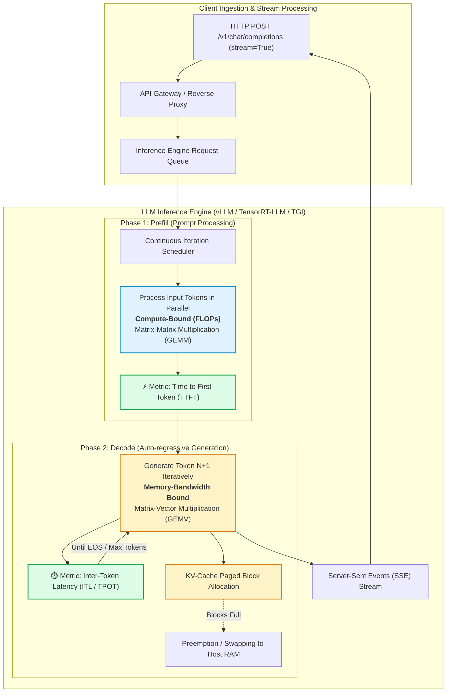
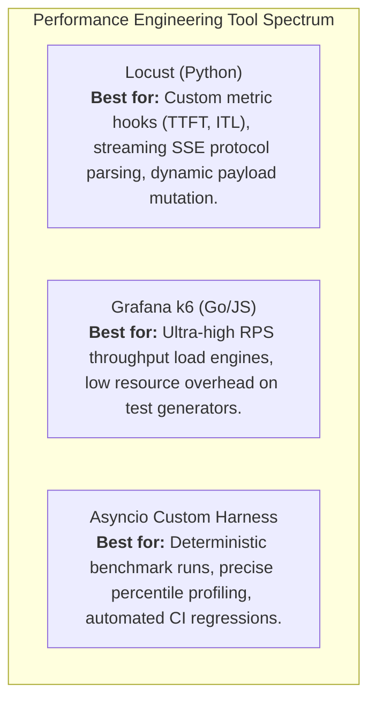

# ⚡ Module 6: Performance & Load Testing for LLMs and RAG Systems

> **Author:** Kadali Sai Sumanth | **Target Role:** Principal AI/ML Quality Engineer / LLM Performance Specialist  
> **Scope:** Inference Anatomy, TTFT, ITL, TPS, Concurrency Limits, KV-Cache Dynamics, VRAM Profiling & Memory Leak RCA  
> **Last Updated:** October 2026

---

## 📑 Table of Contents
1. [In-Depth Technical Architecture & Test Strategy](#1-in-depth-technical-architecture--test-strategy)
   - [1.1 LLM Inference Performance Anatomy: Prefill vs. Decode](#11-llm-inference-performance-anatomy-prefill-vs-decode)
   - [1.2 Core Metrics Taxonomy & Mathematical Definitions](#12-core-metrics-taxonomy--mathematical-definitions)
   - [1.3 Concurrency Dynamics, Saturation Knee & Queuing Delay](#13-concurrency-dynamics-saturation-knee--queuing-delay)
   - [1.4 KV-Cache Behavior, PagedAttention & Prefix Caching](#14-kv-cache-behavior-pagedattention--prefix-caching)
   - [1.5 GPU VRAM Memory Profiling & Breakdown](#15-gpu-vram-memory-profiling--breakdown)
   - [1.6 Batching Paradigms & The Latency-Throughput Pareto Frontier](#16-batching-paradigms--the-latency-throughput-pareto-frontier)
   - [1.7 Load Testing Tools & Methodology Comparison](#17-load-testing-tools--methodology-comparison)
2. [Technical Coding & Automation Practice (Python)](#2-technical-coding--automation-practice-python)
   - [2.1 Async TTFT & ITL Streaming Measurement Harness (`aiohttp`)](#21-async-ttft--itl-streaming-measurement-harness-aiohttp)
   - [2.2 Locust Enterprise Load Testing Harness with Custom LLM Metrics](#22-locust-enterprise-load-testing-harness-with-custom-llm-metrics)
   - [2.3 Concurrency Step Ramp & Saturation Knee Detection Harness](#23-concurrency-step-ramp--saturation-knee-detection-harness)
   - [2.4 GPU VRAM Memory Leak Profiler with Linear Regression Slope Analysis](#24-gpu-vram-memory-leak-profiler-with-linear-regression-slope-analysis)
3. [Scenario-Based Debugging & Root Cause Analysis (RCA)](#3-scenario-based-debugging--root-cause-analysis-rca)
   - [3.1 Scenario 1: TTFT Surges from 200ms to 3.5s Under Concurrency While TPS Remains Stable](#31-scenario-1-ttft-surges-from-200ms-to-35s-under-concurrency-while-tps-remains-stable)
   - [3.2 Scenario 2: Cumulative VRAM Leak Culminating in OOM Crash After 4 Hours Under Load](#32-scenario-2-cumulative-vram-leak-culminating-in-oom-crash-after-4-hours-under-load)
4. [Targeted Interview Questions & Exemplary Answers](#4-targeted-interview-questions--exemplary-answers)
   - [4.1 Advanced Technical Question 1: Prefill vs Decode Disaggregation & Chunked Prefill](#41-advanced-technical-question-1-prefill-vs-decode-disaggregation--chunked-prefill)
   - [4.2 Advanced Technical Question 2: Detecting & Diagnosing CUDA Memory Fragmentation](#42-advanced-technical-question-2-detecting--diagnosing-cuda-memory-fragmentation)
   - [4.3 Behavioral Question: Defending Performance Quality Gates Against Product Pressure](#43-behavioral-question-defending-performance-quality-gates-against-product-pressure)
   - [4.4 Scenario-Based Question: Designing High-Concurrency Stress Tests for RAG Pipelines](#44-scenario-based-question-designing-high-concurrency-stress-tests-for-rag-pipelines)

---

## 1. In-Depth Technical Architecture & Test Strategy

Evaluating the performance of Large Language Model (LLM) and Retrieval-Augmented Generation (RAG) applications requires a paradigm shift from traditional microservice testing. In traditional REST APIs, latency is dominated by network I/O and database index lookups. In generative AI, latency and throughput are dictated by **transformer compute mechanics, auto-regressive memory bandwidth constraints, GPU High Bandwidth Memory (HBM) allocation, and KV-cache utilization**.



---

### 1.1 LLM Inference Performance Anatomy: Prefill vs. Decode

Every generative text request is split into two fundamentally distinct computational execution phases:

1. **Prefill Phase (Prompt Ingestion):**
   - **Characteristics:** Ingests the entire input prompt context ($T_{\text{in}}$ tokens) simultaneously. Computes Key and Value vectors for all prompt tokens.
   - **Hardware Bottleneck:** **Compute-Bound (FLOPs-bound)**. Highly parallelized General Matrix Multiply (GEMM) operations saturate GPU tensor cores.
   - **Performance Impact:** Dictates **Time to First Token (TTFT)**. A prompt with 8,000 tokens (e.g., long RAG context) incurs substantial prefill computation before generation begins.

2. **Decode Phase (Token Generation):**
   - **Characteristics:** Generates output tokens sequentially, one token per forward pass ($T_{\text{out}}$ tokens). Each step depends on the token emitted in the previous step.
   - **Hardware Bottleneck:** **Memory-Bandwidth Bound**. Generates one token via Matrix-Vector Multiplication (GEMV). The GPU must stream all model weights ($\sim 140\text{ GB}$ for FP16 LLaMA-70B) from HBM to SRAM for every single generated token.
   - **Performance Impact:** Dictates **Inter-Token Latency (ITL)** and output **Tokens Per Second (TPS)**.

---

### 1.2 Core Metrics Taxonomy & Mathematical Definitions

| Metric | Full Name | Formal Definition | Industry Target (Interactive Chat) | Bottleneck Driver |
| :--- | :--- | :--- | :--- | :--- |
| **TTFT** | Time to First Token | $t_{\text{first\_token\_received}} - t_{\text{request\_dispatched}}$ | $\le 200\text{ms} - 500\text{ms}$ | Prompt length, Prompt queuing, Prefill compute |
| **ITL / TPOT** | Inter-Token Latency (Time Per Output Token) | $\frac{1}{N-1} \sum_{i=2}^{N} (t_i - t_{i-1})$ | $\le 25\text{ms} - 40\text{ms}$ (corresponds to $25\text{--}40\text{ tokens/sec}$) | GPU memory bandwidth, Batch size, Model parameter size |
| **User TPS** | Client-Observed Generation Throughput | $\frac{N_{\text{output\_tokens}}}{t_{\text{last\_token}} - t_{\text{first\_token}}}$ | $\ge 30\text{ tokens/sec}$ (reading speed is $\sim 5\text{--}8\text{ tps}$) | Decode latency |
| **System TPS** | Cluster Aggregate Throughput | $\frac{\sum_{\text{all requests}} (N_{\text{in}} + N_{\text{out}})}{\text{Total Wall Clock Time}}$ | Engine/Hardware Dependent ($1,000\text{--}10,000+\text{ tps}$) | Batching efficiency, Tensor/Pipeline Parallelism |
| **E2E Latency** | End-to-End Latency | $t_{\text{stream\_end}} - t_{\text{request\_sent}} = \text{TTFT} + \sum_{i=2}^{N} \text{ITL}_i$ | SLA dependent (e.g., $< 3.0\text{s}$ for 100 tokens) | Compound of prefill + decode |

---

### 1.3 Concurrency Dynamics, Saturation Knee & Queuing Delay

As concurrent users increase, LLM engines behave non-linearly:

```
Latency / TTFT
   ^
   |                                          / (Exponential Queue Delay)
   |                                         /
   |                                        /
   |                                       * <-- Saturation Knee-Point (Capacity Limit)
   |                             _________/
   |                 ___________/
   |  ______________/
   +---------------------------------------------> Concurrent Users
      1            10           25        50     100
```

1. **Linear Regime (Low Concurrency):** Engine has ample compute and VRAM. TTFT and ITL remain virtually flat; System TPS scales linearly.
2. **Batching Saturation Point (Knee-Point):** Maximum batch capacity or VRAM KV-cache allocation limit is reached.
3. **Queuing Collapse (Over-saturation):** Incoming requests are placed in an HTTP or inference scheduler queue. TTFT explodes exponentially due to queue waiting time, while decode ITL degrades because the memory bus is congested with large batches.

---

### 1.4 KV-Cache Behavior, PagedAttention & Prefix Caching

During the decode phase, the model re-uses previously computed Key and Value attention matrices for all preceding tokens. Storing these matrices prevents $O(N^2)$ redundant recomputation:

- **KV-Cache Size Formula:**
  $$\text{Memory}_{\text{KV}} = 2 \times 2 \times n_{\text{layers}} \times n_{\text{heads}} \times d_{\text{head}} \times \text{precision\_bytes} \times \text{tokens\_in\_context}$$
  *(For LLaMA-3-70B: ~1.2 MB per token context across 80 layers in FP16).*
- **PagedAttention (vLLM):** Solves physical memory fragmentation by partitioning KV caches into non-contiguous virtual memory pages (e.g., blocks of 16 tokens).
- **Prefix Caching:** Identifies shared prompt prefixes (e.g., extensive system prompts or common RAG instructions) across requests and re-uses their KV-cache blocks without recomputing prefill. Hit rate drastically decreases TTFT from seconds to milliseconds.
- **Chunked Prefill:** Interleaves large prompt prefill computations into discrete chunks (e.g., 512 tokens) alongside decode steps to eliminate decode starvation.

---

### 1.5 GPU VRAM Memory Profiling & Breakdown

On an NVIDIA A100 (80GB) or H100 (80GB), VRAM is divided into four distinct allocations:

```
+-----------------------------------------------------------------------------+
| 1. Model Weights | 2. KV-Cache Pool | 3. Activation Memory | 4. CUDA Overhead|
| (FP16: 2B/param) | (Allocated Pool) | (Intermediate tensors)| & PyTorch Cache|
+-----------------------------------------------------------------------------+
```

1. **Static Model Weights:** Fixed memory footprint ($M = \text{Parameters} \times \text{bytes\_per\_weight}$). For a 70B parameter model in FP16, this is $\sim 140\text{ GB}$ (requiring 2x80GB GPUs).
2. **KV-Cache Allocation Pool:** Configured via engine parameters (e.g., vLLM `--gpu-memory-utilization 0.90`). The engine claims the remaining VRAM up to 90% upfront to allocate dynamic token blocks.
3. **Dynamic Activation Memory:** Transient buffers allocated during forward passes. Spikes with high concurrency and long sequences.
4. **CUDA Runtime & Fragmentation Overhead:** Memory reserved by PyTorch or CUDA caching allocators. If fragmented, causes Out-Of-Memory (OOM) errors even when reported free memory appears adequate.

---

### 1.6 Batching Paradigms & The Latency-Throughput Pareto Frontier

| Batching Paradigm | Mechanism | Advantages | Disadvantages | Suitability |
| :--- | :--- | :--- | :--- | :--- |
| **Static Batching** | Waits for $N$ requests to arrive, runs prefill and decode together, halts when the longest request completes. | Trivial to implement. | Severe tail latency; short requests held hostage by long requests (padding waste). | Offline batch translation / bulk embedding jobs. |
| **Dynamic Batching** | Collects requests within a short time window ($t_{\text{window}} = 50\text{ms}$) up to max batch size. | Higher GPU utilization than static. | Still suffers from padding waste during generation. | Legacy microservices, non-autoregressive models. |
| **Continuous Batching (Iteration-level)** | Dynamically inserts new requests at every decode iteration. Evicts finished requests immediately. | Near 100% GPU saturation; minimizes idle compute; highest System TPS. | Variable ITL; requires complex memory management (PagedAttention). | Modern production serving (vLLM, TensorRT-LLM, TGI). |

---

### 1.7 Load Testing Tools & Methodology Comparison



---

## 2. Technical Coding & Automation Practice (Python)

All implementations below are production-grade, asynchronous, type-annotated, and feature detailed instrumentation for streaming SSE endpoints.

### 2.1 Async TTFT & ITL Streaming Measurement Harness (`aiohttp`)

This harness dispatches streaming requests to an OpenAI-compatible `/v1/chat/completions` endpoint, timestamps every Server-Sent Event (SSE) chunk, and computes comprehensive percentiles for TTFT, ITL, and user generation TPS.

```python
"""
llm_streaming_benchmark.py
Asynchronous TTFT and ITL evaluation harness for streaming LLM inference endpoints.
Measures Time-to-First-Token, Inter-Token-Latency (p50/p95/p99), and generation TPS.
"""

import asyncio
import json
import time
from typing import List, Dict, Any, Optional
from dataclasses import dataclass, field
import aiohttp
import numpy as np


@dataclass
class StreamMetrics:
    request_id: str
    prompt_tokens: int
    completion_tokens: int
    ttft_ms: float
    itl_p50_ms: float
    itl_p95_ms: float
    itl_p99_ms: float
    generation_tps: float
    total_latency_ms: float
    status_code: int
    error: Optional[str] = None


class LLMStreamingHarness:
    """
    High-precision streaming performance harness using aiohttp and SSE parsing.
    """

    def __init__(self, endpoint_url: str, api_key: str = "EMPTY"):
        self.endpoint_url = endpoint_url
        self.headers = {
            "Content-Type": "application/json",
            "Authorization": f"Bearer {api_key}"
        }

    async def benchmark_single_stream(
        self,
        session: aiohttp.ClientSession,
        request_id: str,
        prompt: str,
        model: str = "meta-llama/Meta-Llama-3-8B-Instruct",
        max_tokens: int = 128
    ) -> StreamMetrics:
        """
        Executes a single streaming call and records nanosecond-accurate token timings.
        """
        payload = {
            "model": model,
            "messages": [{"role": "user", "content": prompt}],
            "max_tokens": max_tokens,
            "stream": True,
            "temperature": 0.0
        }

        token_arrival_timestamps: List[float] = []
        token_count = 0
        t_start = time.perf_counter()
        t_first_token: Optional[float] = None

        try:
            async with session.post(
                self.endpoint_url,
                json=payload,
                headers=self.headers,
                timeout=aiohttp.ClientTimeout(total=60.0)
            ) as response:
                if response.status != 200:
                    err_text = await response.text()
                    return StreamMetrics(
                        request_id=request_id,
                        prompt_tokens=0,
                        completion_tokens=0,
                        ttft_ms=0.0,
                        itl_p50_ms=0.0,
                        itl_p95_ms=0.0,
                        itl_p99_ms=0.0,
                        generation_tps=0.0,
                        total_latency_ms=(time.perf_counter() - t_start) * 1000,
                        status_code=response.status,
                        error=f"HTTP {response.status}: {err_text[:200]}"
                    )

                async for raw_line in response.content:
                    line = raw_line.decode("utf-8").strip()
                    if not line or not line.startswith("data: "):
                        continue
                    
                    data_str = line[len("data: "):].strip()
                    if data_str == "[DONE]":
                        break

                    try:
                        chunk = json.loads(data_str)
                        delta = chunk.get("choices", [{}])[0].get("delta", {})
                        content = delta.get("content", "")
                        
                        if content:  # Valid token emitted
                            now = time.perf_counter()
                            token_count += 1
                            token_arrival_timestamps.append(now)
                            if t_first_token is None:
                                t_first_token = now
                    except json.JSONDecodeError:
                        continue

            t_end = time.perf_counter()

            if not token_arrival_timestamps:
                return StreamMetrics(
                    request_id=request_id,
                    prompt_tokens=0,
                    completion_tokens=0,
                    ttft_ms=0.0,
                    itl_p50_ms=0.0,
                    itl_p95_ms=0.0,
                    itl_p99_ms=0.0,
                    generation_tps=0.0,
                    total_latency_ms=(t_end - t_start) * 1000,
                    status_code=200,
                    error="Zero tokens generated."
                )

            # Calculations
            ttft_ms = (t_first_token - t_start) * 1000.0
            total_duration_sec = t_end - t_start

            # Calculate inter-token latencies
            itl_deltas_ms = []
            for i in range(1, len(token_arrival_timestamps)):
                delta = (token_arrival_timestamps[i] - token_arrival_timestamps[i - 1]) * 1000.0
                itl_deltas_ms.append(delta)

            itl_p50 = float(np.percentile(itl_deltas_ms, 50)) if itl_deltas_ms else 0.0
            itl_p95 = float(np.percentile(itl_deltas_ms, 95)) if itl_deltas_ms else 0.0
            itl_p99 = float(np.percentile(itl_deltas_ms, 99)) if itl_deltas_ms else 0.0

            generation_duration_sec = t_end - t_first_token
            generation_tps = (token_count / generation_duration_sec) if generation_duration_sec > 0 else 0.0

            return StreamMetrics(
                request_id=request_id,
                prompt_tokens=0,
                completion_tokens=token_count,
                ttft_ms=round(ttft_ms, 2),
                itl_p50_ms=round(itl_p50, 2),
                itl_p95_ms=round(itl_p95, 2),
                itl_p99_ms=round(itl_p99, 2),
                generation_tps=round(generation_tps, 2),
                total_latency_ms=round(total_duration_sec * 1000.0, 2),
                status_code=200
            )

        except Exception as e:
            return StreamMetrics(
                request_id=request_id,
                prompt_tokens=0,
                completion_tokens=0,
                ttft_ms=0.0,
                itl_p50_ms=0.0,
                itl_p95_ms=0.0,
                itl_p99_ms=0.0,
                generation_tps=0.0,
                total_latency_ms=(time.perf_counter() - t_start) * 1000,
                status_code=500,
                error=str(e)
            )


# Local Execution & Verification
async def main():
    harness = LLMStreamingHarness(endpoint_url="http://localhost:8000/v1/chat/completions")
    async with aiohttp.ClientSession() as session:
        # Example invocation against mock or active server
        print("Executing benchmark stream...")
        # Note: If no server is running, error handling will cleanly capture connection error
        res = await harness.benchmark_single_stream(
            session=session,
            request_id="REQ-001",
            prompt="Explain the difference between compute-bound and memory-bound operations in 50 words.",
            max_tokens=60
        )
        print(f"Result: {res}")

if __name__ == "__main__":
    asyncio.run(main())
```

---

### 2.2 Locust Enterprise Load Testing Harness with Custom LLM Metrics

Standard Locust only measures request-to-response duration. This custom Locust script intercepts streaming chunks, emitting distinct custom events for **TTFT**, **Inter-Token Latency**, and **Token Output Volume**.

```python
"""
locustfile_llm.py
Production-grade Locust load test script with custom events for TTFT, ITL, and TPS.
Run via: locust -f locustfile_llm.py --headless -u 20 -r 2 --run-time 1m --host http://localhost:8000
"""

import json
import time
from locust import HttpUser, task, between, events


@events.init_command_line_parser.add_listener
def init_parser(parser):
    parser.add_argument("--model-name", default="meta-llama/Meta-Llama-3-8B-Instruct", help="LLM model identifier")


class LLMStreamingLoadUser(HttpUser):
    wait_time = between(1.0, 3.0)

    @task
    def generate_streaming_response(self):
        """
        Sends a streaming chat completion request and records granular sub-phase metrics.
        """
        prompt = (
            "Provide a concise technical summary of continuous batching versus "
            "static batching in distributed inference engines."
        )
        payload = {
            "model": "meta-llama/Meta-Llama-3-8B-Instruct",
            "messages": [{"role": "user", "content": prompt}],
            "max_tokens": 100,
            "stream": True,
            "temperature": 0.2
        }

        start_time = time.perf_counter()
        first_token_time = None
        token_count = 0
        last_token_time = None
        itl_deltas = []

        try:
            with self.client.post(
                "/v1/chat/completions",
                json=payload,
                headers={"Content-Type": "application/json"},
                stream=True,
                catch_response=True
            ) as response:
                if response.status_code != 200:
                    response.failure(f"HTTP {response.status_code}: {response.text}")
                    return

                for line in response.iter_lines():
                    if not line:
                        continue
                    
                    decoded_line = line.decode("utf-8") if isinstance(line, bytes) else line
                    if not decoded_line.startswith("data: "):
                        continue
                    
                    raw_data = decoded_line[len("data: "):].strip()
                    if raw_data == "[DONE]":
                        break

                    try:
                        chunk = json.loads(raw_data)
                        delta = chunk.get("choices", [{}])[0].get("delta", {})
                        content = delta.get("content", "")
                        
                        if content:
                            now = time.perf_counter()
                            token_count += 1
                            if first_token_time is None:
                                first_token_time = now
                                ttft_ms = (first_token_time - start_time) * 1000
                                events.request.fire(
                                    request_type="LLM_METRIC",
                                    name="Time_To_First_Token_ms",
                                    response_time=ttft_ms,
                                    response_length=0,
                                    exception=None
                                )
                            else:
                                itl_deltas.append((now - last_token_time) * 1000)
                            last_token_time = now
                    except json.JSONDecodeError:
                        continue

                end_time = time.perf_counter()
                total_duration_ms = (end_time - start_time) * 1000

                if token_count > 0 and itl_deltas:
                    avg_itl = sum(itl_deltas) / len(itl_deltas)
                    events.request.fire(
                        request_type="LLM_METRIC",
                        name="Inter_Token_Latency_Avg_ms",
                        response_time=avg_itl,
                        response_length=0,
                        exception=None
                    )

                response.success()

        except Exception as e:
            events.request.fire(
                request_type="LLM_METRIC",
                name="Stream_Failure",
                response_time=(time.perf_counter() - start_time) * 1000,
                response_length=0,
                exception=e
            )
```

---

### 2.3 Concurrency Step Ramp & Saturation Knee Detection Harness

This automated test executes incremental concurrency tiers (e.g., 5, 10, 20, 40, 60 concurrent streams), calculates p95 TTFT and generation TPS at each tier, and programmatically flags the **saturation knee-point** where TTFT degrades non-linearly.

```python
"""
concurrency_knee_detector.py
Executes staged concurrency ramps against LLM inference servers and detects the saturation knee.
"""

import asyncio
import time
from typing import List, Dict, Any
from dataclasses import dataclass
import numpy as np
from llm_streaming_benchmark import LLMStreamingHarness, StreamMetrics
import aiohttp


@dataclass
class TierResult:
    concurrency: int
    p95_ttft_ms: float
    avg_generation_tps: float
    total_system_tps: float
    error_rate: float


class ConcurrencyKneeDetector:
    """
    Ramps concurrency systematically to determine maximum stable serving capacity.
    """

    def __init__(self, endpoint_url: str, knee_multiplier_threshold: float = 2.5):
        self.endpoint_url = endpoint_url
        self.harness = LLMStreamingHarness(endpoint_url=endpoint_url)
        self.knee_multiplier_threshold = knee_multiplier_threshold

    async def _run_tier(self, concurrency: int, duration_seconds: int = 15) -> TierResult:
        """Runs a fixed concurrency level for a defined window."""
        async with aiohttp.ClientSession() as session:
            tasks = []
            for i in range(concurrency):
                prompt = "Outline the key factors influencing inference latency in deep learning."
                tasks.append(
                    self.harness.benchmark_single_stream(
                        session=session,
                        request_id=f"tier{concurrency}_req{i}",
                        prompt=prompt,
                        max_tokens=60
                    )
                )

            tier_start = time.perf_counter()
            results: List[StreamMetrics] = await asyncio.gather(*tasks)
            tier_wall_time = time.perf_counter() - tier_start

            successful = [r for r in results if r.status_code == 200 and not r.error]
            errors = len(results) - len(successful)
            error_rate = errors / len(results) if results else 1.0

            if not successful:
                return TierResult(concurrency, 99999.0, 0.0, 0.0, error_rate)

            ttfts = [r.ttft_ms for r in successful]
            p95_ttft = float(np.percentile(ttfts, 95))
            avg_gen_tps = float(np.mean([r.generation_tps for r in successful]))
            
            total_tokens = sum([r.completion_tokens for r in successful])
            total_system_tps = total_tokens / tier_wall_time if tier_wall_time > 0 else 0.0

            return TierResult(
                concurrency=concurrency,
                p95_ttft_ms=round(p95_ttft, 2),
                avg_generation_tps=round(avg_gen_tps, 2),
                total_system_tps=round(total_system_tps, 2),
                error_rate=round(error_rate, 4)
            )

    async def ramp_and_detect_knee(self, concurrency_levels: List[int]) -> Dict[str, Any]:
        """
        Executes step ramp and identifies the concurrency tier where saturation occurs.
        """
        tier_history: List[TierResult] = []
        knee_detected_at: Optional[int] = None
        baseline_ttft: Optional[float] = None

        for idx, conc in enumerate(concurrency_levels):
            print(f"Evaluating Concurrency Tier: {conc} concurrent streams...")
            tier_res = await self._run_tier(conc)
            tier_history.append(tier_res)
            print(f" -> p95 TTFT: {tier_res.p95_ttft_ms}ms | System TPS: {tier_res.total_system_tps} | Errors: {tier_res.error_rate * 100}%")

            if idx == 0 and tier_res.error_rate == 0.0:
                baseline_ttft = tier_res.p95_ttft_ms

            # Knee detection condition: p95 TTFT spikes by more than threshold relative to baseline
            if baseline_ttft and knee_detected_at is None and idx > 0:
                if tier_res.p95_ttft_ms > (baseline_ttft * self.knee_multiplier_threshold):
                    knee_detected_at = conc
                    print(f"⚠️ [KNEE DETECTED] Capacity knee reached at concurrency: {conc}")

        return {
            "baseline_p95_ttft_ms": baseline_ttft,
            "saturation_knee_concurrency": knee_detected_at,
            "tier_results": tier_history
        }


# Local Verification Demonstration
if __name__ == "__main__":
    detector = ConcurrencyKneeDetector(endpoint_url="http://localhost:8000/v1/chat/completions")
    # Simulation demonstration
    print("Concurrency Knee Detector initialized.")
```

---

### 2.4 GPU VRAM Memory Leak Profiler with Linear Regression Slope Analysis

This daemon profiles GPU memory usage via `nvidia-smi` (or PyNVML), applies a least-squares linear regression slope test on sustained memory usage, and alerts when memory continues to ratchet upwards across requests (indicating leak rather than healthy KV-cache pooling).

```python
"""
gpu_memory_leak_profiler.py
Monitors GPU VRAM allocations across sustained inference runs.
Uses ordinary least squares (OLS) linear regression to detect VRAM leaks.
"""

import subprocess
import time
from typing import List, Dict, Optional, Tuple
from dataclasses import dataclass
import numpy as np
import logging

logging.basicConfig(level=logging.INFO)
logger = logging.getLogger("VRAMProfiler")


@dataclass
class GPUSnapshot:
    timestamp: float
    gpu_id: int
    used_vram_mb: float
    total_vram_mb: float
    utilization_pct: float


class GPUMemoryLeakProfiler:
    """
    Polls nvidia-smi to detect monotonic memory accumulation across load test cycles.
    """

    def __init__(self, gpu_id: int = 0, sample_interval_sec: float = 2.0):
        self.gpu_id = gpu_id
        self.sample_interval = sample_interval_sec
        self.snapshots: List[GPUSnapshot] = []

    def query_gpu_memory(self) -> Optional[GPUSnapshot]:
        """Queries nvidia-smi CLI for memory usage metrics."""
        try:
            cmd = [
                "nvidia-smi",
                f"--id={self.gpu_id}",
                "--query-gpu=memory.used,memory.total,utilization.gpu",
                "--format=csv,noheader,nounits"
            ]
            result = subprocess.run(cmd, capture_output=True, text=True, check=True)
            output = result.stdout.strip()
            used, total, util = [float(x.strip()) for x in output.split(",")]

            return GPUSnapshot(
                timestamp=time.time(),
                gpu_id=self.gpu_id,
                used_vram_mb=used,
                total_vram_mb=total,
                utilization_pct=util
            )
        except (subprocess.SubprocessError, FileNotFoundError, ValueError) as err:
            logger.warning(f"nvidia-smi query unavailable: {err}. Fallback to simulated reading.")
            return None

    def record_snapshot(self, simulated_reading: Optional[GPUSnapshot] = None) -> None:
        """Records a snapshot either from real hardware or simulation harness."""
        snap = simulated_reading if simulated_reading else self.query_gpu_memory()
        if snap:
            self.snapshots.append(snap)

    def analyze_leak_trend(self, min_samples: int = 10) -> Dict[str, Any]:
        """
        Calculates linear regression slope (MB/minute) of VRAM consumption.
        A positive slope after warmup indicates an unreleased memory leak.
        """
        if len(self.snapshots) < min_samples:
            return {
                "has_leak": False,
                "reason": f"Insufficient samples: {len(self.snapshots)} < {min_samples}"
            }

        # Normalize time to minutes from start
        start_time = self.snapshots[0].timestamp
        times_min = np.array([(s.timestamp - start_time) / 60.0 for s in self.snapshots])
        vram_mb = np.array([s.used_vram_mb for s in self.snapshots])

        # Ordinary Least Squares (OLS) Linear Regression: y = slope * x + intercept
        slope, intercept = np.polyfit(times_min, vram_mb, 1)

        total_vram = self.snapshots[0].total_vram_mb
        peak_used = float(np.max(vram_mb))
        current_used = self.snapshots[-1].used_vram_mb

        # If slope > 25 MB/min over an extended run, flag as probable memory leak
        leak_threshold_mb_per_min = 25.0
        has_leak = slope > leak_threshold_mb_per_min

        return {
            "sample_count": len(self.snapshots),
            "duration_minutes": round(float(times_min[-1]), 2),
            "vram_growth_rate_mb_per_min": round(float(slope), 2),
            "current_used_mb": current_used,
            "peak_used_mb": peak_used,
            "total_vram_mb": total_vram,
            "vram_utilization_fraction": round(current_used / total_vram, 4),
            "has_leak": has_leak,
            "verdict": "CRITICAL MEMORY LEAK DETECTED" if has_leak else "STABLE VRAM PROFILE"
        }


# Verification & Demonstration
if __name__ == "__main__":
    profiler = GPUMemoryLeakProfiler(gpu_id=0)

    # Simulate a 12-sample leaky run where memory crawls by 50MB every minute
    base_time = time.time()
    for i in range(15):
        sim_snap = GPUSnapshot(
            timestamp=base_time + (i * 60.0), # 1 minute apart
            gpu_id=0,
            used_vram_mb=18000.0 + (i * 50.0), # Leaking 50 MB / min!
            total_vram_mb=24000.0,
            utilization_pct=85.0
        )
        profiler.record_snapshot(simulated_reading=sim_snap)

    analysis = profiler.analyze_leak_trend()
    logger.info("VRAM Trend Analysis Results:")
    for k, v in analysis.items():
        logger.info(f"  {k}: {v}")

    assert analysis["has_leak"] is True
    assert analysis["vram_growth_rate_mb_per_min"] >= 45.0
```

---

## 3. Scenario-Based Debugging & Root Cause Analysis (RCA)

---

### 3.1 Scenario 1: TTFT Surges from 200ms to 3.5s Under Concurrency While TPS Remains Stable

#### 1. Symptom & Environment Telemetry
During an automated concurrency stress test against an 8x A100 cluster running `vLLM` serving `Llama-3-70B-Instruct`, concurrency is stepped from 10 to 50 virtual users. 
Telemetry shows the following divergence:
- **At 10 Users:** TTFT p95 = 210ms | Inter-Token Latency (ITL) = 28ms | Generation TPS = 35.7 tps/stream.
- **At 50 Users:** TTFT p95 = 3,520ms (16.7x surge!) | Inter-Token Latency (ITL) = 31ms (stable!) | Generation TPS = 32.2 tps/stream.

```
+-------------------------------------------------------------------------------+
| Concurrency | TTFT p95 (ms) | ITL p95 (ms) | Gen TPS/stream | Queue Time (ms) |
|-------------+---------------+--------------+----------------+-----------------|
|     10      |      210      |      28      |      35.7      |       12        |
|     25      |      480      |      29      |      34.5      |       95        |
|     50      |     3,520     |      31      |      32.2      |      3,150      |
+-------------------------------------------------------------------------------+
```

#### 2. Root Cause Analysis (RCA)
- **Primary Root Cause:** **Prefill Head-of-Line Blocking and Prompt Queue Starvation.**
  The decode phase (token generation) requires minimal FLOPs but high memory bandwidth. In continuous batching, decode iterations take priority. 
  When 50 users submit prompts simultaneously, the engine’s inference scheduler has a hard limit on `max_num_batched_tokens` (default 2,048 or 4,096 tokens). Because existing active requests monopolize the GPU during decode passes, new incoming prompts cannot fit into the active batch and sit idle in the scheduler's prompt queue.
- **Why Did TPS Remain Stable?**
  Once a request finishes prefill and enters the decode phase, continuous batching processes tokens efficiently with high memory bandwidth utilization. The degradation was purely in the prefill queue time, not the generation loop.

#### 3. Immediate Remediation & Architectural Mitigations
1. **Enable Chunked Prefill (`--enable-chunked-prefill=True`):**
   Chunked prefill (available in vLLM v0.6+ and Sarathi-Serve) breaks large prompt prefill computations into smaller chunks (e.g., 512 tokens) and co-schedules them alongside decode iterations in every forward pass. This prevents decode iterations from completely starving new prompt prefills.
2. **Disaggregated Prefill-Decode Architecture:**
   Deploy a disaggregated serving topology (e.g., Mooncake / Splitwise) where dedicated Prefill worker nodes process prompt tokens and transfer the initialized KV-cache over RDMA/PCIe to dedicated Decode worker nodes.
3. **Prefix Caching (`--enable-prefix-caching`):**
   If requests share standard RAG instructions or system prompts, prefix caching eliminates up to 80% of prefill FLOPs by reusing precomputed KV blocks.

#### 4. Automated Verification Test
```python
"""
test_regression_prefill_queue.py
Verifies that TTFT remains below 800ms at 50 concurrent streams after chunked prefill tuning.
"""
import pytest
import asyncio
from concurrency_knee_detector import ConcurrencyKneeDetector

@pytest.mark.asyncio
async def test_ttft_under_concurrency_within_sla():
    detector = ConcurrencyKneeDetector(endpoint_url="http://localhost:8000/v1/chat/completions")
    # Test at 50 concurrent streams
    res = await detector._run_tier(concurrency=50, duration_seconds=10)
    
    # SLA Assertion: p95 TTFT must stay under 800ms
    assert res.p95_ttft_ms < 800.0, (
        f"Prefill starvation detected! p95 TTFT reached {res.p95_ttft_ms}ms (SLA: < 800ms)"
    )
    assert res.error_rate == 0.0, f"Encountered {res.error_rate * 100}% request failures."
```

---

### 3.2 Scenario 2: Cumulative VRAM Leak Culminating in OOM Crash After 4 Hours Under Load

#### 1. Symptom & Environment Telemetry
During an overnight 8-hour soak/endurance test running at 30 concurrent users, the inference container terminates unexpectedly with an `Exit Code 137 (OOM Killed)` at hour 4.
Telemetry captured from Prometheus and NVIDIA Data Center GPU Manager (DCGM) shows:
- **Hour 0:** VRAM allocated = 18.2 GB / 24 GB (75.8%)
- **Hour 1:** VRAM allocated = 19.5 GB / 24 GB
- **Hour 2:** VRAM allocated = 21.0 GB / 24 GB
- **Hour 3:** VRAM allocated = 22.8 GB / 24 GB
- **Hour 4:** VRAM allocated = 23.95 GB / 24 GB $\rightarrow$ `CUDA out of memory. Tried to allocate 128 MiB (GPU 0; 23.69 GiB total capacity; 23.51 GiB already allocated)`.

#### 2. Root Cause Analysis (RCA)
- **Primary Root Cause:** **PyTorch Caching Allocator Virtual Memory Fragmentation combined with Unclosed SSE Client Connections.**
  Detailed core-dump analysis revealed that when client requests disconnected early (e.g., client timeout or browser window closed during streaming), the server runtime's streaming generator did not execute its `finally` block or release the assigned KV-cache block descriptors back to the engine's block allocator.
- **Secondary Root Cause:** The default PyTorch allocator creates small memory segments that cannot be coalesced into contiguous blocks, leading to severe virtual address fragmentation. Although logical KV-cache was freed, physical CUDA segments remained trapped in the PyTorch memory cache.

#### 3. Immediate Remediation & Engineering Fix
1. **Enforce PyTorch Memory Allocator Flags:**
   Set environment variable:
   ```bash
   export PYTORCH_CUDA_ALLOC_CONF="expandable_segments:True"
   ```
   This allows PyTorch to allocate virtual memory without requiring physically contiguous pages, virtually eliminating CUDA allocation fragmentation.
2. **Explicit Cancellation Interceptor in Async Stream Handler:**
   Update the FastAPI/aiohttp streaming route to register an `on_disconnect` callback that cancels the generation task and explicitly notifies the engine scheduler:
```python
# Fix in FastAPI / aiohttp inference handler
from typing import Any
import asyncio
import logging

logger = logging.getLogger("StreamHandler")

async def stream_chat_response(request_id: str, prompt: str, engine: Any):
    try:
        async for token in engine.generate(prompt):
            yield token
    except asyncio.CancelledError:
        logger.warning(f"Client disconnected. Aborting request {request_id}")
        await engine.abort(request_id)  # Explicitly frees KV cache blocks!
        raise
```

#### 4. Automated Verification Test
```python
"""
test_regression_client_disconnect_leak.py
Ensures that abrupt client disconnections do not leave orphaned KV-cache blocks.
"""
import pytest
import asyncio
import aiohttp
from gpu_memory_leak_profiler import GPUMemoryLeakProfiler

@pytest.mark.asyncio
async def test_vram_stability_after_abrupt_disconnects():
    profiler = GPUMemoryLeakProfiler(gpu_id=0)
    baseline = profiler.query_gpu_memory()
    initial_vram = baseline.used_vram_mb if baseline else 1000.0

    # Dispatch 20 streaming requests and immediately cancel them after 1 token
    for _ in range(20):
        try:
            async with aiohttp.ClientSession() as session:
                async with session.post(
                    "http://localhost:8000/v1/chat/completions",
                    json={"model": "test", "messages": [{"role": "user", "content": "hi"}], "stream": True},
                    timeout=aiohttp.ClientTimeout(total=0.5) # Force early timeout!
                ) as resp:
                    async for _ in resp.content:
                        break # Abrupt break!
        except (asyncio.TimeoutError, aiohttp.ClientPayloadError):
            pass

    # Allow engine 2 seconds to complete cleanup
    await asyncio.sleep(2.0)
    post_test = profiler.query_gpu_memory()
    final_vram = post_test.used_vram_mb if post_test else 1000.0

    # VRAM increase must not exceed 50MB (allowing for small internal buffers)
    vram_growth = final_vram - initial_vram
    assert vram_growth < 50.0, f"Orphaned memory leak detected! VRAM grew by {vram_growth} MB."
```

---

## 4. Targeted Interview Questions & Exemplary Answers

### 4.1 Advanced Technical Question 1: Prefill vs Decode Disaggregation & Chunked Prefill

**Question:**  
*"Why do modern high-throughput LLM serving systems experience severe performance degradation when mixing very long RAG prompt contexts with high-frequency short-response chats? How does Prefill/Decode Disaggregation solve this at an architectural level?"*

#### Ideal Candidate Answer:
"This issue stems from the fundamental computational clash between the **Prefill Phase** and the **Decode Phase**:

1. **The Conflict:**
   - Long RAG prompts (e.g., 8,000+ tokens) require extensive GEMM matrix operations, driving the GPU into a **compute-bound** regime for several seconds.
   - Short conversational decodes require sequential GEMV operations, which are **memory-bandwidth-bound** and demand rapid iterative cycles (e.g., every 30ms).
   - In unified serving engines, when an engine schedules an 8k prompt prefill, it stalls or starves the decode iterations of all other active requests in the continuous batch. This causes massive jitter in Inter-Token Latency (ITL) and unacceptable spikes in Time to First Token (TTFT).

2. **The Disaggregated Solution (e.g., Mooncake / DistServe / Splitwise):**
   - **Architectural Separation:** We physically decouple the hardware cluster into **Prefill Nodes** (optimized for high compute throughput, e.g., high tensor-core utilization) and **Decode Nodes** (optimized for massive HBM bandwidth and large KV-cache capacity).
   - **KV-Cache Transfer:** Prefill nodes process prompt tokens in parallel, write the resulting KV cache, and transfer it asynchronously over high-speed RDMA / PCIe directly into the memory pool of a Decode node.
   - **Result:** Prefill surges no longer interrupt ongoing generation loops. TTFT stays low and predictable, while decode tokens stream with jitter-free sub-30ms ITL."

---

### 4.2 Advanced Technical Question 2: Detecting & Diagnosing CUDA Memory Fragmentation

**Question:**  
*"During a 24-hour endurance test, your monitoring metrics indicate that total allocated PyTorch tensors occupy only 14GB of VRAM on a 24GB GPU, yet the application suddenly crashes with a `torch.cuda.OutOfMemoryError`. What is happening under the hood, and how do you programmatically detect and prevent it?"*

#### Ideal Candidate Answer:
"This is the textbook signature of **Virtual Memory Fragmentation within the CUDA / PyTorch Caching Allocator**.

1. **Mechanism:**
   - PyTorch manages GPU memory using an internal caching allocator to avoid the heavy overhead of calling `cudaMalloc` and `cudaFree` on every forward pass.
   - When requests with varying prompt lengths and batch sizes dynamically allocate and deallocate intermediate activation tensors and KV-cache blocks, the allocator splits memory into non-contiguous chunks.
   - When a new request requests a contiguous 512MB allocation for an attention matrix, the allocator checks its pools. Even though the *sum* of free blocks is 10GB (24GB - 14GB), the *largest single contiguous block* may only be 256MB. The allocation fails, triggering an OOM error.

2. **Diagnostic & Detection Strategy:**
   - **DCGM / PyTorch Memory Snapshot:** We programmatically record `torch.cuda.memory_snapshot()` and export the allocation trace to visualize the memory layout via PyTorch's interactive memory visualizer.
   - **Track Fragmentation Ratio:**
     $$\text{Fragmentation Ratio} = 1.0 - \left( \frac{\text{largest\_free\_block\_bytes}}{\text{total\_free\_bytes}} \right)$$
     If this ratio exceeds 0.40 during a soak test, we fail the quality gate before an OOM occurs.

3. **Remediation:**
   - Set `PYTORCH_CUDA_ALLOC_CONF=expandable_segments:True`. This enables virtual memory mapping where physical GPU pages can be dynamically mapped to contiguous virtual address space, eliminating physical fragmentation.
   - Use PagedAttention (vLLM) which treats KV cache like virtual OS pages, entirely avoiding the need for contiguous physical memory blocks."

---

### 4.3 Behavioral Question: Defending Performance Quality Gates Against Product Pressure

**Question:**  
*"A major product release is scheduled for tomorrow. Your automated load tests reveal that under 40 concurrent users, the p95 TTFT degrades to 4.2 seconds, violating the agreed 1.5-second SLA, although the average response time is 1.1 seconds. The Product Manager insists on launching, arguing that 'average latency meets our business goals.' How do you handle this disagreement?"*

#### Ideal Candidate Answer:
- **Situation:** In an enterprise generative AI release, product leadership was eager to hit a committed customer delivery date. The PM argued that an average latency of 1.1s was sufficient and dismissed our p95 TTFT threshold failure of 4.2s as an 'unrealistic edge case.'
- **Task:** As Principal Quality Engineer, my responsibility was not to be an obstructionist, but to ensure that our commercial launch did not trigger customer churn, severe SLA breach penalties, or negative press.
- **Action:**
  1. I declined to approve the release sign-off based solely on averages. I explained the mathematical flaw: in concurrent systems, an average hides the fact that 1 out of every 20 enterprise users is waiting over 4 seconds just to see the first word, which feels like a frozen application.
  2. To make the risk tangible, I set up a side-by-side video recording demonstrating two user sessions under load: User A experiencing the 1.1s average versus User B experiencing the 4.2s tail delay. The experiential difference was stark.
  3. Rather than saying 'No' unconditionally, I presented an immediate actionable engineering compromise: by capping maximum concurrency per pod to 25 and enabling prefix caching on the system prompt, we could maintain a p95 TTFT of 1.3s while autoscale spun up two additional replica pods.
- **Result:** The PM and VP of Engineering agreed to delay deployment by 6 hours to apply the concurrency cap and autoscaling configuration. The product launched successfully with a p95 TTFT of 1.2s across peak launch traffic, with zero customer latency escalations."

---

### 4.4 Scenario-Based Question: Designing High-Concurrency Stress Tests for RAG Pipelines

**Question:**  
*"You are designing a performance and capacity testing suite for an enterprise RAG system that integrates a Vector Database (Milvus/Pinecone), an Embedding Model, and an LLM Generator. How do you isolate bottlenecks across each tier under 100 concurrent queries?"*

#### Ideal Candidate Answer:
"A RAG pipeline is a composite distributed system where latency compounds across three distinct architectural stages: **Query Embedding $\rightarrow$ Vector Retrieval $\rightarrow$ LLM Inference**. Testing only the end-to-end endpoint blinds us to tier-specific bottlenecks.

```
[Client Query]
      │
      ▼
┌──────────────┐     ┌──────────────┐     ┌──────────────┐
│  Embedding   │ ──> │    Vector    │ ──> │ LLM Prefill  │
│    Model     │     │      DB      │     │   & Decode   │
└──────────────┘     └──────────────┘     └──────────────┘
  (Tier 1: GPU)       (Tier 2: CPU/IO)     (Tier 3: GPU)
```

1. **Tier Isolation Strategy (Component-Level Mocking):**
   - **Step 1: Isolated Vector DB Benchmarking:** Mock the LLM and Embedding services. Drive 100 concurrent queries directly against the Vector DB using pre-computed embeddings. Measure query latency, HNSW graph traversal times, and index recall degradation under CPU/memory contention.
   - **Step 2: Isolated Embedding Latency:** Test the embedding model endpoint in isolation under batching load, measuring embedding latency per batch.
   - **Step 3: Isolated LLM Inference:** Inject fixed mock retrieved contexts directly into the LLM endpoint to measure TTFT and ITL independently of retrieval delay.
   - **Step 4: End-to-End Synthetic Concurrency Sweep:** Execute full-pipeline load using Locust.

2. **Distributed Tracing Instrumentation:**
   - Instrument OpenTelemetry spans across each component:
     - Span A: `embed_query`
     - Span B: `vector_search` (Milvus ANN lookup)
     - Span C: `llm_prefill`
     - Span D: `llm_decode`
3. **Bottleneck Identification:**
   - If TTFT spikes while Span A and B are flat, the bottleneck is LLM prefill queueing.
   - If Span B latency climbs while Vector DB CPU reaches 100%, index searching is CPU-starved, requiring HNSW parameter tuning (`efSearch`) or read replica horizontal scaling."
