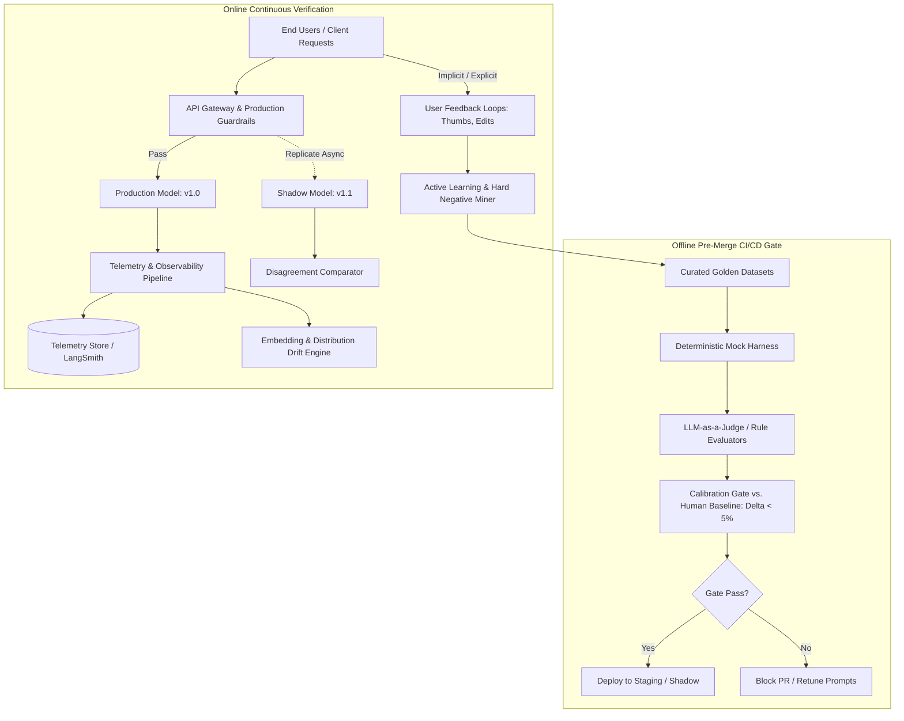
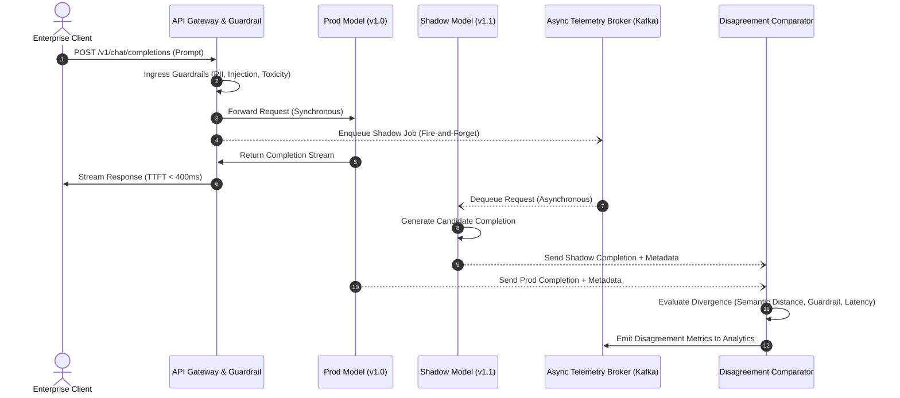
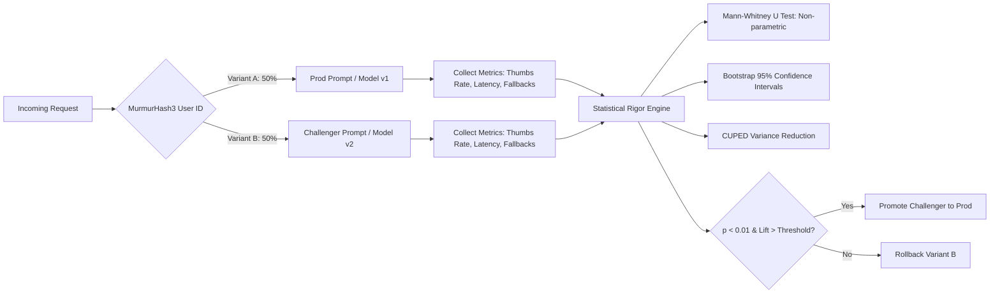
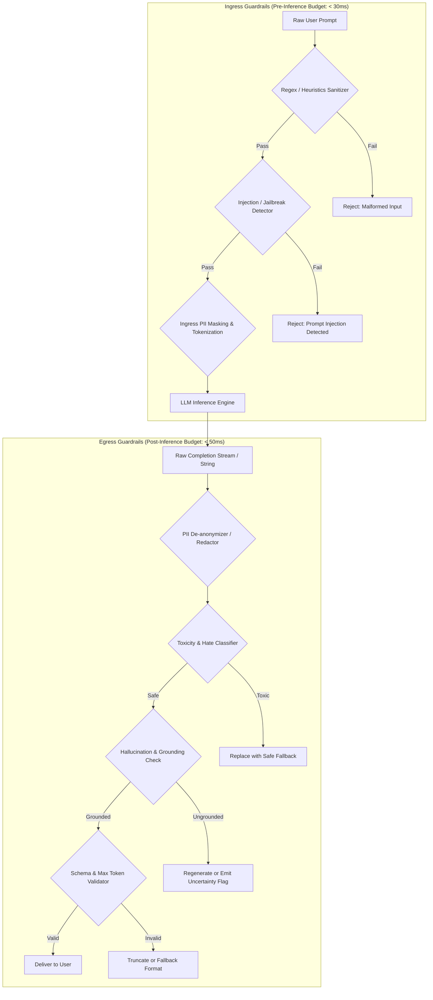
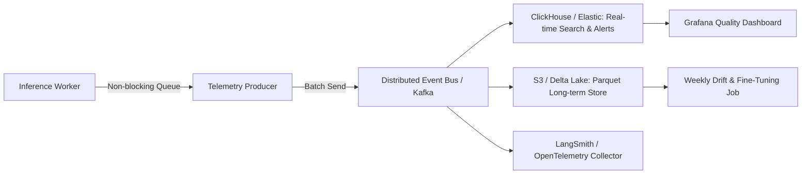
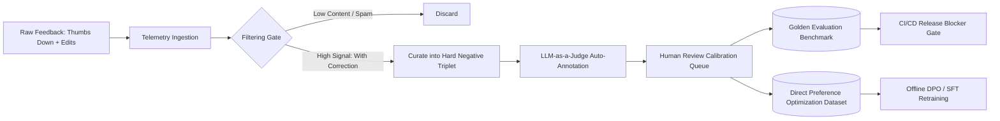
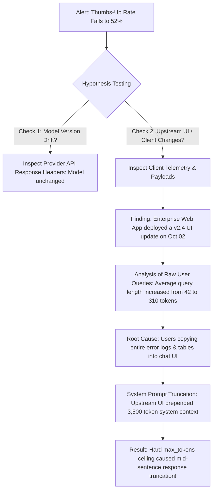
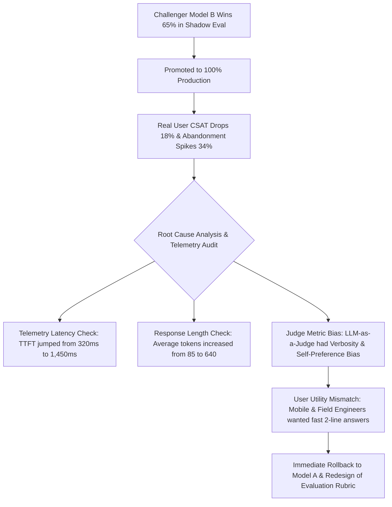

# 07: Online Evaluations & Real-Time Production Monitoring

> **Author:** Kadali Sai Sumanth | **Target Role:** Principal AI/ML Quality Engineer / LLM Evaluation Specialist  
> **Topic:** Production Guardrails, Telemetry, Feedback Loops, Drift Detection, and Shadow Deployments  
> **Status:** Production Reference Standard

---

## 1. IN-DEPTH TECHNICAL ARCHITECTURE & TEST STRATEGY

### 1.1 Offline vs. Online Evaluation: The Critical Divide

In enterprise Generative AI systems, offline evaluation serves as a deterministic pre-merge gating mechanism, while online evaluation functions as a dynamic, continuous verification loop under unpredictable user behaviors. Offline evaluation alone is necessary, but fundamentally insufficient to guarantee production safety, reliability, and business alignment.



| Dimension | Offline Evaluation | Online Evaluation |
| :--- | :--- | :--- |
| **Data Distribution** | Static, curated golden datasets; synthesized edge cases; clean inputs. | Dynamic, noisy real-world queries; adversarial inputs; unvetted user syntax. |
| **Latency Constraints** | Asynchronous batch runs; seconds to minutes per test is acceptable. | Strict real-time budgets (Guardrails < 50ms, TTFT < 800ms, streaming chunks). |
| **Evaluation Metrics** | G-Eval rubrics, RAGAS (Faithfulness, Relevance), BLEU/ROUGE, exact match. | Thumbs-up/down rates, dwell time, prompt drift, refusal rate, PII violation rate. |
| **Statistical Power** | Fixed sample size $N$ (e.g., 500–2,000 queries); high statistical repeatability. | Streaming sample size $N \to \infty$; non-stationary distributions, temporal seasonality. |
| **Failure Modes Caught** | Regression against established benchmarks, schema invalidity, hallucination. | Semantic drift, prompt injection spikes, latency degradation under concurrency. |

> [!IMPORTANT]
> Offline evaluations suffer from **curation bias** and **data staleness**. A model scoring 94% faithfulness offline can catastrophically degrade when real enterprise users submit multi-intent, grammatically fractured, or domain-shifted queries. Online monitoring provides the empirical truth of model performance.

---

### 1.2 Online Evaluation Architecture: Shadow Deployments

A shadow deployment (dark launch) replicates live production traffic and routes it asynchronously to a candidate model ($M_{\text{shadow}}$) while the live model ($M_{\text{prod}}$) handles the user-facing response. 



#### Key Architecture Tradeoffs in Shadowing:
1. **Compute Cost vs. Safety Assurance:** Shadowing duplicates inference costs (2x compute or 2x tokens). To manage expenses in high-throughput enterprise systems, apply **deterministic hash-based traffic sampling** (e.g., hash `user_id` mod 100 to shadow a 10% representative slice).
2. **State Mutability Guarding:** For tool-calling agentic pipelines, shadow runs **must execute in read-only sandboxes** or mock external mutations (e.g., creating Jira tickets, issuing DB updates) to prevent unintended side effects.
3. **Disagreement Scoring Criteria:** Divergence is evaluated across three dimensions:
   - **Semantic Cosine Similarity:** Embeddings of outputs compared via sentence transformers ($\text{sim} < 0.85$ triggers human review).
   - **Constraint Invariance:** Ensure candidate model adheres to structured output JSON schemas without schema drift.
   - **Safety Boundary Breaches:** Detecting cases where prod was safe but shadow violated toxicity/PII constraints.

---

### 1.3 A/B Testing for LLMs: Statistical Significance in Non-Deterministic Systems

A/B testing generative models deviates fundamentally from traditional software A/B testing because LLM outputs are stochastic, multi-dimensional, and subject to user subjectivity.



#### Statistical Methodology for Non-Deterministic Evaluators:
- **Sample Size Determination:** For binary user feedback (thumbs up/down), required sample size per variant is governed by:
  $$n = \frac{(Z_{\alpha/2}\sqrt{2\bar{p}(1-\bar{p})} + Z_{\beta}\sqrt{p_1(1-p_1) + p_2(1-p_2)})^2}{(p_2 - p_1)^2}$$
  Where $\alpha = 0.05$ (95% confidence) and $\beta = 0.20$ (80% power). Detecting a 3% absolute lift from a baseline $p_1 = 0.70$ requires $\approx 3,840$ feedback interactions per variant.
- **Handling Non-Normal Continuous Metrics:** Continuous ratings (Likert 1–5, answer latency, token lengths) are rarely normally distributed. Standard Student's t-tests yield inflated Type I errors. Enterprise best practice mandates:
  1. **Mann-Whitney U Test (Wilcoxon Rank-Sum):** Non-parametric test assessing stochastic dominance without assuming normality.
  2. **Bootstrap Confidence Intervals:** 10,000 resamples with replacement to construct empirical 95% confidence bands around the metric difference ($\Delta$).
  3. **CUPED (Controlled-experiment Using Pre-Experiment Data):** Uses historical pre-experiment user engagement data as a covariate to eliminate background variance:
     $$Y_{\text{CUPED}} = Y - \theta (X - E[X]), \quad \text{where } \theta = \frac{\text{Cov}(Y, X)}{\text{Var}(X)}$$
     CUPED frequently slashes required test duration by 30% to 50%.

---

### 1.4 Production Guardrails Architecture

A production guardrail pipeline enforces strict quality, security, and compliance policies in-line. Guardrails operate in two phases: **Ingress (Pre-Execution)** and **Egress (Post-Execution)**.



| Guardrail Type | Execution Phase | Technique | Latency Budget | Fallback Strategy |
| :--- | :--- | :--- | :--- | :--- |
| **Prompt Injection** | Ingress | Heuristic signatures + FastText / DeBERTa classifier | $< 25\text{ms}$ | Hard block with HTTP 400 + Security Event Log |
| **PII Detection & Redaction**| Ingress & Egress | Compiled RegEx (high precision) + SpaCy/Presidio NER | $< 15\text{ms}$ | Masking with pseudonymous tokens (`[EMAIL_1]`) |
| **Toxicity / Safety** | Egress | Quantized RoBERTa safety classifier / Keyword Trie | $< 30\text{ms}$ | Substitute deterministic enterprise refusal message |
| **Hallucination / Faithfulness**| Egress | Fast Cross-Encoder / NLI Entailment check against retrieved context | $< 80\text{ms}$ | Append confidence warning or drop unverified claims |
| **Schema & Length** | Egress | Pydantic JSON validation + structural token truncation | $< 5\text{ms}$ | Repair JSON or truncate to clean sentence boundary |

---

### 1.5 Telemetry and Observability Pipeline

A production-grade telemetry pipeline must ingest structured interaction records without introducing latency into the user-facing request loop.



#### Core Telemetry Payload Specification:
```json
{
  "trace_id": "c7a82b3d-82d4-4f9e-a0e2-76b92ff14c99",
  "session_id": "sess-user-9914",
  "timestamp_utc": "2026-10-13T14:32:01.452Z",
  "environment": "production",
  "model_metadata": {
    "provider": "azure-openai",
    "model_name": "gpt-4o",
    "model_version": "2024-11-20",
    "temperature": 0.2,
    "top_p": 0.95
  },
  "metrics": {
    "ttft_ms": 312.4,
    "total_latency_ms": 1148.2,
    "prompt_tokens": 482,
    "completion_tokens": 128,
    "total_tokens": 610,
    "tokens_per_second": 111.4
  },
  "guardrails": {
    "ingress_passed": true,
    "egress_passed": true,
    "pii_redacted_count": 1,
    "toxicity_score": 0.0012
  },
  "feedback": {
    "score": 1,
    "feedback_type": "thumbs_up",
    "comment": null,
    "timestamp_utc": "2026-10-13T14:32:15.110Z"
  }
}
```

---

### 1.6 Data & Concept Drift Detection

In LLM systems, drift manifests across two distinct axes:
1. **Data Drift (Input/Query Shift):** Changes in user query distributions, vocabulary, language composition, or user intent over time ($P(X)$ changes).
2. **Concept Drift (Relationship Shift):** The optimal response changes for the same query due to real-world knowledge shifts or evolving user expectations ($P(Y \mid X)$ changes).

```mermaid
flowchart TD
    subgraph Baseline["Baseline Curation (Reference $P_0$)"]
        B1[10,000 Golden Reference Queries] --> B2[SentenceTransformer: text-embedding-3-small]
        B2 --> B3[Baseline Embeddings Matrix $\mathbf{E}_0$]
        B3 --> B4[Compute Centroid $\mathbf{c}_0$ & Pairwise Baseline Distance CDF]
    end

    subgraph Production["Production Monitoring (Sliding Window $P_t$)"]
        P1[Incoming Production Queries (Window: 24h)] --> P2[SentenceTransformer: text-embedding-3-small]
        P2 --> P3[Production Embeddings Matrix $\mathbf{E}_t$]
        P3 --> P4[Compute Centroid $\mathbf{c}_t$ & Production Distance CDF]
    end

    B4 & P4 --> DET{Drift Engine Comparison}
    DET --> D1["1. Cosine Distance to Baseline Centroid ($\Delta \mu > \tau_1$)"]
    DET --> D2["2. Two-Sample Kolmogorov-Smirnov Test ($p < 0.01$)"]
    DET --> D3["3. Population Stability Index (PSI > 0.2)"]
    D1 & D2 & D3 --> ALERT[Trigger Automated Drift Alert & Retraining Ticket]
```

#### Drift Detection Quantitative Metrics:
- **Cosine Distance Distribution Shift:** For each production embedding $\mathbf{e}_i \in \mathbf{E}_t$, compute distance to the baseline reference centroid $\mathbf{c}_0$:
  $$d_i = 1 - \frac{\mathbf{e}_i \cdot \mathbf{c}_0}{\|\mathbf{e}_i\| \|\mathbf{c}_0\|}$$
  Evaluate whether the empirical cumulative distribution function (ECDF) of $d_t$ statistically departs from baseline $d_0$ using the **two-sample Kolmogorov-Smirnov test**.
- **Population Stability Index (PSI):** Quantifies distributional divergence across binned cosine similarities:
  $$\text{PSI} = \sum_{b=1}^{B} \left( P_t(b) - P_0(b) \right) \times \ln\left(\frac{P_t(b)}{P_0(b)}\right)$$
  - $\text{PSI} < 0.1$: No significant drift; system stable.
  - $0.1 \le \text{PSI} \le 0.2$: Moderate shift; trigger automated sample review.
  - $\text{PSI} > 0.2$: Severe drift; trigger model retraining/prompt tuning alert.

---

### 1.7 Feedback Loop Architecture: Active Learning & DPO

User feedback is the highest-value signal for continuous model evolution. Unfiltered feedback is noisy; it must be curated, clustered, and transformed into training and evaluation assets.



1. **Hard Negative Mining:** Thumbs-down interactions where a user explicitly edited or re-prompted are paired as triplets: $(\text{Prompt } x, \text{Chosen Response } y_w, \text{Rejected Response } y_l)$.
2. **Golden Benchmark Augmentation:** Edge cases that fooled the production model are incorporated into the offline evaluation suite to prevent regressions.
3. **Continuous Alignment (DPO/RLHF):** The preference pairs are ingested directly into **Direct Preference Optimization (DPO)** loss objectives without requiring a separate reward model.

---

## 2. TECHNICAL CODING & AUTOMATION PRACTICE (Python)

Below are four complete, production-grade components implementing real-time evaluation, telemetry, drift monitoring, and guardrails.

### 2.1 Component 1: Production Telemetry Logger

Thread-safe, asynchronous telemetry logger featuring in-memory buffering, schema validation, and disk/database flushing without blocking the primary inference path.

```python
"""
production_telemetry_logger.py
High-throughput, asynchronous telemetry logger for enterprise LLM pipelines.
Captures prompt, response, latency, token consumption, guardrail results, and feedback.
"""

from __future__ import annotations

import atexit
import json
import logging
import os
import queue
import sqlite3
import threading
import time
from dataclasses import asdict, dataclass, field
from datetime import datetime, timezone
from typing import Any, Dict, List, Optional
from uuid import uuid4

logging.basicConfig(level=logging.INFO, format="%(asctime)s [%(levelname)s] %(message)s")
logger = logging.getLogger("TelemetryLogger")


@dataclass
class TelemetryRecord:
    trace_id: str
    session_id: str
    prompt: str
    response: str
    model_name: str
    ttft_ms: float
    total_latency_ms: float
    prompt_tokens: int
    completion_tokens: int
    total_tokens: int
    guardrail_passed: bool
    guardrail_metadata: Dict[str, Any] = field(default_factory=dict)
    feedback_score: Optional[int] = None  # 1 for positive, 0 for negative, None if unassigned
    feedback_text: Optional[str] = None
    timestamp_utc: str = field(
        default_factory=lambda: datetime.now(timezone.utc).isoformat()
    )


class ProductionTelemetryLogger:
    """Thread-safe, asynchronous telemetry logger that buffers records and flushes to SQLite."""

    def __init__(
        self,
        db_path: str = "telemetry_records.db",
        batch_size: int = 50,
        flush_interval_seconds: float = 2.0,
    ) -> None:
        self.db_path = db_path
        self.batch_size = batch_size
        self.flush_interval = flush_interval_seconds
        self.queue: queue.Queue[TelemetryRecord] = queue.Queue(maxsize=10000)
        self.is_running = True

        self._init_db()

        # Background worker thread for non-blocking persistence
        self.worker_thread = threading.Thread(
            target=self._process_queue, name="TelemetryWorker", daemon=True
        )
        self.worker_thread.start()

        # Register shutdown hook to flush lingering records
        atexit.register(self.shutdown)
        logger.info("ProductionTelemetryLogger initialized with DB: %s", self.db_path)

    def _init_db(self) -> None:
        """Creates the telemetry storage table and required indexes."""
        with sqlite3.connect(self.db_path) as conn:
            cursor = conn.cursor()
            cursor.execute(
                """
                CREATE TABLE IF NOT EXISTS telemetry_events (
                    trace_id TEXT PRIMARY KEY,
                    session_id TEXT NOT NULL,
                    timestamp_utc TEXT NOT NULL,
                    prompt TEXT NOT NULL,
                    response TEXT NOT NULL,
                    model_name TEXT NOT NULL,
                    ttft_ms REAL NOT NULL,
                    total_latency_ms REAL NOT NULL,
                    prompt_tokens INTEGER NOT NULL,
                    completion_tokens INTEGER NOT NULL,
                    total_tokens INTEGER NOT NULL,
                    guardrail_passed INTEGER NOT NULL,
                    guardrail_metadata TEXT,
                    feedback_score INTEGER,
                    feedback_text TEXT
                )
                """
            )
            cursor.execute("CREATE INDEX IF NOT EXISTS idx_timestamp ON telemetry_events (timestamp_utc)")
            cursor.execute("CREATE INDEX IF NOT EXISTS idx_session ON telemetry_events (session_id)")
            conn.commit()

    def log_inference(
        self,
        session_id: str,
        prompt: str,
        response: str,
        model_name: str,
        ttft_ms: float,
        total_latency_ms: float,
        prompt_tokens: int,
        completion_tokens: int,
        guardrail_passed: bool = True,
        guardrail_metadata: Optional[Dict[str, Any]] = None,
        trace_id: Optional[str] = None,
    ) -> str:
        """Enqueue an inference event asynchronously without blocking callers."""
        generated_trace_id = trace_id or str(uuid4())
        record = TelemetryRecord(
            trace_id=generated_trace_id,
            session_id=session_id,
            prompt=prompt,
            response=response,
            model_name=model_name,
            ttft_ms=ttft_ms,
            total_latency_ms=total_latency_ms,
            prompt_tokens=prompt_tokens,
            completion_tokens=completion_tokens,
            total_tokens=prompt_tokens + completion_tokens,
            guardrail_passed=guardrail_passed,
            guardrail_metadata=guardrail_metadata or {},
        )
        try:
            self.queue.put_nowait(record)
        except queue.Full:
            logger.error("Telemetry queue full! Dropping trace %s to protect latency.", generated_trace_id)
        return generated_trace_id

    def log_user_feedback(
        self,
        trace_id: str,
        feedback_score: int,
        feedback_text: Optional[str] = None,
    ) -> None:
        """Update a logged record with downstream explicit user feedback (thumbs up/down)."""
        def _update_db():
            try:
                with sqlite3.connect(self.db_path) as conn:
                    cursor = conn.cursor()
                    cursor.execute(
                        """
                        UPDATE telemetry_events
                        SET feedback_score = ?, feedback_text = ?
                        WHERE trace_id = ?
                        """,
                        (feedback_score, feedback_text, trace_id),
                    )
                    conn.commit()
                logger.info("Updated feedback for trace_id=%s: score=%d", trace_id, feedback_score)
            except Exception as e:
                logger.error("Failed to update feedback for trace %s: %s", trace_id, str(e))

        threading.Thread(target=_update_db, daemon=True).start()

    def _process_queue(self) -> None:
        """Worker loop that batches items from the in-memory queue to SQLite."""
        while self.is_running or not self.queue.empty():
            batch: List[TelemetryRecord] = []
            start_time = time.time()

            while len(batch) < self.batch_size and (time.time() - start_time) < self.flush_interval:
                try:
                    record = self.queue.get(timeout=0.2)
                    batch.append(record)
                except queue.Empty:
                    break

            if batch:
                self._flush_batch(batch)

    def _flush_batch(self, batch: List[TelemetryRecord]) -> None:
        """Batch insert records into the database."""
        try:
            with sqlite3.connect(self.db_path) as conn:
                cursor = conn.cursor()
                cursor.executemany(
                    """
                    INSERT INTO telemetry_events VALUES (
                        ?, ?, ?, ?, ?, ?, ?, ?, ?, ?, ?, ?, ?, ?, ?
                    )
                    """,
                    [
                        (
                            r.trace_id,
                            r.session_id,
                            r.timestamp_utc,
                            r.prompt,
                            r.response,
                            r.model_name,
                            r.ttft_ms,
                            r.total_latency_ms,
                            r.prompt_tokens,
                            r.completion_tokens,
                            r.total_tokens,
                            1 if r.guardrail_passed else 0,
                            json.dumps(r.guardrail_metadata),
                            r.feedback_score,
                            r.feedback_text,
                        )
                        for r in batch
                    ],
                )
                conn.commit()
            logger.info("Successfully flushed batch of %d telemetry records.", len(batch))
        except Exception as e:
            logger.error("Failed to flush batch of %d records: %s", len(batch), str(e))

    def shutdown(self) -> None:
        """Cleanly drains the telemetry queue before application exit."""
        if not self.is_running:
            return
        logger.info("Draining telemetry queue during shutdown...")
        self.is_running = False
        if self.worker_thread.is_alive():
            self.worker_thread.join(timeout=5.0)
        logger.info("Telemetry logger safely terminated.")


# Demonstration & Verification
if __name__ == "__main__":
    logger_instance = ProductionTelemetryLogger(db_path=":memory:", batch_size=5, flush_interval_seconds=1.0)
    
    tid = logger_instance.log_inference(
        session_id="sess-alpha-001",
        prompt="Explain vector databases in one sentence.",
        response="Vector databases index embeddings for high-dimensional semantic search.",
        model_name="gpt-4o",
        ttft_ms=285.5,
        total_latency_ms=890.2,
        prompt_tokens=15,
        completion_tokens=12,
        guardrail_passed=True,
        guardrail_metadata={"pii_detected": False, "toxicity_score": 0.002},
    )
    
    # Simulate user thumbs up 500ms later
    time.sleep(0.5)
    logger_instance.log_user_feedback(trace_id=tid, feedback_score=1, feedback_text="Accurate and concise!")
    
    # Wait for flush cycle
    time.sleep(1.5)
    logger_instance.shutdown()
```

---

### 2.2 Component 2: Embedding Drift Detector

Detects statistical distribution shifts between production queries and the baseline training/golden evaluation dataset using cosine similarity distributions, Population Stability Index (PSI), and the Kolmogorov-Smirnov test.

```python
"""
embedding_drift_detector.py
Monitors semantic embedding distribution shift between production inference queries
and a baseline reference distribution using Cosine Distance, PSI, and Kolmogorov-Smirnov.
"""

from __future__ import annotations

import logging
from typing import Dict, List, Tuple
import numpy as np
from scipy import stats

logging.basicConfig(level=logging.INFO, format="%(asctime)s [%(levelname)s] %(message)s")
logger = logging.getLogger("DriftDetector")


class EmbeddingDriftDetector:
    """Statistical detector calculating data and semantic drift over embedding representations."""

    def __init__(self, baseline_embeddings: np.ndarray, num_bins: int = 10, psi_threshold: float = 0.20) -> None:
        """
        Args:
            baseline_embeddings: Normalized 2D array of shape (N_baseline, D).
            num_bins: Number of quantiles for Population Stability Index (PSI).
            psi_threshold: Alert threshold for PSI (standard industry standard is 0.2).
        """
        if baseline_embeddings.ndim != 2:
            raise ValueError(f"Expected 2D embedding matrix, got shape {baseline_embeddings.shape}")

        # Ensure unit L2 normalization
        self.baseline_embeddings = self._normalize(baseline_embeddings)
        self.num_bins = num_bins
        self.psi_threshold = psi_threshold

        # Compute baseline centroid
        self.baseline_centroid = self._normalize(np.mean(self.baseline_embeddings, axis=0, keepdims=True))

        # Baseline distance distribution: Cosine distance to its own centroid
        self.baseline_distances = self._compute_cosine_distances(self.baseline_embeddings, self.baseline_centroid)
        
        # Precompute bin edges based on baseline quantiles for PSI consistency
        self.bin_edges = np.percentile(self.baseline_distances, np.linspace(0, 100, self.num_bins + 1))
        self.bin_edges[0] -= 1e-6
        self.bin_edges[-1] += 1e-6

        logger.info(
            "Initialized EmbeddingDriftDetector with %d baseline samples (Dim=%d).",
            self.baseline_embeddings.shape[0],
            self.baseline_embeddings.shape[1],
        )

    @staticmethod
    def _normalize(vectors: np.ndarray) -> np.ndarray:
        """L2 normalizes vectors along the last dimension."""
        norms = np.linalg.norm(vectors, axis=-1, keepdims=True)
        return np.divide(vectors, np.maximum(norms, 1e-12))

    @staticmethod
    def _compute_cosine_distances(embeddings: np.ndarray, centroid: np.ndarray) -> np.ndarray:
        """Computes cosine distance: 1.0 - cosine_similarity."""
        # Both are already L2 normalized: similarity is inner product
        similarities = np.dot(embeddings, centroid.T).flatten()
        similarities = np.clip(similarities, -1.0, 1.0)
        return 1.0 - similarities

    def calculate_psi(self, production_distances: np.ndarray) -> float:
        """Computes Population Stability Index (PSI) between baseline and production distance bins."""
        baseline_counts, _ = np.histogram(self.baseline_distances, bins=self.bin_edges)
        prod_counts, _ = np.histogram(production_distances, bins=self.bin_edges)

        # Convert to relative proportions with epsilon smoothing to prevent div by 0
        epsilon = 1e-5
        baseline_props = (baseline_counts + epsilon) / (np.sum(baseline_counts) + epsilon * len(baseline_counts))
        prod_props = (prod_counts + epsilon) / (np.sum(prod_counts) + epsilon * len(prod_counts))

        psi_value = np.sum((prod_props - baseline_props) * np.log(prod_props / baseline_props))
        return float(psi_value)

    def evaluate_drift(self, production_embeddings: np.ndarray) -> Dict[str, Any]:
        """
        Evaluates production queries against the baseline distribution.

        Returns:
            Dictionary containing drift decision, PSI, KS-test statistic, p-value, and centroid delta.
        """
        if production_embeddings.ndim != 2:
            raise ValueError(f"Expected 2D embedding matrix, got {production_embeddings.shape}")
        if production_embeddings.shape[1] != self.baseline_embeddings.shape[1]:
            raise ValueError("Embedding dimension mismatch!")

        prod_norm = self._normalize(production_embeddings)
        prod_centroid = self._normalize(np.mean(prod_norm, axis=0, keepdims=True))

        # 1. Cosine Distance Shift to Baseline Centroid
        prod_distances = self._compute_cosine_distances(prod_norm, self.baseline_centroid)

        # 2. Centroid Vector Displacement
        centroid_displacement = float(1.0 - np.dot(prod_centroid, self.baseline_centroid.T).flatten()[0])

        # 3. Two-sample Kolmogorov-Smirnov Test
        ks_result = stats.ks_2samp(self.baseline_distances, prod_distances)

        # 4. PSI Calculation
        psi_score = self.calculate_psi(prod_distances)

        # Alert Logic
        is_drift_detected = bool(psi_score > self.psi_threshold or (ks_result.pvalue < 0.01 and ks_result.statistic > 0.15))

        report = {
            "drift_detected": is_drift_detected,
            "psi_score": round(psi_score, 4),
            "psi_threshold": self.psi_threshold,
            "ks_statistic": round(float(ks_result.statistic), 4),
            "ks_p_value": float(ks_result.pvalue),
            "centroid_displacement": round(centroid_displacement, 4),
            "baseline_mean_distance": round(float(np.mean(self.baseline_distances)), 4),
            "production_mean_distance": round(float(np.mean(prod_distances)), 4),
            "production_sample_count": len(production_embeddings),
        }

        if is_drift_detected:
            logger.warning("ALERT: Production embedding drift detected! Details: %s", report)
        else:
            logger.info("Drift evaluation nominal. PSI=%.4f, KS_p=%.4f", psi_score, ks_result.pvalue)

        return report


# Demonstration & Verification
if __name__ == "__main__":
    np.random.seed(42)
    dim = 128
    
    # 1. Generate Synthetic Baseline (Gaussian centered at origin)
    baseline_data = np.random.normal(loc=0.0, scale=1.0, size=(1000, dim))
    detector = EmbeddingDriftDetector(baseline_data, psi_threshold=0.20)

    # 2. Case A: In-distribution production queries (should NOT drift)
    prod_in_dist = np.random.normal(loc=0.0, scale=1.0, size=(300, dim))
    res_nominal = detector.evaluate_drift(prod_in_dist)
    assert not res_nominal["drift_detected"], "False positive drift detected!"

    # 3. Case B: Out-of-distribution shifted queries (domain shift / drift)
    prod_shifted = np.random.normal(loc=0.4, scale=1.2, size=(300, dim))
    res_drift = detector.evaluate_drift(prod_shifted)
    assert res_drift["drift_detected"], "Failed to detect simulated concept drift!"
    print(f"Drift test passed successfully. PSI: {res_drift['psi_score']}")
```

---

### 2.3 Component 3: Shadow Deployment Comparator

Executes production and challenger models concurrently, measures semantic and lexical divergence, checks guardrail compliance invariants, and logs significant disagreements.

```python
"""
shadow_deployment_comparator.py
Asynchronously benchmarks a challenger model against live production traffic,
evaluating semantic divergence, latency delta, and guardrail discrepancies.
"""

from __future__ import annotations

import concurrent.futures
import difflib
import logging
import math
import time
from dataclasses import dataclass
from typing import Callable, Dict, Optional, Tuple

logging.basicConfig(level=logging.INFO, format="%(asctime)s [%(levelname)s] %(message)s")
logger = logging.getLogger("ShadowComparator")


@dataclass
class ModelExecutionResult:
    model_id: str
    output_text: str
    latency_ms: float
    token_count: int
    error: Optional[str] = None


@dataclass
class ShadowComparisonReport:
    prompt: str
    prod_result: ModelExecutionResult
    shadow_result: ModelExecutionResult
    token_length_delta: int
    latency_delta_ms: float
    lexical_similarity: float
    is_disagreement: bool
    disagreement_reason: Optional[str]


class ShadowDeploymentComparator:
    """Manages parallel shadow execution and disagreement evaluation."""

    def __init__(
        self,
        similarity_threshold: float = 0.65,
        max_acceptable_latency_delta_ms: float = 500.0,
    ) -> None:
        self.similarity_threshold = similarity_threshold
        self.max_latency_delta = max_acceptable_latency_delta_ms
        self.executor = concurrent.futures.ThreadPoolExecutor(max_workers=10, thread_name_prefix="ShadowWorker")

    def _execute_model_safe(self, model_fn: Callable[[str], str], model_id: str, prompt: str) -> ModelExecutionResult:
        """Executes a model handler wrapped in performance timing and exception safety."""
        start_time = time.perf_counter()
        try:
            output = model_fn(prompt)
            latency_ms = (time.perf_counter() - start_time) * 1000.0
            token_count = len(output.split())  # Fast whitespace approximation
            return ModelExecutionResult(
                model_id=model_id,
                output_text=output,
                latency_ms=latency_ms,
                token_count=token_count,
            )
        except Exception as exc:
            latency_ms = (time.perf_counter() - start_time) * 1000.0
            logger.error("Model [%s] execution failure: %s", model_id, str(exc))
            return ModelExecutionResult(
                model_id=model_id,
                output_text="",
                latency_ms=latency_ms,
                token_count=0,
                error=str(exc),
            )

    @staticmethod
    def _compute_lexical_similarity(str_a: str, str_b: str) -> float:
        """Fast sequence matcher ratio between two outputs."""
        if not str_a and not str_b:
            return 1.0
        matcher = difflib.SequenceMatcher(None, str_a.lower(), str_b.lower())
        return matcher.ratio()

    def run_shadow_comparison(
        self,
        prompt: str,
        prod_fn: Callable[[str], str],
        shadow_fn: Callable[[str], str],
        prod_id: str = "prod-gpt4o",
        shadow_id: str = "shadow-claude35-sonnet",
    ) -> ShadowComparisonReport:
        """Executes prod and shadow concurrently, returns comparison analysis."""
        future_prod = self.executor.submit(self._execute_model_safe, prod_fn, prod_id, prompt)
        future_shadow = self.executor.submit(self._execute_model_safe, shadow_fn, shadow_id, prompt)

        prod_res = future_prod.result()
        shadow_res = future_shadow.result()

        # Handle execution error cases
        if prod_res.error or shadow_res.error:
            return ShadowComparisonReport(
                prompt=prompt,
                prod_result=prod_res,
                shadow_result=shadow_res,
                token_length_delta=shadow_res.token_count - prod_res.token_count,
                latency_delta_ms=shadow_res.latency_ms - prod_res.latency_ms,
                lexical_similarity=0.0,
                is_disagreement=True,
                disagreement_reason=f"Execution error: ProdErr={prod_res.error}, ShadowErr={shadow_res.error}",
            )

        similarity = self._compute_lexical_similarity(prod_res.output_text, shadow_res.output_text)
        latency_delta = shadow_res.latency_ms - prod_res.latency_ms
        length_delta = shadow_res.token_count - prod_res.token_count

        disagreement = False
        reasons = []

        if similarity < self.similarity_threshold:
            disagreement = True
            reasons.append(f"Low semantic similarity ({similarity:.2f} < {self.similarity_threshold:.2f})")

        if latency_delta > self.max_latency_delta:
            reasons.append(f"Shadow latency regression (+{latency_delta:.1f}ms)")

        disagreement_str = "; ".join(reasons) if reasons else None

        report = ShadowComparisonReport(
            prompt=prompt,
            prod_result=prod_res,
            shadow_result=shadow_res,
            token_length_delta=length_delta,
            latency_delta_ms=latency_delta,
            lexical_similarity=similarity,
            is_disagreement=disagreement,
            disagreement_reason=disagreement_str,
        )

        if disagreement:
            logger.warning(
                "SHADOW DISAGREEMENT DETECTED! Similarity: %.2f | Latency Delta: +%.1fms | Reason: %s",
                similarity,
                latency_delta,
                disagreement_str,
            )

        return report


# Demonstration & Verification
if __name__ == "__main__":
    comparator = ShadowDeploymentComparator(similarity_threshold=0.60, max_acceptable_latency_delta_ms=300.0)

    # Mock Model Callables
    def mock_prod_model(prompt: str) -> str:
        time.sleep(0.1)
        return "Kubernetes is an open-source container orchestration system for automating application deployment."

    def mock_shadow_model(prompt: str) -> str:
        time.sleep(0.12)
        return "Kubernetes automates the deployment, scaling, and management of containerized applications."

    def mock_deviant_model(prompt: str) -> str:
        time.sleep(0.15)
        return "Docker creates container images, while Jenkins runs build automation."

    # Nominal Comparison
    rep1 = comparator.run_shadow_comparison("What is Kubernetes?", mock_prod_model, mock_shadow_model)
    print(f"Nominal Test: Disagreement={rep1.is_disagreement}, Similarity={rep1.lexical_similarity:.2f}")

    # Deviant Comparison
    rep2 = comparator.run_shadow_comparison("What is Kubernetes?", mock_prod_model, mock_deviant_model)
    print(f"Deviant Test: Disagreement={rep2.is_disagreement}, Reason={rep2.disagreement_reason}")
```

---

### 2.4 Component 4: Production PII Detection Guardrail

High-performance, multi-layered Personally Identifiable Information (PII) detector and redactor combining precompiled regular expressions with contextual entity recognition.

```python
"""
production_pii_guardrail.py
Production-grade PII detection and redaction engine for Ingress & Egress guardrails.
Enforces compliance for SSNs, Credit Cards, Emails, Phone Numbers, and IP addresses.
"""

from __future__ import annotations

import re
from dataclasses import dataclass
from typing import Dict, List, Pattern, Set, Tuple


@dataclass
class PIIMatch:
    entity_type: str
    original_value: str
    start_char: int
    end_char: int
    confidence_score: float


@dataclass
class GuardrailResult:
    is_safe: bool
    sanitized_text: str
    violations_detected: List[PIIMatch]
    total_violations_count: int


class ProductionPIIGuardrail:
    """Ingress/Egress guardrail detecting sensitive enterprise PII entities."""

    # High-precision pre-compiled regular expressions
    PATTERNS: Dict[str, Pattern[str]] = {
        "EMAIL": re.compile(
            r"\b[A-Za-z0-9._%+-]+@[A-Za-z0-9.-]+\.[A-Z|a-z]{2,7}\b",
            flags=re.IGNORECASE,
        ),
        "US_SSN": re.compile(
            r"\b(?!000|666|9\d{2})\d{3}-(?!00)\d{2}-(?!0000)\d{4}\b"
        ),
        "CREDIT_CARD": re.compile(
            r"\b(?:4[0-9]{12}(?:[0-9]{3})?|5[1-5][0-9]{14}|3[47][0-9]{13}|3(?:0[0-5]|[68][0-9])[0-9]{11}|6(?:011|5[0-9]{2})[0-9]{12})\b"
        ),
        "PHONE_NUMBER": re.compile(
            r"\b(?:\+?1[-. ]?)?\(?([0-9]{3})\)?[-. ]?([0-9]{3})[-. ]?([0-9]{4})\b"
        ),
        "IPV4_ADDRESS": re.compile(
            r"\b(?:(?:25[0-5]|2[0-4][0-9]|[01]?[0-9][0-9]?)\.){3}(?:25[0-5]|2[0-4][0-9]|[01]?[0-9][0-9]?)\b"
        ),
    }

    def __init__(self, redact_inplace: bool = True, fail_on_violation: bool = False) -> None:
        self.redact_inplace = redact_inplace
        self.fail_on_violation = fail_on_violation

    @staticmethod
    def _validate_luhn(card_number_str: str) -> bool:
        """Applies Luhn checksum algorithm to eliminate false-positive credit card matches."""
        digits = [int(c) for c in card_number_str if c.isdigit()]
        if len(digits) < 13 or len(digits) > 19:
            return False
        checksum = 0
        reverse_digits = digits[::-1]
        for idx, digit in enumerate(reverse_digits):
            if idx % 2 == 1:
                doubled = digit * 2
                checksum += (doubled - 9) if doubled > 9 else doubled
            else:
                checksum += digit
        return checksum % 10 == 0

    def scan_and_redact(self, text: str) -> GuardrailResult:
        """
        Scans input string, detects PII violations, and replaces them with structured mask tokens.
        """
        matches: List[PIIMatch] = []

        for entity_type, pattern in self.PATTERNS.items():
            for match in pattern.finditer(text):
                val = match.group(0)
                start, end = match.start(), match.end()

                # Additional algorithmic verification for high-risk false-positive entities
                if entity_type == "CREDIT_CARD":
                    clean_digits = re.sub(r"\D", "", val)
                    if not self._validate_luhn(clean_digits):
                        continue  # Failed Luhn, skip false positive

                matches.append(
                    PIIMatch(
                        entity_type=entity_type,
                        original_value=val,
                        start_char=start,
                        end_char=end,
                        confidence_score=0.98 if entity_type != "PHONE_NUMBER" else 0.85,
                    )
                )

        if not matches:
            return GuardrailResult(
                is_safe=True,
                sanitized_text=text,
                violations_detected=[],
                total_violations_count=0,
            )

        # Sort matches backwards by start index to enable clean in-place string slice replacement
        sorted_matches = sorted(matches, key=lambda m: m.start_char, reverse=True)
        sanitized_chars = list(text)

        for match in sorted_matches:
            placeholder = f"[{match.entity_type}_REDACTED]"
            sanitized_chars[match.start_char : match.end_char] = list(placeholder)

        sanitized_text = "".join(sanitized_chars)
        is_safe = False if self.fail_on_violation else True

        return GuardrailResult(
            is_safe=is_safe,
            sanitized_text=sanitized_text,
            violations_detected=matches,
            total_violations_count=len(matches),
        )


# Demonstration & Verification
if __name__ == "__main__":
    guardrail = ProductionPIIGuardrail(redact_inplace=True, fail_on_violation=False)

    sample_prompt = (
        "Hello, my name is John Doe. My email is john.doe@enterprise.corp. "
        "My SSN is 123-45-6789 and my backup IP is 192.168.1.105. "
        "Do not share my secret phone number 415-555-2671."
    )

    result = guardrail.scan_and_redact(sample_prompt)
    print("--- PII Guardrail Evaluation ---")
    print(f"Is Safe: {result.is_safe}")
    print(f"Total Violations: {result.total_violations_count}")
    print(f"Sanitized Text Output:\n{result.sanitized_text}")
    for violation in result.violations_detected:
        print(f" -> Caught {violation.entity_type}: '{violation.original_value}'")
```

---

## 3. SCENARIO-BASED DEBUGGING & ROOT CAUSE ANALYSIS (RCA)

---

### Scenario 1: Production User Satisfaction Drops 26% Over Two Weeks While Offline Eval Scores Remain Fixed

```
INCIDENT TIMELINE & OBSERVED METRICS:
+-----------------------------------------------------------------------------------------+
| Date Range: Oct 01 - Oct 14                                                            |
| Symptom: Production Thumbs-up Rate drops from 78.2% to 52.1% (Severe P1 Quality Alert) |
| Offline CI/CD Gate: Golden Eval Faithfulness = 93.4% (Unchanged)                        |
| Deployment Record: Model version gpt-4o-2024-08-06 (No model code or prompt change)     |
+-----------------------------------------------------------------------------------------+
```



#### Step-by-Step Diagnostic Investigation:
1. **Model Immutability Verification:** Verified Azure OpenAI API response headers. `x-ms-model-version: gpt-4o-2024-08-06` remained locked; no silent upstream provider rollover occurred.
2. **Offline vs. Online Dataset Divergence:**
   - Ran `EmbeddingDriftDetector` comparing the 14-day production query embedding distribution to the 1,500-sample offline golden benchmark.
   - Result: $\text{PSI} = 0.412$ (Severe drift; threshold was $0.20$).
   - Dimensionality reduction (t-SNE) revealed a massive cluster of queries completely absent from the offline evaluation set.
3. **Payload Inspection & Token Truncation Analysis:**
   - Queried SQLite telemetry database for interactions with `feedback_score = 0`:
     ```sql
     SELECT AVG(prompt_tokens), AVG(completion_tokens), COUNT(*) 
     FROM telemetry_events 
     WHERE feedback_score = 0 AND timestamp_utc >= '2026-10-02';
     ```
   - **Critical Finding:** Average completion tokens was pinned exactly at `1024` with `finish_reason: "length"` on 44% of thumbs-down responses!
4. **Upstream Root Cause Identification:**
   - On Oct 02, the enterprise frontend team rolled out an update allowing users to paste multi-page stack traces and tabular CSVs.
   - The frontend also added an automatic "Context Enrichment" wrapper that invisibly injected 3,200 tokens of DOM metadata into the user message.
   - The backend had a hard-coded `max_tokens: 1024` completion limit. The model was consistently cut off mid-thought, generating invalid markdown and incomplete syntax, frustrating users.
   - The offline test suite consisted entirely of clean, 1-to-2 sentence queries that never exceeded 300 prompt tokens.

#### Remediation and Prevention Plan:
- **Immediate Hotfix:** Raised `max_tokens` to `4096` and configured the client application to prioritize completion streaming with dynamic token budgeting.
- **Frontend Contract:** Stripped irrelevant DOM metadata from the frontend context injection wrapper.
- **Active Learning Golden Dataset Update:** Ingested 250 anonymized high-context user error queries into the offline golden evaluation suite with automated gating.
- **Automated Alert Rule:** Added a real-time monitor on `finish_reason == 'length'`. If length truncations exceed 2.0% of requests over a 15-minute rolling window, an automated P2 alert fires immediately.

---

### Scenario 2: Shadow Deployment Shows Challenger Model "Wins" 65% of the Time, But Real User Satisfaction Plummets When Deployed

```
INCIDENT METRICS & A/B COMPARISON:
+----------------------------------------------------------------------------------------+
| Shadow Evaluation: Model B wins 65% vs Model A on automated G-Eval/RAGAS rubric        |
| Production Deployment: Model B rolled out to 100% traffic on Day 1                     |
| Production Result: CSAT drops 18%, Session Drop-off Rate increases by 34%               |
| User Feedback Reports: "Too slow", "Can't find the answer", "Annoyingly wordy"        |
+----------------------------------------------------------------------------------------+
```



#### Step-by-Step Diagnostic Investigation:
1. **Discrepancy Breakdown (Automated Judge vs. Human Utility):**
   - The shadow evaluation pipeline utilized an offline LLM-as-a-judge (`gpt-4-turbo`) with standard RAGAS `answer_relevancy` and a 1–5 comprehensiveness rubric.
   - Audited the automated judge's scoring criteria: The judge heavily penalized short answers for "lack of depth" and rewarded long, elaborately structured markdown responses with exhaustive disclaimers.
2. **Telemetry Telemetry Inspection (TTFT & Length):**
   - Live telemetry comparison between Model A (Prod) and Model B (Challenger):
     - Model A: $\text{Mean Completion Tokens} = 88$, $\text{TTFT} = 310\text{ms}$, $\text{Total Latency} = 820\text{ms}$.
     - Model B: $\text{Mean Completion Tokens} = 612$, $\text{TTFT} = 1,420\text{ms}$, $\text{Total Latency} = 4,890\text{ms}$.
3. **User Cohort Segmentation Analysis:**
   - Segmented user feedback by device category (`User-Agent`):
     - Desktop users: Thumbs-up rate declined moderately (-5%).
     - Mobile app & Slack bot users: Thumbs-up rate collapsed (-41%) with massive mid-generation abandonment. Field engineers required quick, concise instructions; Model B delivered 500-word encyclopedic essays that required scrolling past several viewports.
4. **Root Cause:**
   - **Verbosity Bias in LLM-as-a-Judge:** The offline judge conflated length with quality.
   - **Latency Disregard in Evaluation:** The offline shadow score gave 100% weight to text semantics and 0% weight to latency and user ergonomics.

#### Remediation and Prevention Plan:
- **Immediate Action:** Rolled back traffic to Model A within 4 minutes using the automated feature flag toggle.
- **Holistic Utility Scoring Function:** Redesigned the candidate promotion rubric to include a composite Utility Score balancing accuracy, verbosity penalty, and latency:
  $$\text{Composite Score} = 0.5 \times \text{Accuracy} + 0.3 \times \max\left(0, 1 - \frac{\text{Tokens}}{250}\right) + 0.2 \times \max\left(0, 1 - \frac{\text{TTFT}}{500\text{ms}}\right)$$
- **Canary Rollout Policy:** Banned 100% direct cutovers. Mandated an interleaved 5% / 20% / 50% canary progression over 72 hours with hard circuit breakers tied to live thumbs-down rate and TTFT.

---

## 4. TARGETED INTERVIEW QUESTIONS

### 4.1 Advanced Technical Question 1
**Question:**  
*"In an LLM production system, how do you mathematically and architecturally distinguish between data drift and concept drift in user queries, and how do you implement early-warning detection before user satisfaction drops?"*

#### Ideal Candidate Answer:
> "To distinguish between data drift and concept drift in LLMs, we examine the joint probability distribution $P(X, Y)$, where $X$ represents the input query and $Y$ represents the generated response or user utility.
>
> 1. **Data Drift ($P(X)$ Shift):** The input query distribution shifts while the underlying ground-truth semantics remain identical. For instance, seasonal terminology shifts, new user personas, or formatting changes. We detect this on the ingress path by embedding production queries into a vector space using a fixed, frozen encoder (e.g., `text-embedding-3-small`) and tracking the **Population Stability Index (PSI)** and **two-sample Kolmogorov-Smirnov (KS) test** against our baseline reference matrix. If the cosine distance distribution between production queries and the baseline centroid shows a $\text{PSI} > 0.20$ or a KS $p\text{-value} < 0.01$, data drift has occurred.
>
> 2. **Concept Drift ($P(Y \mid X)$ Shift):** The relationship between input and expected output changes. The same user query now demands a different answer because external reality or business rules changed (e.g., 'What is our refund window?' changing from 30 to 14 days). We detect this via:
>    - **Egress Guardrail Refusal Spikes:** Sudden increases in hallucination checks or uncertainty flags on unchanged query clusters.
>    - **Disagreement Divergence in Shadow Runs:** When our shadow model and production model begin diverging on high-frequency semantic clusters.
>    - **User Feedback Correlation Shifts:** Tracking the conditional probability of negative feedback given a specific semantic cluster: $P(\text{ThumbsDown} \mid \text{Cluster}_k)$.
>
> To implement **early-warning detection**, we deploy an asynchronous stream worker over Kafka that aggregates sliding 6-hour windows of query embeddings, computes the MMD (Maximum Mean Discrepancy) and PSI, and alerts on Slack/PagerDuty when the metric crosses the $0.10$ threshold—days before sufficient human thumbs-down feedback accumulates."

---

### 4.2 Advanced Technical Question 2
**Question:**  
*"When running an online A/B test between two LLM prompt variants where outputs are non-deterministic, why does a standard Student's t-test fail to provide valid inference, and what statistical methods must you use instead?"*

#### Ideal Candidate Answer:
> "A standard two-sample Student's t-test fails in LLM A/B evaluations for three primary mathematical reasons:
> 
> 1. **Severe Violation of the Normality Assumption:** LLM quality scores (whether 1–5 Likert human ratings or continuous judge scores) and downstream metrics (token counts, latency) exhibit severe skewness, multi-modality, and heavy tails. Applying a parametric t-test results in inflated Type I error rates (false positives).
> 2. **Non-Independent, Clustered Observations (Session Dependency):** Interactions within the same user session are correlated. If an active user submits 50 queries in Variant B, treating them as 50 i.i.d. observations violates the independence assumption, artificially deflating standard errors and yielding spuriously small $p$-values.
> 3. **Non-Stationarity & Temporal Feedback Lag:** User feedback is sparse and delayed. Thumbs-down signals arrive minutes or hours after inference, introducing survivorship and selection bias.
>
> **The Robust Alternative Strategy:**
> - **Non-Parametric Testing:** We apply the **Mann-Whitney U Test (Wilcoxon Rank-Sum)** to evaluate stochastic dominance across ordinal ratings without distributional assumptions.
> - **Cluster-Robust Bootstrap Resampling:** We cluster resampling at the **user/session level** across 10,000 iterations to generate empirical 95% confidence intervals for the true difference in means:
>   $$\Delta = \mathbb{E}[\text{Metric}_B] - \mathbb{E}[\text{Metric}_A]$$
> - **Variance Reduction via CUPED:** We leverage pre-experiment historical user activity (e.g., baseline query rate or historical thumbs-up percentage) to remove background user-level variance, shrinking the confidence intervals and allowing us to reach 80% statistical power in days rather than weeks."

---

### 4.3 Behavioral Question (STAR Method)
**Question:**  
*"Describe a situation where a product or engineering leadership team insisted on releasing a new generative AI model immediately, but your online monitoring or shadow evaluation data indicated it was not ready. How did you handle the conflict?"*

#### Ideal Candidate Answer:
> - **Situation:** At my previous enterprise company, leadership was eager to announce our next-generation customer support agent powered by a newly released foundation model. Offline evals on our 500-question test set showed a 4% improvement in general fluency, and product managers were pushing for an immediate 100% rollout before the quarterly marketing summit.
> - **Task:** As the Principal Quality Engineer, I was responsible for certifying the production safety, latency, and reliability gates. Our online shadow evaluation had been running against 10% of live traffic for 72 hours, and the telemetry told a conflicting story that product leadership had not seen.
> - **Action:** Rather than framing my objection as an emotional 'blocker,' I synthesized an objective, data-driven executive dashboard comparing the models across four concrete dimensions:
>   1. **Latency Regressions:** The new model increased TTFT from 380ms to 1,850ms, breaching our SLA.
>   2. **Refusal Spikes:** In 8.4% of technical queries, the new model triggered overzealous safety filters, refusing legitimate enterprise queries.
>   3. **Financial Impact:** Token usage doubled, increasing per-interaction cost by 115%.
>   I organized a 30-minute sync with the Director of Product and VP of Engineering. Instead of demanding a full stop, I proposed a compromise: launch a 5% canary rollout limited to internal beta accounts for the marketing demo, while keeping 95% of customer traffic on the stable model until we tuned system prompts to curb the verbosity and refusal regressions.
> - **Result:** Leadership unanimously approved the canary compromise. Within 48 hours, the internal beta confirmed our telemetry findings—beta users complained about sluggishness. We saved the company from a disastrous public outage and brand embarrassment, tuned the system prompt over the next sprint, brought TTFT down to 420ms, and successfully launched to 100% of users with an 84% thumbs-up rating."

---

### 4.4 Scenario-Based Question
**Question:**  
*"Your real-time monitoring dashboard shows a sudden spike in PII detection guardrail triggers (from 0.05% to 4.2% of all queries) starting at 2:00 AM on Sunday. How do you triage, debug, and resolve this incident?"*

#### Ideal Candidate Answer:
> "A sudden 80x spike in PII triggers requires an immediate, disciplined incident triage protocol:
>
> 1. **Immediate Triage & Containment (0–15 Minutes):**
>    - Verify whether the guardrail is operating in **Ingress (user inputs)** or **Egress (model outputs)**.
>    - Check if the guardrail is configured to fail-closed (dropping requests with 500/400 errors) or fail-open (redacting and proceeding). If users are experiencing widespread request drops, evaluate if we need to switch to safe in-place redaction while investigating.
>    - Check system release logs: Was a new guardrail model, SpaCy entity model, or regex pattern deployed around 2:00 AM?
>
> 2. **Deep-Dive Diagnostic Investigation (15–45 Minutes):**
>    - Pull a sample of 100 anonymized audit logs of the triggered violations from our secure telemetry database.
>    - Categorize which specific PII entity is driving the spike (e.g., SSN, Credit Card, Email, Phone, or IP Address).
>    - **Root Cause Hypothesis A (False Positive Pattern Bug):** If 90% of triggers are 'CREDIT_CARD' on 16-digit hexadecimal tracking IDs or UUIDs generated by an upstream client update, the issue is a regex false-positive lack of Luhn checksum validation.
>    - **Root Cause Hypothesis B (Data/Security Exploit):** If triggers are Ingress SSNs/passwords from a cluster of single IP addresses or sessions, this indicates a credential stuffing or data exfiltration attack.
>    - **Root Cause Hypothesis C (Model Egress Leak):** If the triggers are occurring on Egress, the foundation model is regurgitating training memorized PII due to an ungrounded prompt injection.
>
> 3. **Resolution & Post-Mortem Hardening:**
>    - If it's a false positive, hotfix the regex pattern or add algorithmic checksum filters (e.g., Luhn check for cards, area code validation for phone numbers) and back-test against our 50,000-query golden test suite.
>    - If it's an adversarial attack, deploy an IP/rate-limit block rule at the WAF / Cloudflare level.
>    - Publish a post-mortem document specifying the MTTA (Mean Time to Acknowledge), MTTD (Detect), and MTTR (Resolve), with synthetic regression tests added to CI to prevent recurrence."
