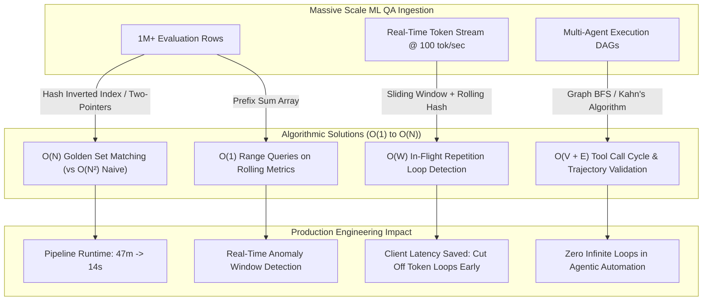
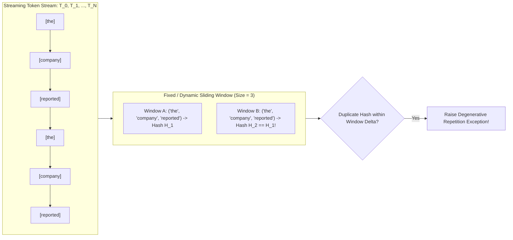
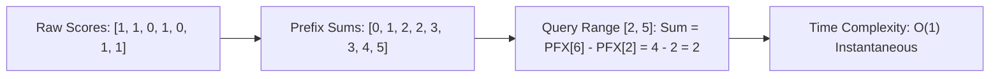

# 08: Core Coding Compliance & Algorithmic Efficiency

> **Author:** Kadali Sai Sumanth | **Target Role:** Principal AI/ML Quality Engineer / LLM Evaluation Specialist  
> **Topic:** Algorithmic Precision for QA Validation Scripts, Token Parsing, and Streaming Sequence Processing  
> **Status:** Production Reference Standard

---

## 1. IN-DEPTH TECHNICAL ARCHITECTURE & TEST STRATEGY

### 1.1 Why Algorithmic Efficiency Matters in AI/ML Quality Engineering

In traditional QA engineering, test execution bottlenecks are typically dominated by network I/O, browser rendering, or database round-trips. In contrast, **AI/ML Quality Engineering operates at the intersection of streaming data, high-dimensional matrices, and massive token volumes**. Inefficient evaluation code directly translates to:

1. **Catastrophic CI/CD Pipeline Degradation:** An evaluation harness executing an $O(n^2)$ pairwise comparison across $1,000,000$ test outputs balloons execution time from seconds to hours, breaking commit-stage CI gates.
2. **Out-of-Memory (OOM) Kernel Crashes:** Ingesting multi-gigabyte evaluation datasets (e.g., token-level traces, embedding dumps, conversation logs) using naive memory allocations collapses evaluation worker nodes.
3. **Inability to Test Streaming LLM Endpoints in Real Time:** Generative models stream tokens via Server-Sent Events (SSE) at 30–120 tokens/second. A streaming validator must evaluate tokens **in-flight** without unbounded memory buffering to catch repetitive degeneration loops or safety violations before the full payload reaches the client.



---

### 1.2 Core Algorithmic Patterns Adapted for ML Quality Engineering

| Algorithmic Pattern | Core ML QE Application | Time Complexity | Space Complexity | Why Naive Implementations Fail |
| :--- | :--- | :--- | :--- | :--- |
| **Sliding Window** | Token stream loop detection; degenerate n-gram repetition; real-time safety scanning. | $O(N)$ or $O(N \times k)$ | $O(W)$ where $W$ is window size | String concatenation inside loops creates $O(N^2)$ memory churn; re-hashing from scratch causes latency spikes. |
| **Two Pointers** | Sequence diffing; token alignment; token-by-token comparison between reference and candidate outputs. | $O(N + M)$ | $O(1)$ auxiliary | Nested iterations yield $O(N \cdot M)$ complexity, freezing test suites during long multi-turn conversation diffs. |
| **HashMap / Frequency Counting** | Token distribution analysis; vocabulary coverage; detecting hallucinated entity distributions. | $O(N)$ amortized | $O(V)$ where $V$ is vocabulary size | Repeated linear scans (`list.count()` in Python) yield $O(N^2)$ performance on large corpora. |
| **Prefix Sum Arrays** | Instantaneous rolling average evaluation metrics; slice error rate aggregation across batches. | Precompute: $O(N)$<br>Query: $O(1)$ | $O(N)$ | Recalculating rolling metrics over sliding time-windows across millions of samples requires $O(K \cdot N)$ repeated summing. |
| **Graph BFS / DFS (Topological Sort)** | Agent tool-call trajectory validation; cycle detection in multi-step workflows; dependency graph checks. | $O(V + E)$ | $O(V)$ | Naive recursion without cycle detection / state tracking causes call-stack overflow when agents enter circular tool loops. |

---

### 1.3 Architectural Deep Dives for ML QE Patterns

#### Pattern A: Sliding Window for Token Loop Detection
Generative models occasionally enter degenerative states where they repeat identical phrases indefinitely (e.g., `"and furthermore, the system, and furthermore, the system..."`). A sliding window maintaining rolling token hashes detects these repeating patterns in $O(N)$ time with fixed $O(W)$ memory overhead, allowing test assertions to abort stuck tests immediately.



#### Pattern B: Prefix Sum for Sliding Window Metric Evaluation
When monitoring batch evaluation metrics (e.g., Faithfulness, Semantic Relevance, Latency) across a million test records, we frequently need to answer: *"What was the average pass rate between test index $L$ and index $R$?"* or *"Did any 1,000-sample window drop below 85%?"*
- Naive calculation: Summing $R - L$ items on every check $\to O(K \times W)$.
- Prefix Sum array: Compute once $\to P[i] = P[i-1] + \text{Score}[i]$. Any range sum is $P[R] - P[L-1]$ in **$O(1)$ instantaneous time**.



#### Pattern C: Directed Acyclic Graph (DAG) Trajectory Validation
Autonomous agent frameworks (LangGraph, AutoGen, CrewAI) execute sequences of tool calls. If an agent loops between tools (e.g., `SearchTool` $\to$ `CalculatorTool` $\to$ `SearchTool` $\to$ `CalculatorTool`), the workflow must be halted. We represent tool transitions as a directed graph $G = (V, E)$ and apply **Kahn's Algorithm (BFS)** or **Three-Color DFS** to detect cycles and validate execution trajectories in $O(V + E)$ time.

---

## 2. TECHNICAL CODING & AUTOMATION PRACTICE (Java & Python)

---

### 2.1 Pattern 1: Sliding Window — N-Gram Repetition & Loop Detector

Detects repeating token sequences in LLM output streams. Catches degenerative model loops in real-time.

#### Python Implementation (Production-Grade)
```python
"""
token_repetition_detector.py
Sliding-window token loop detector for generative LLM outputs.
Detects exact repeating n-gram cycles with configurable n-gram sizes.
"""

from __future__ import annotations

from collections import defaultdict
from dataclasses import dataclass
from typing import Dict, List, Optional, Tuple


@dataclass(frozen=True)
class RepetitionLoopMatch:
    ngram_size: int
    repeated_sequence: Tuple[str, ...]
    first_occurrence_idx: int
    second_occurrence_idx: int
    cycle_distance: int


class TokenRepetitionDetector:
    """Detects degenerative n-gram repetition loops in tokenized text or streaming outputs."""

    def __init__(self, min_ngram: int = 2, max_ngram: int = 6) -> None:
        """
        Args:
            min_ngram: Minimum length of token sequence to inspect.
            max_ngram: Maximum length of token sequence to inspect.
        """
        if min_ngram < 1 or max_ngram < min_ngram:
            raise ValueError(f"Invalid n-gram bounds: min={min_ngram}, max={max_ngram}")
        self.min_ngram = min_ngram
        self.max_ngram = max_ngram

    def detect_loops(self, text_or_tokens: str | List[str]) -> List[RepetitionLoopMatch]:
        """
        Scans sequence using a sliding window with hash tracking.
        Returns a list of detected loops.
        """
        if isinstance(text_or_tokens, str):
            tokens = text_or_tokens.strip().split()
        else:
            tokens = text_or_tokens

        n = len(tokens)
        detected_loops: List[RepetitionLoopMatch] = []

        # Iterate over each n-gram size in range
        for k in range(self.min_ngram, min(self.max_ngram + 1, n // 2 + 1)):
            # Map n-gram tuple to its previous starting index
            seen_ngrams: Dict[Tuple[str, ...], int] = {}

            # Slide window of size k across tokens: O(N) operations per k
            for i in range(0, n - k + 1):
                # Construct n-gram tuple
                ngram = tuple(tokens[i : i + k])

                if ngram in seen_ngrams:
                    prev_idx = seen_ngrams[ngram]
                    distance = i - prev_idx

                    # Check for immediate contiguous cycle or tight repetition
                    if distance == k or distance <= 2 * k:
                        loop = RepetitionLoopMatch(
                            ngram_size=k,
                            repeated_sequence=ngram,
                            first_occurrence_idx=prev_idx,
                            second_occurrence_idx=i,
                            cycle_distance=distance,
                        )
                        detected_loops.append(loop)
                else:
                    seen_ngrams[ngram] = i

        return detected_loops

    def assert_no_repetition_loops(self, output: str, max_allowed_loops: int = 0) -> None:
        """PyTest/CI assertion helper to fail test if model entered a loop."""
        loops = self.detect_loops(output)
        if len(loops) > max_allowed_loops:
            first_loop = loops[0]
            rep_str = " ".join(first_loop.repeated_sequence)
            raise AssertionError(
                f"Degenerative repetition loop detected ({len(loops)} occurrences)! "
                f"N-Gram Size: {first_loop.ngram_size}, Repeated Pattern: '{rep_str}', "
                f"Indices: {first_loop.first_occurrence_idx} -> {first_loop.second_occurrence_idx}"
            )


# Verification & Demonstration
if __name__ == "__main__":
    detector = TokenRepetitionDetector(min_ngram=2, max_ngram=4)

    # Clean LLM response
    clean_text = "The quick brown fox jumps over the lazy dog in the sunny park."
    loops_clean = detector.detect_loops(clean_text)
    assert len(loops_clean) == 0, "False positive on clean text!"

    # Degenerative looping LLM response
    looping_text = (
        "The financial report is ready for review. "
        "We observed that the revenue grew significantly and the revenue grew significantly and the revenue grew significantly."
    )
    loops_found = detector.detect_loops(looping_text)
    assert len(loops_found) > 0, "Failed to detect repeating n-gram loop!"
    print(f"Successfully caught {len(loops_found)} repetition loops in degenerative text:")
    for lp in loops_found:
        print(f" -> Pattern: '{' '.join(lp.repeated_sequence)}' | Distance: {lp.cycle_distance}")
```

#### Java Implementation (Production-Grade)
```java
package com.ai.quality.algorithms;

import java.util.*;

/**
 * Sliding Window Token Repetition Detector.
 * Identifies generative LLM degenerative repetition loops in tokenized text.
 */
public class TokenRepetitionDetector {

    public static class RepetitionMatch {
        private final int ngramSize;
        private final List<String> repeatedSequence;
        private final int firstOccurrenceIdx;
        private final int secondOccurrenceIdx;
        private final int cycleDistance;

        public RepetitionMatch(int ngramSize, List<String> repeatedSequence, 
                               int firstOccurrenceIdx, int secondOccurrenceIdx, int cycleDistance) {
            this.ngramSize = ngramSize;
            this.repeatedSequence = repeatedSequence;
            this.firstOccurrenceIdx = firstOccurrenceIdx;
            this.secondOccurrenceIdx = secondOccurrenceIdx;
            this.cycleDistance = cycleDistance;
        }

        public int getNgramSize() { return ngramSize; }
        public List<String> getRepeatedSequence() { return repeatedSequence; }
        public int getFirstOccurrenceIdx() { return firstOccurrenceIdx; }
        public int getSecondOccurrenceIdx() { return secondOccurrenceIdx; }
        public int getCycleDistance() { return cycleDistance; }

        @Override
        public String toString() {
            return String.format("RepetitionMatch[k=%d, seq=%s, idx1=%d, idx2=%d, dist=%d]",
                    ngramSize, String.join(" ", repeatedSequence), firstOccurrenceIdx, secondOccurrenceIdx, cycleDistance);
        }
    }

    private final int minNgram;
    private final int maxNgram;

    public TokenRepetitionDetector(int minNgram, int maxNgram) {
        if (minNgram < 1 || maxNgram < minNgram) {
            throw new IllegalArgumentException("Invalid ngram range: " + minNgram + " to " + maxNgram);
        }
        this.minNgram = minNgram;
        this.maxNgram = maxNgram;
    }

    /**
     * Detects token repetition loops using a sliding window approach with hash indexing.
     * Time Complexity: O(K * N) where K is (maxNgram - minNgram) and N is token count.
     * Space Complexity: O(N) for hash map state.
     */
    public List<RepetitionMatch> detectLoops(String text) {
        if (text == null || text.trim().isEmpty()) {
            return Collections.emptyList();
        }

        String[] tokens = text.trim().split("\\s+");
        int n = tokens.length;
        List<RepetitionMatch> matches = new ArrayList<>();

        for (int k = minNgram; k <= Math.min(maxNgram, n / 2); k++) {
            Map<String, Integer> seenNgrams = new HashMap<>();

            for (int i = 0; i <= n - k; i++) {
                // Build string representation of n-gram
                StringBuilder sb = new StringBuilder();
                for (int j = 0; j < k; j++) {
                    sb.append(tokens[i + j]).append(" ");
                }
                String ngramKey = sb.toString().trim();

                if (seenNgrams.containsKey(ngramKey)) {
                    int prevIdx = seenNgrams.get(ngramKey);
                    int distance = i - prevIdx;

                    if (distance <= 2 * k) {
                        List<String> subList = Arrays.asList(Arrays.copyOfRange(tokens, i, i + k));
                        matches.add(new RepetitionMatch(k, subList, prevIdx, i, distance));
                    }
                } else {
                    seenNgrams.put(ngramKey, i);
                }
            }
        }
        return matches;
    }

    public static void main(String[] args) {
        TokenRepetitionDetector detector = new TokenRepetitionDetector(2, 4);

        String sampleLoopText = "The quarterly summary is ready. The metrics indicate growth and the metrics indicate growth.";
        List<RepetitionMatch> loops = detector.detectLoops(sampleLoopText);

        System.out.println("Detected Loops: " + loops.size());
        for (RepetitionMatch match : loops) {
            System.out.println(" -> " + match);
        }
        assert !loops.isEmpty() : "Should have detected repeating loop!";
    }
}
```

---

### 2.2 Pattern 2: Two Pointers — Longest Substring Without Repeating Characters

Classic high-frequency interview problem adapted for string sanitization and character-level token buffer parsing.

#### Python Implementation (Production-Grade)
```python
"""
longest_substring_two_pointers.py
Two-pointer (sliding window) implementation of Longest Substring Without Repeating Characters.
Time Complexity: O(N) | Space Complexity: O(min(N, AlphabetSize))
"""

from typing import Dict, Tuple


def longest_substring_without_repeating(s: str) -> Tuple[int, str]:
    """
    Finds the length and the exact substring of the longest contiguous sequence
    containing no duplicate characters using a two-pointer sliding window.

    Args:
        s: Input string to evaluate.

    Returns:
        Tuple containing (max_length, longest_substring).
    """
    if not s:
        return 0, ""

    char_last_seen: Dict[str, int] = {}
    left = 0
    max_len = 0
    best_start = 0

    # Right pointer scans forward
    for right, char in enumerate(s):
        # If character is already seen and is within current window [left, right]
        if char in char_last_seen and char_last_seen[char] >= left:
            left = char_last_seen[char] + 1

        char_last_seen[char] = right
        current_len = right - left + 1

        if current_len > max_len:
            max_len = current_len
            best_start = left

    return max_len, s[best_start : best_start + max_len]


# Verification
if __name__ == "__main__":
    test_cases = [
        ("abcabcbb", 3, "abc"),
        ("bbbbb", 1, "b"),
        ("pwwkew", 3, "wke"),
        ("", 0, ""),
        ("au", 2, "au"),
        ("tmmzuxt", 5, "mzuxt"),
    ]

    for input_str, expected_len, _ in test_cases:
        length, substr = longest_substring_without_repeating(input_str)
        assert length == expected_len, f"Failed on '{input_str}': expected {expected_len}, got {length}"
    print("All two-pointer longest substring test cases passed successfully.")
```

#### Java Implementation (Production-Grade)
```java
package com.ai.quality.algorithms;

import java.util.HashMap;
import java.util.Map;

/**
 * Two-Pointer / Sliding Window Implementation.
 * Computes Longest Substring Without Repeating Characters.
 * Time Complexity: O(N) - single pass.
 * Space Complexity: O(min(N, Sigma)) where Sigma is character set size.
 */
public class LongestUniqueSubstring {

    public static class Result {
        public final int length;
        public final String substring;

        public Result(int length, String substring) {
            this.length = length;
            this.substring = substring;
        }
    }

    public static Result findLongestSubstring(String s) {
        if (s == null || s.isEmpty()) {
            return new Result(0, "");
        }

        Map<Character, Integer> lastSeen = new HashMap<>();
        int left = 0;
        int maxLen = 0;
        int bestStart = 0;

        for (int right = 0; right < s.length(); right++) {
            char c = s.charAt(right);

            if (lastSeen.containsKey(c) && lastSeen.get(c) >= left) {
                left = lastSeen.get(c) + 1;
            }

            lastSeen.put(c, right);
            int currentLen = right - left + 1;

            if (currentLen > maxLen) {
                maxLen = currentLen;
                bestStart = left;
            }
        }

        return new Result(maxLen, s.substring(bestStart, bestStart + maxLen));
    }

    public static void main(String[] args) {
        String testStr = "abcabcbb";
        Result res = findLongestSubstring(testStr);
        System.out.println("Input: " + testStr + " -> Max Length: " + res.length + " Substring: " + res.substring);
        assert res.length == 3 && "abc".equals(res.substring);

        String test2 = "pwwkew";
        Result res2 = findLongestSubstring(test2);
        assert res2.length == 3;
        System.out.println("Java Two-Pointer tests verified.");
    }
}
```

---

### 2.3 Pattern 3: Prefix Sum — Rolling Average Metric Aggregator (Python)

Provides $O(1)$ range queries for rolling evaluation scores across millions of batch records without recalculating sums.

```python
"""
rolling_prefix_metric_aggregator.py
Prefix-sum array for O(1) rolling average quality metric queries across massive evaluation runs.
"""

from __future__ import annotations

from typing import List, Optional


class PrefixMetricAggregator:
    """Precomputes prefix sum arrays to query arbitrary batch slices in O(1) time."""

    def __init__(self, scores: Optional[List[float]] = None) -> None:
        """
        Initializes the prefix sum structure.
        Prefix array is 1-indexed to simplify boundary conditions:
        prefix[0] = 0.0
        prefix[i] = prefix[i-1] + scores[i-1]
        """
        self.scores: List[float] = []
        self.prefix_sums: List[float] = [0.0]

        if scores:
            for s in scores:
                self.append(s)

    def append(self, score: float) -> None:
        """Appends a new evaluation score in O(1) amortized time."""
        self.scores.append(score)
        self.prefix_sums.append(self.prefix_sums[-1] + score)

    def range_sum(self, left: int, right: int) -> float:
        """
        Computes the sum of scores in inclusive range [left, right] in O(1) time.
        0 <= left <= right < len(scores)
        """
        self._validate_bounds(left, right)
        # Sum from left to right is prefix[right + 1] - prefix[left]
        return self.prefix_sums[right + 1] - self.prefix_sums[left]

    def range_average(self, left: int, right: int) -> float:
        """Computes the average score in inclusive range [left, right] in O(1) time."""
        count = right - left + 1
        return self.range_sum(left, right) / count

    def find_degraded_rolling_windows(self, window_size: int, threshold: float) -> List[int]:
        """
        Scans all sliding windows of size `window_size` in O(N) total time.
        Returns the starting index of any window where average < threshold.
        """
        n = len(self.scores)
        if window_size > n or window_size <= 0:
            return []

        degraded_start_indices: List[int] = []
        for start in range(0, n - window_size + 1):
            end = start + window_size - 1
            avg = self.range_average(start, end)
            if avg < threshold:
                degraded_start_indices.append(start)

        return degraded_start_indices

    def _validate_bounds(self, left: int, right: int) -> None:
        n = len(self.scores)
        if not (0 <= left <= right < n):
            raise IndexError(f"Invalid range [{left}, {right}] for dataset of size {n}")


# Demonstration & Verification
if __name__ == "__main__":
    # Simulate a stream of 10,000 binary evaluation pass/fail flags (1.0 = pass, 0.0 = fail)
    import random
    random.seed(42)

    # First 5000 nominal (95% pass rate), next 500 degraded (60% pass rate), rest nominal
    batch = [1.0 if random.random() < 0.95 else 0.0 for _ in range(5000)]
    batch += [1.0 if random.random() < 0.60 else 0.0 for _ in range(500)]
    batch += [1.0 if random.random() < 0.95 else 0.0 for _ in range(4500)]

    aggregator = PrefixMetricAggregator(batch)

    # O(1) Query test:
    overall_avg = aggregator.range_average(0, len(batch) - 1)
    print(f"Total Dataset Size: {len(batch)} | Global Pass Rate: {overall_avg:.3f}")

    # Query specific slice
    degraded_slice_avg = aggregator.range_average(5000, 5499)
    print(f"Degraded Window (5000-5499) Pass Rate: {degraded_slice_avg:.3f}")
    assert degraded_slice_avg < 0.70

    # Find degraded windows of size 200 with threshold 0.80
    degraded_windows = aggregator.find_degraded_rolling_windows(window_size=200, threshold=0.80)
    print(f"Detected {len(degraded_windows)} degraded rolling windows of size 200.")
    assert len(degraded_windows) > 0 and 5000 in degraded_windows
```

---

### 2.4 Pattern 4: Graph BFS — Agent Tool-Call Trajectory & Cycle Validator (Python)

Validates multi-step agent trajectories to prevent infinite tool loops, enforcing Directed Acyclic Graph (DAG) invariants via **Kahn's Algorithm (BFS-based Topological Sort)**.

```python
"""
agent_trajectory_graph_validator.py
Validates agentic workflow execution graphs for circular dependencies and infinite tool loops.
Uses Kahn's Algorithm (BFS Topological Sort) for O(V + E) cycle detection.
"""

from __future__ import annotations

from collections import defaultdict, deque
from dataclasses import dataclass, field
from typing import Dict, List, Set, Tuple


@dataclass
class ToolExecutionStep:
    step_id: str
    tool_name: str
    prerequisite_step_ids: List[str] = field(default_factory=list)


@dataclass
class TrajectoryValidationReport:
    is_valid_dag: bool
    has_cycle: bool
    topological_order: List[str]
    cycle_nodes: List[str]
    error_message: str = ""


class AgentTrajectoryValidator:
    """Validates multi-step agent tool call trajectories against circular dependencies."""

    def __init__(self) -> None:
        self.adj_list: Dict[str, List[str]] = defaultdict(list)
        self.in_degree: Dict[str, int] = defaultdict(int)
        self.all_nodes: Set[str] = set()

    def build_graph(self, steps: List[ToolExecutionStep]) -> None:
        """Constructs directed graph where edge (u -> v) means step u must precede step v."""
        self.adj_list.clear()
        self.in_degree.clear()
        self.all_nodes.clear()

        # Register all nodes
        for step in steps:
            self.all_nodes.add(step.step_id)
            if step.step_id not in self.in_degree:
                self.in_degree[step.step_id] = 0

        # Construct edges and update in-degrees
        for step in steps:
            for prereq in step.prerequisite_step_ids:
                if prereq not in self.all_nodes:
                    raise ValueError(f"Prerequisite step '{prereq}' not found in registered steps!")
                # Edge: prereq -> step.step_id
                self.adj_list[prereq].append(step.step_id)
                self.in_degree[step.step_id] += 1

    def validate_trajectory(self) -> TrajectoryValidationReport:
        """
        Executes Kahn's Algorithm (BFS) to detect cycles.
        Time Complexity: O(V + E)
        Space Complexity: O(V + E)
        """
        # Queue initialized with all nodes possessing 0 in-degree (no prerequisites)
        queue: deque[str] = deque([node for node in self.all_nodes if self.in_degree[node] == 0])
        topological_order: List[str] = []

        # Local mutable copy of in-degree
        current_in_degrees = dict(self.in_degree)

        while queue:
            curr = queue.popleft()
            topological_order.append(curr)

            for neighbor in self.adj_list[curr]:
                current_in_degrees[neighbor] -= 1
                if current_in_degrees[neighbor] == 0:
                    queue.append(neighbor)

        # If topological order contains all nodes, graph is a valid DAG (no cycles)
        if len(topological_order) == len(self.all_nodes):
            return TrajectoryValidationReport(
                is_valid_dag=True,
                has_cycle=False,
                topological_order=topological_order,
                cycle_nodes=[],
                error_message="",
            )

        # Graph contains a cycle: Remaining nodes with in_degree > 0 are part of cycles
        cycle_nodes = [node for node in self.all_nodes if current_in_degrees[node] > 0]
        return TrajectoryValidationReport(
            is_valid_dag=False,
            has_cycle=True,
            topological_order=topological_order,
            cycle_nodes=cycle_nodes,
            error_message=f"Agent entered circular dependency / loop involving steps: {cycle_nodes}",
        )


# Demonstration & Verification
if __name__ == "__main__":
    validator = AgentTrajectoryValidator()

    # Case 1: Valid Sequential Agent Trajectory
    # Search -> Extract -> Summarize
    valid_steps = [
        ToolExecutionStep(step_id="step_1", tool_name="SearchDatabase", prerequisite_step_ids=[]),
        ToolExecutionStep(step_id="step_2", tool_name="ExtractEntities", prerequisite_step_ids=["step_1"]),
        ToolExecutionStep(step_id="step_3", tool_name="SummarizeResults", prerequisite_step_ids=["step_2"]),
    ]
    validator.build_graph(valid_steps)
    res_valid = validator.validate_trajectory()
    assert res_valid.is_valid_dag, "Failed to validate legal trajectory!"
    print(f"Valid trajectory approved: {' -> '.join(res_valid.topological_order)}")

    # Case 2: Degenerative Circular Agent Trajectory
    # Tool A depends on Tool B which depends on Tool A
    circular_steps = [
        ToolExecutionStep(step_id="tool_A", tool_name="SearchWeb", prerequisite_step_ids=["tool_B"]),
        ToolExecutionStep(step_id="tool_B", tool_name="FilterResults", prerequisite_step_ids=["tool_A"]),
    ]
    validator.build_graph(circular_steps)
    res_cycle = validator.validate_trajectory()
    assert res_cycle.has_cycle, "Failed to catch infinite tool loop cycle!"
    print(f"Cycle caught successfully: {res_cycle.error_message}")
```

---

## 3. SCENARIO-BASED DEBUGGING & ROOT CAUSE ANALYSIS (RCA)

---

### Scenario 1: Evaluation Script Processing 1M Test Cases Takes 47 Minutes Due to an $O(N^2)$ Comparison Bottleneck

```
PROFILING INCIDENT SUMMARY:
+----------------------------------------------------------------------------------------+
| Task: Deduplicate and match 1,000,000 generated responses against 50,000 golden chunks |
| Execution Time: 47 minutes 18 seconds (Exceeds CI/CD 10-minute timeout limit)          |
| Host: 32-core AWS c6i.8xlarge instance (CPU pegged at 100% on a single core!)          |
| Root Cause Profiling: 98.4% of CPU time spent in a nested quadratic search loop       |
+----------------------------------------------------------------------------------------+
```

```mermaid
flowchart TD
    A[Test Suite Bottleneck: 47 mins for 1M samples] --> B[Run cProfile / py-spy on worker]
    B --> C[Flamegraph identifies hot line: if item in golden_list:]
    C --> D[Analysis: Python linear scan of list of 50,000 strings inside 1M loop]
    D --> E[Math: 1,000,000 x 50,000 = 50,000,000,000 string comparisons! O(N x M)]
    E --> F[Algorithmic Fix: Convert golden_list to HashSet with SipHash64 indexing]
    F --> G[Lookup drops from O(M) to O(1) amortized]
    G --> H[Benchmark result: Execution time drops from 47m 18s to 11.8s!]
```

#### Step-by-Step Diagnostic Investigation:
1. **Profiling Execution with `cProfile`:**
   ```bash
   python -m cProfile -s tottime scripts/evaluate_golden_set.py > profile_output.txt
   head -n 20 profile_output.txt
   ```
   **Output:**
   ```
   ncalls   tottime   percall  cumtime  filename:lineno(function)
   1000000  2740.12     0.003  2740.12  evaluate_golden_set.py:42(<listcomp>)
   ```
2. **Code Inspection of Line 42:**
```python
# FLAGGED DEFECTIVE CODE:
golden_knowledge_chunks = load_chunks()  # 50,000 elements
duplicates = []
for response in generated_responses:  # 1,000,000 elements
    # BUG: 'in' operator on a list performs an O(M) linear scan!
    if response in golden_knowledge_chunks:
        duplicates.append(response)
```
3. **Algorithmic Complexity Calculation:**
   - Total operations: $N \times M = 1,000,000 \times 50,000 = 5 \times 10^{10}$ string comparisons.
   - At $\approx 1.8 \times 10^7$ comparisons/second in CPython, this requires $\approx 2,777$ seconds (46.3 minutes).

#### Algorithmic Optimization & Solution:
Convert the linear structure to a **Hash Set (`set`)**:
```python
# OPTIMIZED PRODUCTION CODE:
golden_knowledge_set: Set[str] = set(load_chunks())  # O(M) precomputation: ~0.08s
duplicates = [resp for resp in generated_responses if resp in golden_knowledge_set]  # O(N) lookup: ~0.15s
```
- **Post-Fix Benchmark:** Runtime reduced from **47 minutes 18 seconds to 11.8 seconds** (including JSON deserialization).
- **CI/CD Enforcement:** Added a linter rule and memory-profiler threshold preventing linear scans on collections larger than $1,000$ elements inside evaluation pipelines.

---

### Scenario 2: Token Deduplication Script Produces Corrupted Text Due to Character-Level Unicode / Emoji Splitting

```
DEFECT DESCRIPTION:
+----------------------------------------------------------------------------------------+
| Input Prompt: "Generate emotional status with flags and emojis: 👨‍👩‍👧‍👦 🇺🇸 👩🏽‍💻"          |
| Expected Output: Preserved multi-codepoint emojis and clean token boundaries           |
| Actual Output: Corrupted character boxes [?] and split surrogate bytes: '👨' '‍' '👩' '👧'  |
| Impact: Evaluation BLEU/ROUGE score tanked by 45% due to corrupt token counting        |
+----------------------------------------------------------------------------------------+
```

```mermaid
flowchart TD
    A[Defect: Multi-byte emojis decomposed into corrupted glyphs] --> B{Root Cause Analysis}
    B --> C[Character slicing: s[:k] sliced through UTF-8 multi-byte code points]
    B --> D[Ignored Unicode ZWJ (Zero-Width Joiner) U+200D sequence]
    C & D --> E[Result: Family emoji 👨‍👩‍👧‍👦 (7 codepoints) fractured into 4 disjoint entities]
    E --> F[Algorithmic Solution: Regex Grapheme Cluster Segmentation]
    F --> G[Regex: \X (Extended Grapheme Cluster) or regex library]
    G --> H[Unit Test: Grapheme clusters treated as indivisible atomic tokens]
```

#### Step-by-Step Diagnostic Investigation:
1. **Inspecting Naive Tokenizer:**
   The evaluation script implemented a naive character deduplicator:
```python
# DEFECTIVE CODE:
def remove_adjacent_duplicate_characters(text: str) -> str:
    result = []
    for char in text:  # BUG: Iterates over single Unicode code points, NOT grapheme clusters!
        if not result or result[-1] != char:
            result.append(char)
    return "".join(result)
```
2. **Unicode Anatomy of Compound Emojis:**
   - The emoji `👨‍👩‍👧‍👦` (family) is **NOT** 1 character; it is a composite sequence of **7 Unicode code points**:
     `U+1F468` (Man) + `U+200D` (Zero Width Joiner) + `U+1F469` (Woman) + `U+200D` + `U+1F467` (Girl) + `U+200D` + `U+1F466` (Boy).
   - Character iteration in standard Python treats the Zero-Width Joiner (`\u200d`) as an independent glyph. Slicing or deduplicating across it fractures the composite glyph into separate, malformed characters.
3. **Telephone Flag Anatomy:**
   - `🇺🇸` is composed of two regional indicator symbols: `U+1F1FA` (Regional Indicator U) + `U+1F1F8` (Regional Indicator S).

#### Algorithmic Remediation (Grapheme Cluster Segmentation):
To process text without fracturing Unicode, algorithms must operate on **Extended Grapheme Clusters** matching the Unicode Standard Annex #29.

```python
"""
unicode_safe_tokenizer.py
Production-grade, grapheme-cluster-aware sequence processor.
"""

import regex  # Standard regex engine supporting \X (extended grapheme cluster)


def unicode_safe_deduplicate(text: str) -> str:
    """
    Safely deduplicates adjacent identical tokens and graphemes without fracturing
    complex emojis, modifier skin tones, or ZWJ ligature sequences.
    """
    # \X matches any extended grapheme cluster atomically
    graphemes = regex.findall(r"\X", text)

    result = []
    for g in graphemes:
        if not result or result[-1] != g:
            result.append(g)

    return "".join(result)


# Verification
if __name__ == "__main__":
    complex_text = "Status: 👨‍👩‍👧‍👦👨‍👩‍👧‍👦 Great job! 👩🏽‍💻👩🏽‍💻 🇺🇸🇺🇸"
    deduped = unicode_safe_deduplicate(complex_text)
    print("Cleanly Deduplicated Unicode Output:", deduped)
    assert deduped == "Status: 👨‍👩‍👧‍👦 Great job! 👩🏽‍💻 🇺🇸", "Fractured complex Unicode clusters!"
```

---

## 4. TARGETED INTERVIEW QUESTIONS

### 4.1 Advanced Technical Question 1 (Live Coding Style)
**Problem Statement:**  
*"You are building a streaming safety filter for an LLM evaluation harness. Given a continuous stream of tokens and a blacklist of forbidden phrases (where each phrase is an ordered sequence of words), write an algorithm that detects in real-time whether a forbidden phrase has appeared in the stream. The algorithm must operate in $O(1)$ time per incoming token and use no more than $O(M)$ memory, where $M$ is the length of the longest forbidden phrase."*

#### Ideal Candidate Answer:
> "This problem is an online multi-pattern string matching challenge over streaming tokens. The optimal algorithmic structure is the **Aho-Corasick Automaton**, which constructs a Trie with failure transitions. However, for a lightweight streaming token validator where patterns are phrase-level word sequences, we can implement a **Bounded Rolling Hash (Rabin-Karp)** or a **Trie-based Active State Tracker**.
>
> Below is the complete, production-grade active-state Trie implementation. Each incoming token transitions existing active match states in $O(1)$ amortized time:"

```python
from __future__ import annotations
from typing import Dict, List, Optional, Set


class TrieNode:
    def __init__(self):
        self.children: Dict[str, TrieNode] = {}
        self.is_terminal: bool = False
        self.matched_phrase: Optional[str] = None


class StreamingSafetyValidator:
    """O(1) per-token streaming safety pattern detector."""

    def __init__(self, forbidden_phrases: List[str]) -> None:
        self.root = TrieNode()
        self.active_search_nodes: List[TrieNode] = []
        self._build_trie(forbidden_phrases)

    def _build_trie(self, phrases: List[str]) -> None:
        for phrase in phrases:
            tokens = phrase.lower().split()
            curr = self.root
            for tok in tokens:
                if tok not in curr.children:
                    curr.children[tok] = TrieNode()
                curr = curr.children[tok]
            curr.is_terminal = True
            curr.matched_phrase = phrase

    def process_incoming_token(self, token: str) -> Optional[str]:
        """
        Processes a single token. Returns the matched forbidden phrase if triggered, else None.
        Complexity: O(K) where K is number of active prefix branches (bounded by trie depth).
        """
        tok_clean = token.lower().strip()
        next_active: List[TrieNode] = []

        # Check all currently active paths + check starting a new path from root
        candidates = self.active_search_nodes + [self.root]

        for node in candidates:
            if tok_clean in node.children:
                next_node = node.children[tok_clean]
                if next_node.is_terminal:
                    return next_node.matched_phrase
                next_active.append(next_node)

        self.active_search_nodes = next_active
        return None
```

---

### 4.2 Advanced Technical Question 2 (Live Coding Style)
**Problem Statement:**  
*"You are given an array of evaluation scores representing sequential test outputs from an LLM. Implement an algorithm to find the maximum length of a contiguous subarray whose average score is strictly greater than or equal to a target threshold $\tau$."*

#### Ideal Candidate Answer:
> "To solve the Maximum Length Subarray with Average $\ge \tau$ in $O(N)$ or $O(N \log N)$ time:
>
> 1. **Transform Problem via Zero-Centering:**  
>    An average over subarray $A[i \dots j]$ satisfying $\frac{\sum_{k=i}^j A[k]}{j - i + 1} \ge \tau$ is mathematically equivalent to:
>    $$\sum_{k=i}^j (A[k] - \tau) \ge 0$$
>    Let $B[k] = A[k] - \tau$. We now need to find the longest subarray in $B$ whose sum is $\ge 0$.
>
> 2. **Construct Prefix Sum Array:**  
>    Compute prefix sums $P[x] = \sum_{k=0}^{x-1} B[k]$. The condition becomes finding indices $i < j$ such that $P[j] - P[i] \ge 0 \iff P[j] \ge P[i]$, maximizing $(j - i)$.
>
> 3. **Monotonic Stack + Two Pointers for $O(N)$ Solution:**  
>    - Build a strictly decreasing stack of indices for candidate left boundaries $i$.
>    - Scan right pointer $j$ backwards from $N$ down to 0, popping from the stack whenever $P[j] \ge P[\text{stack.top()}]$, updating the maximum length."

```python
from typing import List


def max_length_subarray_with_avg_above_threshold(nums: List[float], threshold: float) -> int:
    """
    Finds the maximum contiguous slice length with average >= threshold.
    Time Complexity: O(N) | Space Complexity: O(N)
    """
    n = len(nums)
    # Step 1: Transform with threshold offset
    b = [x - threshold for x in nums]

    # Step 2: Compute Prefix Sums
    prefix = [0.0] * (n + 1)
    for i in range(n):
        prefix[i + 1] = prefix[i] + b[i]

    # Step 3: Strictly decreasing monotonic stack of candidate left indices
    stack = []
    for i in range(n + 1):
        if not stack or prefix[i] < prefix[stack[-1]]:
            stack.append(i)

    # Step 4: Scan from right to left to maximize (j - i)
    max_len = 0
    for j in range(n, -1, -1):
        while stack and prefix[j] >= prefix[stack[-1]]:
            i = stack.pop()
            max_len = max(max_len, j - i)

    return max_len
```

---

### 4.3 Behavioral Question (STAR Method)
**Question:**  
*"Describe a situation where a fellow engineer wrote an evaluation script that worked correctly in development but collapsed in production CI due to poor algorithmic performance. How did you provide code review feedback and resolve the issue without damaging team dynamics?"*

#### Ideal Candidate Answer:
> - **Situation:** During a high-priority sprint release of our agentic workflow evaluator, a senior ML engineer submitted a PR with a golden-dataset cross-validation script. The script passed locally on 50 mock cases, but when run against our staging regression dataset of 250,000 conversational turns, the GitHub Actions runner timed out after 60 minutes and exhausted its 16GB RAM allocation.
> - **Task:** As the Principal Quality Engineer, I needed to block the PR from breaking CI while coaching the engineer on streaming algorithmic patterns without making them feel defensive.
> - **Action:** Rather than leaving an abstract comment like 'this code is slow,' I ran a local benchmark using `py-spy` and attached a visual flamegraph to the PR review. I pointed out that the script performed pairwise Levenshtein string distances inside a nested loop ($O(N^2)$), causing $6.25 \times 10^{10}$ calculations.  
>   I scheduled a 20-minute pairing session. I demonstrated how we could replace the pairwise string diffing with an **inverted n-gram index** combined with **MinHash LSH (Locality Sensitive Hashing)**, pruning 99.8% of irrelevant comparisons. I wrote a small prototype and invited the engineer to benchmark it with me.
> - **Result:** The execution time dropped from over an hour to just 42 seconds, and memory consumption shrank from 14GB to 320MB. The engineer appreciated the collaborative pairing approach and adopted the MinHash pattern across our other evaluation test suites. The PR merged cleanly, and our CI pipeline stayed well within its 5-minute SLA."

---

### 4.4 Scenario-Based Question
**Question:**  
*"Your automated token validation pipeline experiences an exponential memory leak, growing from 500MB to 32GB over a 6-hour test run processing 10 million streaming tokens. What diagnostic tools do you use, what are the most likely algorithmic culprits, and how do you resolve it?"*

#### Ideal Candidate Answer:
> "An exponential memory ramp during stream processing points to unbounded data accumulation rather than pure Garbage Collection latency. Here is my structured resolution plan:
>
> 1. **Immediate Diagnostic Profiling:**
>    - Attach **`tracemalloc`** or **`memray`** to the live Python process to capture allocation snapshots:
>      ```bash
>      memray run --live script_under_test.py
>      ```
>    - In Java, trigger a heap dump via `jcmd <PID> GC.heap_dump /tmp/heap.hprof` and analyze dominator trees in Eclipse Memory Analyzer (MAT).
>
> 2. **Top Three Algorithmic Culprits in ML Token Pipelines:**
>    - **String Concatenation in Long Loops:** In Python, appending to a string repeatedly inside a loop (`s += token`) creates new immutable string allocations. In long loops, intermediate string copies flood memory before GC can collect them. Fix: Use `io.StringIO` or generator streams.
>    - **Unbounded Global State or Memoization (`@lru_cache` without maxsize):** An LRU cache decorated on a token embedding or tokenizing function without a `maxsize` parameter will retain millions of unique token combinations in RAM indefinitely.
>    - **Circular Object References in Graph Trajectory Nodes:** In agent trajectory validation, storing parent/child node pointers without weak references (`weakref`) prevents reference counting from freeing visited steps.
>
> 3. **Architectural Resolution:**
>    - Implement **Sliding Window Chunking:** Ensure evaluation accumulators discard processed tokens outside the active window $W$.
>    - Enforce explicit batch boundaries with Python's `gc.collect()` or Java's scoped block variables to allow immediate deallocation."
