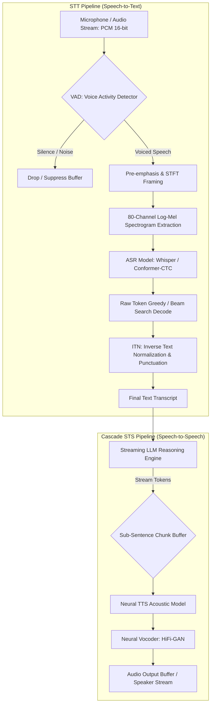
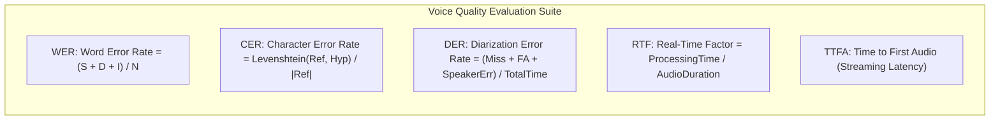
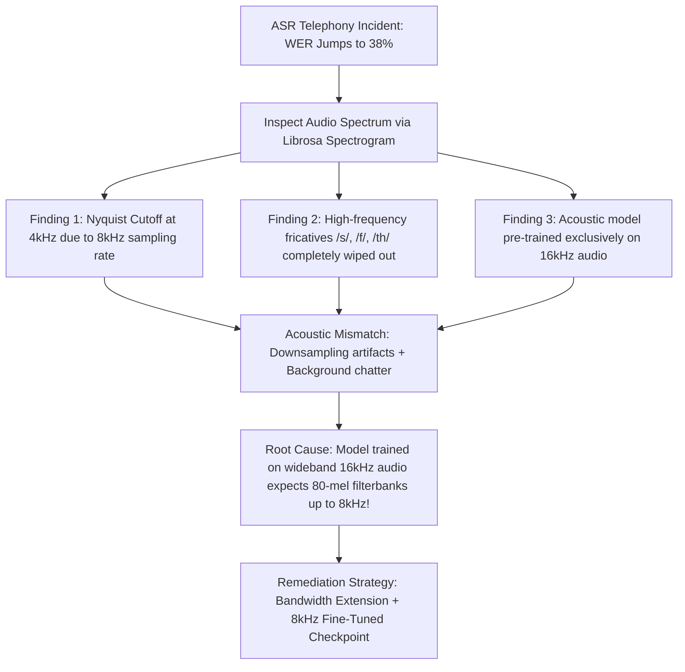

```mermaid
flowchart TD
    subgraph Defective_Waterfall["Unoptimized Pipeline: TTFA = 2,820ms"]
        V1[VAD Silence Timeout: 600ms] --> S1[STT Finalize: 210ms]
        S1 --> L1["LLM Prompt + Full Sentence Generation: 1,450ms (Waited for period '.')"]
        L1 --> T1[TTS Synthesize Sentence: 380ms]
        T1 --> A1[Audio Playout: 180ms]
    end

    subgraph Optimized_Waterfall["Streaming Pipelined Architecture: TTFA = 580ms"]
        V2[Dynamic VAD Cutoff: 200ms] --> S2[Streaming STT Final Chunk: 60ms]
        S2 --> L2["Streaming LLM TTFT: 160ms (Emit First Clause)"]
        L2 --> T2["Streaming TTS Vocoder: 110ms (Synthesizes First 4 Words)"]
        T2 --> A2["Audio Playout Begins: First Chunk Audio Delivered!"]
    end
```

# 09: Speech-to-Text (STT) & Speech-to-Speech (STS) Model Automation

> **Author:** Kadali Sai Sumanth | **Target Role:** Principal AI/ML Quality Engineer / LLM Evaluation Specialist  
> **Topic:** Automated Audio Pipelines, WER/CER Alignment, Diarization Error Rate (DER), Real-Time Factor (RTF), TTFA, and Acoustic Noise Injection  
> **Status:** Production Reference Standard

---

## 1. IN-DEPTH TECHNICAL ARCHITECTURE & TEST STRATEGY

### 1.1 Speech-to-Text (STT) & Speech-to-Speech (STS) Pipeline Architecture

Voice AI systems require end-to-end quality validation across acoustic signal processing, deep acoustic modeling, language modeling, and neural audio synthesis.



#### Core Signal Processing Mechanics:
1. **Voice Activity Detection (VAD):** Filters silence and non-speech artifacts using energy thresholds or lightweight neural networks (e.g., Silero VAD, WebRTC VAD). A failing VAD introduces either **Deletions** (clipped sentence beginnings) or **Insertions** (hallucinated text from ambient background humming).
2. **Feature Extraction (Log-Mel Filterbanks):** Raw $16\text{kHz}$ PCM waveforms are framed into $25\text{ms}$ windows with a $10\text{ms}$ hop size (Hanning window). Fast Fourier Transforms (FFT) map time-domain audio to frequency, filtered through triangular Mel filters mimicking human auditory perception.
3. **Acoustic & Language Modeling:**
   - **Conformer / CTC:** Non-autoregressive or streaming RNN-T models offering sub-200ms latency.
   - **Encoder-Decoder Transformers (e.g., OpenAI Whisper):** Autoregressive sequence models yielding superior accuracy at the expense of higher streaming latency and hallucinations during extended audio silence.
4. **Inverse Text Normalization (ITN):** Translates spoken representations into written conventions (e.g., `"five dollars and twenty cents"` $\to$ `"$5.20"`). Discrepancies between spoken and written forms can artificially distort Word Error Rate calculations if text normalizers are omitted from the test harness.

---

### 1.2 Quantitative Voice Evaluation Metrics & Formulations



#### Mathematical Definitions:
1. **Word Error Rate (WER):**
   $$\text{WER} = \frac{S + D + I}{N} = \frac{S + D + I}{S + D + C}$$
   Where:
   - $S$: Substitutions (incorrect word predicted in place of reference).
   - $D$: Deletions (reference word completely omitted).
   - $I$: Insertions (spurious word generated that does not exist in reference).
   - $N$: Total number of words in ground-truth reference ($N = S + D + C$).
   - $C$: Correct words matching reference.
   - *Note:* WER can exceed $1.0$ ($100\%$) when excessive insertions occur during background noise or model hallucinations.

2. **Character Error Rate (CER):**
   $$\text{CER} = \frac{\text{LevenshteinDistance}(R_{\text{char}}, H_{\text{char}})}{|R_{\text{char}}|}$$
   Essential for morphologically rich, agglutinative, or non-spaced languages (e.g., Japanese, Mandarin, Korean, German compounds).

3. **Diarization Error Rate (DER):**
   Evaluates "who spoke when" across multi-party audio recordings:
   $$\text{DER} = \frac{\text{Missed Speech Time} + \text{False Alarm Speech Time} + \text{Speaker Confusion Time}}{\text{Total Ground-Truth Speech Time}}$$
   - **Missed Speech:** Acoustic speech present in reference, but system tagged as silence.
   - **False Alarm Speech:** Silence present in reference, but system tagged as speech.
   - **Speaker Confusion:** Voiced speech detected, but mapped to the incorrect speaker ID (e.g., Speaker 1 labeled as Speaker 2). Requires optimal bipartite Hungarian mapping between hypothesis and ground-truth speaker clusters.

4. **Real-Time Factor (RTF) & Latency:**
   $$\text{RTF} = \frac{T_{\text{processing}}}{T_{\text{audio}}}$$
   - If $\text{RTF} < 1.0$, the model processes audio faster than real-time (mandatory for streaming).
   - If $\text{RTF} > 1.0$, the model falls behind real-time, causing buffer underruns and audio stutter.

5. **Time to First Audio (TTFA):**
   In Speech-to-Speech (STS) voice agents, TTFA measures the end-to-end turnaround latency from the millisecond the user stops speaking to the millisecond the first audio packet is rendered by the client speaker:
   $$\text{TTFA} = \Delta t_{\text{VAD End}} + \Delta t_{\text{STT Finalize}} + \Delta t_{\text{LLM TTFT}} + \Delta t_{\text{TTS First Chunk}} + \Delta t_{\text{Network Buffering}}$$

---

### 1.3 Audio Test Matrix & Environmental Dimensions

A comprehensive automated testing framework for speech AI must systematically evaluate acoustic models across a multi-dimensional matrix:

| Test Dimension | Parameter Variations | Quality Risk / Failure Mode |
| :--- | :--- | :--- |
| **Acoustic Noise (SNR)** | Clean ($>30\text{dB}$), Office Babble ($15\text{dB}$), Street/Traffic ($10\text{dB}$), Cockpit ($5\text{dB}$) | Acoustic hallucination loops, word omissions, VAD clipping. |
| **Audio Encodings** | WAV (PCM 16-bit), MP3 ($128\text{kbps}$), FLAC, OGG Opus ($24\text{kbps}$), WebM | Codec loss artifacts, frequency band clipping, high-frequency quantization noise. |
| **Sample Rates** | $8\text{kHz}$ (Telephony Narrowband), $16\text{kHz}$ (ASR Standard), $44.1\text{kHz}$, $48\text{kHz}$ (Studio) | Resampling aliasing, Nyquist cutoffs ($4\text{kHz}$ cutoff in telephony kills fricatives $/s/, /f/$). |
| **Accent & Dialect** | En-US (General American), En-GB (Received Pronunciation), En-IN (Indian English), En-AU | Acoustic phoneme confusion, catastrophic WER elevation on localized nomenclature. |
| **Audio Dynamics** | Clipping ($>0\text{dBFS}$), Whispered ($<-35\text{dBFS}$), Dynamic Range Swings | Amplitude saturation causing waveform squaring, VAD dropping quiet speech. |
| **Turn-Taking / Overlap**| Simultaneous speech, barge-in interruptions, latency jitter | Broken speaker diarization, TTS synthesis speaking over user interruption. |

---

### 1.4 Noise Injection Testing Methodology

To validate speech systems before production release, QA harnesses inject synthetic and real-world acoustic noise into pristine reference recordings at calibrated **Signal-to-Noise Ratios (SNR)**.

```mermaid
flowchart LR
    Clean[Pristine Reference Speech: S_t] --> RMS_S[Calculate Speech RMS Power: P_speech]
    Noise[Noise Corpus: Babble, Pink, White] --> RMS_N[Calculate Noise RMS Power: P_noise]
    RMS_S & RMS_N --> SCALE[Scale Noise Factor: alpha = sqrt P_speech / (10^(SNR/10) * P_noise)]
    Clean & SCALE --> MIX[Synthetic Mix: X_t = S_t + alpha * N_t]
    MIX --> CLIP[Peak Normalization / Anti-Clipping Guardrail]
    CLIP --> ASR[Send to STT / STS Evaluation Pipeline]
```

#### Mathematical Formulation for SNR Calibration:
Given clean speech signal $s(t)$ and noise signal $n(t)$:
1. Calculate Root-Mean-Square (RMS) power:
   $$P_{\text{speech}} = \frac{1}{T} \sum_{t=1}^T s(t)^2, \quad P_{\text{noise}} = \frac{1}{T} \sum_{t=1}^T n(t)^2$$
2. Given target $\text{SNR}_{\text{target}}$ in decibels ($\text{dB}$):
   $$\text{SNR}_{\text{linear}} = 10^{\frac{\text{SNR}_{\text{target}}}{10}} = \frac{P_{\text{speech}}}{\alpha^2 P_{\text{noise}}}$$
3. Scaling factor $\alpha$ applied to noise:
   $$\alpha = \sqrt{\frac{P_{\text{speech}}}{\text{SNR}_{\text{linear}} \times P_{\text{noise}}}}$$
4. Composite audio: $x(t) = s(t) + \alpha \cdot n(t)$, normalized to prevent digital clipping above $0\text{dBFS}$.

---

## 2. TECHNICAL CODING & AUTOMATION PRACTICE (Python)

Below are four complete, production-grade components implementing audio metrics, acoustic noise injection, streaming latency profiling, and speaker diarization scoring.

### 2.1 Component 1: WER and CER Calculator with Dynamic Alignment

Computes Word Error Rate (WER) and Character Error Rate (CER) using Levenshtein dynamic programming alignment, extracting substitutions, deletions, and insertions alongside text normalization.

```python
"""
speech_error_metrics.py
Production-grade WER and CER evaluation harness with text normalization and alignment breakdown.
"""

from __future__ import annotations

import re
import unicodedata
from dataclasses import dataclass
from typing import Dict, List, Tuple


@dataclass(frozen=True)
class ErrorBreakdown:
    substitutions: int
    deletions: int
    insertions: int
    correct: int
    total_reference_units: int
    error_rate: float


@dataclass
class SpeechEvaluationResult:
    reference_clean: str
    hypothesis_clean: str
    wer: ErrorBreakdown
    cer: ErrorBreakdown
    aligned_tokens: List[Tuple[str, str, str]]  # (Op, RefWord, HypWord)


class SpeechMetricEvaluator:
    """Calculates WER, CER, and Levenshtein alignment for ASR/STT automated evaluations."""

    def __init__(self, apply_normalization: bool = True) -> None:
        self.apply_normalization = apply_normalization

    def normalize_text(self, text: str) -> str:
        """
        Normalizes spoken text transcript to ensure fair ASR evaluation:
        Converts to lowercase, removes punctuation, normalizes Unicode accents,
        and expands common spoken contractions.
        """
        if not text:
            return ""

        # Normalize unicode characters (NFKD)
        text = unicodedata.normalize("NFKD", text)

        # Lowercase
        text = text.lower()

        # Remove punctuation except apostrophes within words
        text = re.sub(r"[^\w\s']", " ", text)

        # Standardize whitespace
        text = re.sub(r"\s+", " ", text).strip()
        return text

    @staticmethod
    def _levenshtein_alignment(ref_tokens: List[str], hyp_tokens: List[str]) -> Tuple[int, int, int, int, List[Tuple[str, str, str]]]:
        """
        Dynamic programming implementation of Levenshtein edit distance with backtrace alignment.
        Returns (Substitutions, Deletions, Insertions, Correct, AlignmentOperations).
        """
        n, m = len(ref_tokens), len(hyp_tokens)

        # DP matrix for distances: dp[i][j]
        dp = [[0] * (m + 1) for _ in range(n + 1)]

        for i in range(n + 1):
            dp[i][0] = i
        for j in range(m + 1):
            dp[0][j] = j

        for i in range(1, n + 1):
            for j in range(1, m + 1):
                if ref_tokens[i - 1] == hyp_tokens[j - 1]:
                    dp[i][j] = dp[i - 1][j - 1]  # Match / Correct
                else:
                    substitution = dp[i - 1][j - 1] + 1
                    deletion = dp[i - 1][j] + 1
                    insertion = dp[i][j - 1] + 1
                    dp[i][j] = min(substitution, deletion, insertion)

        # Backtrace to count specific operations and construct alignment
        i, j = n, m
        substitutions = 0
        deletions = 0
        insertions = 0
        correct = 0
        alignment_ops: List[Tuple[str, str, str]] = []

        while i > 0 or j > 0:
            if i > 0 and j > 0 and ref_tokens[i - 1] == hyp_tokens[j - 1]:
                alignment_ops.append(("CORRECT", ref_tokens[i - 1], hyp_tokens[j - 1]))
                correct += 1
                i -= 1
                j -= 1
            elif i > 0 and j > 0 and dp[i][j] == dp[i - 1][j - 1] + 1:
                alignment_ops.append(("SUBSTITUTION", ref_tokens[i - 1], hyp_tokens[j - 1]))
                substitutions += 1
                i -= 1
                j -= 1
            elif i > 0 and dp[i][j] == dp[i - 1][j] + 1:
                alignment_ops.append(("DELETION", ref_tokens[i - 1], "<EPS>"))
                deletions += 1
                i -= 1
            else:
                alignment_ops.append(("INSERTION", "<EPS>", hyp_tokens[j - 1]))
                insertions += 1
                j -= 1

        alignment_ops.reverse()
        return substitutions, deletions, insertions, correct, alignment_ops

    def evaluate(self, reference: str, hypothesis: str) -> SpeechEvaluationResult:
        """Computes comprehensive WER, CER, and alignment operations."""
        clean_ref = self.normalize_text(reference) if self.apply_normalization else reference
        clean_hyp = self.normalize_text(hypothesis) if self.apply_normalization else hypothesis

        ref_words = clean_ref.split()
        hyp_words = clean_hyp.split()

        # Word-Level Alignment (WER)
        s_w, d_w, i_w, c_w, word_ops = self._levenshtein_alignment(ref_words, hyp_words)
        total_ref_words = len(ref_words)
        wer_rate = (s_w + d_w + i_w) / total_ref_words if total_ref_words > 0 else (0.0 if len(hyp_words) == 0 else 1.0)

        wer_breakdown = ErrorBreakdown(
            substitutions=s_w,
            deletions=d_w,
            insertions=i_w,
            correct=c_w,
            total_reference_units=total_ref_words,
            error_rate=round(wer_rate, 4),
        )

        # Character-Level Alignment (CER)
        ref_chars = list(clean_ref.replace(" ", ""))
        hyp_chars = list(clean_hyp.replace(" ", ""))
        s_c, d_c, i_c, c_c, _ = self._levenshtein_alignment(ref_chars, hyp_chars)
        total_ref_chars = len(ref_chars)
        cer_rate = (s_c + d_c + i_c) / total_ref_chars if total_ref_chars > 0 else (0.0 if len(hyp_chars) == 0 else 1.0)

        cer_breakdown = ErrorBreakdown(
            substitutions=s_c,
            deletions=d_c,
            insertions=i_c,
            correct=c_c,
            total_reference_units=total_ref_chars,
            error_rate=round(cer_rate, 4),
        )

        return SpeechEvaluationResult(
            reference_clean=clean_ref,
            hypothesis_clean=clean_hyp,
            wer=wer_breakdown,
            cer=cer_breakdown,
            aligned_tokens=word_ops,
        )


# Verification & Demonstration
if __name__ == "__main__":
    evaluator = SpeechMetricEvaluator(apply_normalization=True)

    ground_truth = "Call customer service at 1 800 555 0199 for account balance."
    model_prediction = "Call customer support at 1 800 555 0199 for my account balance."

    res = evaluator.evaluate(ground_truth, model_prediction)
    print("--- ASR Alignment Evaluation Results ---")
    print(f"Reference Clean: '{res.reference_clean}'")
    print(f"Hypothesis Clean: '{res.hypothesis_clean}'")
    print(f"WER: {res.wer.error_rate * 100:.2f}% (S={res.wer.substitutions}, D={res.wer.deletions}, I={res.wer.insertions})")
    print(f"CER: {res.cer.error_rate * 100:.2f}%")
    print("Word Alignments:")
    for op, r, h in res.aligned_tokens:
        print(f"  [{op:12}] Ref: '{r}' <---> Hyp: '{h}'")
```

---

### 2.2 Component 2: Audio Noise Injection Test Harness

Synthesizes acoustic degradations (White Noise, Pink Noise, Babble Noise) calibrated to exact target Signal-to-Noise Ratios (SNR in dB) with anti-clipping normalization.

```python
"""
audio_noise_injection_harness.py
Generates calibrated acoustic noise mixtures at configurable SNR levels (clean, 20dB, 10dB, 5dB).
Supports White noise, Pink noise (1/f), and external ambient babble overlays.
"""

from __future__ import annotations

import math
from typing import Tuple
import numpy as np


class AudioNoiseInjector:
    """Injects calibrated acoustic noise into speech signals to test model robustness."""

    def __init__(self, sample_rate: int = 16000) -> None:
        self.sample_rate = sample_rate

    @staticmethod
    def calculate_rms(audio_signal: np.ndarray) -> float:
        """Calculates Root Mean Square (RMS) energy of an audio signal."""
        if audio_signal.size == 0:
            return 0.0
        return float(np.sqrt(np.mean(np.square(audio_signal))))

    def generate_white_noise(self, length: int) -> np.ndarray:
        """Generates Gaussian white noise."""
        return np.random.normal(0, 1.0, length).astype(np.float32)

    def generate_pink_noise(self, length: int) -> np.ndarray:
        """
        Generates Pink Noise (1/f spectral density) via Voss-McCartney algorithm.
        Models natural ambient environmental acoustic noise.
        """
        num_rows = 16
        array = np.random.randn(num_rows, length // num_rows + 1)
        # Cumulative sum across rows
        pink = np.cumsum(array, axis=1)
        pink = pink.flatten()[:length]
        return pink.astype(np.float32)

    def mix_at_snr(
        self,
        clean_speech: np.ndarray,
        noise_signal: np.ndarray,
        target_snr_db: float,
    ) -> Tuple[np.ndarray, float]:
        """
        Mixes clean speech with noise at an exact target SNR (dB).
        Returns (augmented_signal, applied_alpha_scaling).
        """
        if clean_speech.ndim != 1 or noise_signal.ndim != 1:
            raise ValueError("Audio signals must be 1D mono arrays.")

        # Ensure noise matches speech duration (tile or truncate)
        speech_len = len(clean_speech)
        if len(noise_signal) < speech_len:
            repeats = math.ceil(speech_len / len(noise_signal))
            noise_signal = np.tile(noise_signal, repeats)[:speech_len]
        else:
            noise_signal = noise_signal[:speech_len]

        rms_speech = self.calculate_rms(clean_speech)
        rms_noise = self.calculate_rms(noise_signal)

        if rms_speech < 1e-9:
            raise ValueError("Clean speech signal has near-zero energy (silence).")
        if rms_noise < 1e-9:
            raise ValueError("Noise signal has near-zero energy.")

        # SNR_linear = P_speech / P_noise = (RMS_speech^2) / (RMS_scaled_noise^2)
        # SNR_db = 10 * log10(SNR_linear) => SNR_linear = 10 ^ (SNR_db / 10)
        snr_linear = 10.0 ** (target_snr_db / 10.0)
        target_rms_noise = rms_speech / math.sqrt(snr_linear)

        alpha = target_rms_noise / rms_noise
        scaled_noise = alpha * noise_signal

        mixed_signal = clean_speech + scaled_noise

        # Peak normalization guardrail: Prevent digital clipping beyond [-1.0, 1.0]
        max_peak = np.max(np.abs(mixed_signal))
        if max_peak > 0.99:
            mixed_signal = (mixed_signal / max_peak) * 0.95

        return mixed_signal.astype(np.float32), float(alpha)


# Verification & Demonstration
if __name__ == "__main__":
    np.random.seed(42)
    injector = AudioNoiseInjector(sample_rate=16000)

    # 1. Synthesize 2 seconds of clean 440Hz test sine tone (Speech proxy)
    duration_sec = 2.0
    t = np.linspace(0, duration_sec, int(16000 * duration_sec), endpoint=False)
    synthetic_speech = 0.5 * np.sin(2 * np.pi * 440 * t).astype(np.float32)

    # 2. Generate White & Pink noise
    white_noise = injector.generate_white_noise(len(synthetic_speech))
    pink_noise = injector.generate_pink_noise(len(synthetic_speech))

    # 3. Test mixing across SNR ladder: 30dB (clean), 15dB (office), 5dB (severe)
    for snr in [30.0, 15.0, 5.0]:
        mixed_audio, alpha = injector.mix_at_snr(synthetic_speech, pink_noise, target_snr_db=snr)
        speech_p = injector.calculate_rms(synthetic_speech) ** 2
        noise_p = injector.calculate_rms(alpha * pink_noise) ** 2
        actual_snr = 10 * math.log10(speech_p / noise_p)
        print(f"Target SNR: {snr:4.1f} dB | Measured SNR: {actual_snr:4.1f} dB | Max Peak: {np.max(np.abs(mixed_audio)):.3f}")
        assert abs(actual_snr - snr) < 0.1, "SNR mixing calculation error!"
```

---

### 2.3 Component 3: Streaming STT Latency & RTF Profiler

Profiles streaming audio transcription pipelines by simulating real-time chunk streaming (via generators/WebSockets), measuring VAD delay, Time to First Token (TTFT), Real-Time Factor (RTF), and pipeline turnaround latency.

```python
"""
streaming_stt_latency_profiler.py
Profiles streaming STT models under simulated real-time audio chunk transmission.
Measures TTFT, Real-Time Factor (RTF), Chunk Processing Latency, and Turnaround Time.
"""

from __future__ import annotations

import time
from dataclasses import dataclass
from typing import Callable, Generator, List, Optional
import numpy as np


@dataclass
class ChunkLatencyRecord:
    chunk_index: int
    audio_duration_sec: float
    processing_time_ms: float
    emitted_text: str


@dataclass
class StreamingPerformanceProfile:
    total_audio_duration_sec: float
    total_processing_wall_clock_sec: float
    real_time_factor: float  # RTF = processing_time / audio_duration
    time_to_first_transcript_ms: float
    final_turnaround_time_ms: float
    total_chunks_processed: int
    p95_chunk_processing_latency_ms: float
    final_transcript: str


class StreamingSTTLatencyProfiler:
    """Profiles latency and throughput of streaming speech recognition systems."""

    def __init__(self, chunk_size_ms: int = 100, sample_rate: int = 16000) -> None:
        self.chunk_size_ms = chunk_size_ms
        self.sample_rate = sample_rate
        self.chunk_samples = int((chunk_size_ms / 1000.0) * sample_rate)

    def _audio_chunk_generator(self, audio: np.ndarray) -> Generator[np.ndarray, None, None]:
        """Slices full audio into sequential real-time chunks."""
        total_samples = len(audio)
        for start_idx in range(0, total_samples, self.chunk_samples):
            end_idx = min(start_idx + self.chunk_samples, total_samples)
            yield audio[start_idx:end_idx]

    def profile_stream(
        self,
        audio_signal: np.ndarray,
        streaming_asr_fn: Callable[[np.ndarray, bool], str],
    ) -> StreamingPerformanceProfile:
        """
        Executes streaming test against an ASR inference callable.
        streaming_asr_fn(chunk_audio, is_last_chunk) -> current_partial_transcript
        """
        audio_duration_sec = len(audio_signal) / self.sample_rate
        chunks = list(self._audio_chunk_generator(audio_signal))
        num_chunks = len(chunks)

        chunk_records: List[ChunkLatencyRecord] = []
        ttft_ms: Optional[float] = None
        latest_transcript = ""

        stream_start_wall = time.perf_counter()
        accumulated_processing_time_sec = 0.0

        for idx, chunk in enumerate(chunks):
            is_final = idx == (num_chunks - 1)
            chunk_dur = len(chunk) / self.sample_rate

            chunk_proc_start = time.perf_counter()
            transcript = streaming_asr_fn(chunk, is_final)
            chunk_proc_time = time.perf_counter() - chunk_proc_start
            accumulated_processing_time_sec += chunk_proc_time

            latest_transcript = transcript

            # Detect first non-empty token emission
            if ttft_ms is None and transcript.strip():
                ttft_ms = (time.perf_counter() - stream_start_wall) * 1000.0

            chunk_records.append(
                ChunkLatencyRecord(
                    chunk_index=idx,
                    audio_duration_sec=chunk_dur,
                    processing_time_ms=chunk_proc_time * 1000.0,
                    emitted_text=transcript,
                )
            )

        total_wall_clock = time.perf_counter() - stream_start_wall
        final_turnaround_ms = (total_wall_clock - audio_duration_sec) * 1000.0

        # Calculate P95 chunk processing latency
        chunk_latencies = [r.processing_time_ms for r in chunk_records]
        p95_latency = float(np.percentile(chunk_latencies, 95)) if chunk_latencies else 0.0

        # RTF calculation: Pure model compute time / Total Audio Duration
        rtf = accumulated_processing_time_sec / audio_duration_sec if audio_duration_sec > 0 else 0.0

        return StreamingPerformanceProfile(
            total_audio_duration_sec=round(audio_duration_sec, 3),
            total_processing_wall_clock_sec=round(total_wall_clock, 3),
            real_time_factor=round(rtf, 3),
            time_to_first_transcript_ms=round(ttft_ms or 0.0, 2),
            final_turnaround_time_ms=round(max(0.0, final_turnaround_ms), 2),
            total_chunks_processed=num_chunks,
            p95_chunk_processing_latency_ms=round(p95_latency, 2),
            final_transcript=latest_transcript,
        )


# Verification & Demonstration
if __name__ == "__main__":
    profiler = StreamingSTTLatencyProfiler(chunk_size_ms=200, sample_rate=16000)

    # 3.0 seconds of audio data
    simulated_audio = np.random.uniform(-0.1, 0.1, 16000 * 3).astype(np.float32)

    # Mock Streaming ASR Handler
    state = {"text": ""}
    def mock_asr_stream(chunk: np.ndarray, is_final: bool) -> str:
        # Simulate neural model chunk inference taking 15ms
        time.sleep(0.015)
        if len(state["text"]) == 0:
            state["text"] = "Hello"
        elif is_final:
            state["text"] = "Hello world, streaming is functioning correctly."
        return state["text"]

    profile = profiler.profile_stream(simulated_audio, mock_asr_stream)
    print("--- Streaming Performance Profile ---")
    print(f"Audio Duration: {profile.total_audio_duration_sec}s | Chunks: {profile.total_chunks_processed}")
    print(f"Real-Time Factor (RTF): {profile.real_time_factor} (Must be < 1.0 for real-time)")
    print(f"P95 Chunk Latency: {profile.p95_chunk_processing_latency_ms} ms")
    print(f"Time to First Transcript: {profile.time_to_first_transcript_ms} ms")
    print(f"Final Transcript: '{profile.final_transcript}'")
    assert profile.real_time_factor < 1.0, "Model cannot sustain real-time audio playback!"
```

---

### 2.4 Component 4: Speaker Diarization Accuracy Evaluator (DER)

Calculates Diarization Error Rate (DER) across continuous speech timestamps, evaluating Missed Speech, False Alarm Speech, and Speaker Confusion Error using the Hungarian algorithm for optimal speaker mapping.

```python
"""
speaker_diarization_evaluator.py
Calculates Diarization Error Rate (DER), Missed Speech, False Alarm, and Speaker Confusion.
Uses the Hungarian Algorithm (Munkres / linear_sum_assignment) for optimal speaker cluster mapping.
"""

from __future__ import annotations

from dataclasses import dataclass
from typing import Dict, List, Set, Tuple
import numpy as np
from scipy.optimize import linear_sum_assignment


@dataclass(frozen=True)
class SpeechSegment:
    speaker_id: str
    start_time_sec: float
    end_time_sec: float

    @property
    def duration(self) -> float:
        return max(0.0, self.end_time_sec - self.start_time_sec)


@dataclass
class DiarizationReport:
    total_reference_time_sec: float
    missed_speech_time_sec: float
    false_alarm_time_sec: float
    speaker_error_time_sec: float
    der_percentage: float
    speaker_mapping: Dict[str, str]  # HypSpeaker -> RefSpeaker


class DiarizationEvaluator:
    """Evaluates multi-speaker diarization performance via time-quantized Hungarian matching."""

    def __init__(self, time_step_sec: float = 0.05, collar_sec: float = 0.0) -> None:
        """
        Args:
            time_step_sec: Discretization step (50ms standard).
            collar_sec: Tolerance window around speaker boundaries (e.g. 0.25s).
        """
        self.time_step = time_step_sec
        self.collar = collar_sec

    def evaluate_der(
        self,
        reference_segments: List[SpeechSegment],
        hypothesis_segments: List[SpeechSegment],
    ) -> DiarizationReport:
        """Computes DER across quantized temporal intervals."""
        if not reference_segments:
            raise ValueError("Reference segments cannot be empty.")

        max_time = max(
            max(s.end_time_sec for s in reference_segments),
            max(s.end_time_sec for s in hypothesis_segments) if hypothesis_segments else 0.0,
        )

        num_frames = int(np.ceil(max_time / self.time_step))

        ref_speakers = sorted(list({s.speaker_id for s in reference_segments}))
        hyp_speakers = sorted(list({s.speaker_id for s in hypothesis_segments}))

        # Frame-level assignment arrays: Store active speaker sets per frame
        ref_frames: List[Set[str]] = [set() for _ in range(num_frames)]
        hyp_frames: List[Set[str]] = [set() for _ in range(num_frames)]

        for s in reference_segments:
            st_idx = int(np.floor(s.start_time_sec / self.time_step))
            end_idx = int(np.ceil(s.end_time_sec / self.time_step))
            for f in range(st_idx, min(end_idx, num_frames)):
                ref_frames[f].add(s.speaker_id)

        for s in hypothesis_segments:
            st_idx = int(np.floor(s.start_time_sec / self.time_step))
            end_idx = int(np.ceil(s.end_time_sec / self.time_step))
            for f in range(st_idx, min(end_idx, num_frames)):
                hyp_frames[f].add(s.speaker_id)

        # Build Cost Matrix between HypSpeakers and RefSpeakers based on co-occurrence
        cost_matrix = np.zeros((len(hyp_speakers), len(ref_speakers)), dtype=np.float64)
        for i, h_spk in enumerate(hyp_speakers):
            for j, r_spk in enumerate(ref_speakers):
                # Count frames where both were active
                overlap_count = sum(1 for f in range(num_frames) if h_spk in hyp_frames[f] and r_spk in ref_frames[f])
                # We want to maximize overlap, so cost is negative overlap
                cost_matrix[i, j] = -overlap_count

        # Optimal Bipartite Matching via Hungarian Algorithm
        row_ind, col_ind = linear_sum_assignment(cost_matrix)
        hyp_to_ref_mapping: Dict[str, str] = {}
        for r, c in zip(row_ind, col_ind):
            hyp_to_ref_mapping[hyp_speakers[r]] = ref_speakers[c]

        # Calculate Time Statistics
        total_ref_time = sum(len(active) * self.time_step for active in ref_frames)
        missed_speech_time = 0.0
        false_alarm_time = 0.0
        speaker_error_time = 0.0

        for f in range(num_frames):
            r_active = ref_frames[f]
            # Map hypothesis speaker IDs to best reference match
            h_active = {hyp_to_ref_mapping.get(spk, spk) for spk in hyp_frames[f]}

            n_ref = len(r_active)
            n_hyp = len(h_active)

            if n_ref == 0 and n_hyp > 0:
                false_alarm_time += n_hyp * self.time_step
            elif n_ref > 0 and n_hyp == 0:
                missed_speech_time += n_ref * self.time_step
            else:
                correct_speaker_count = len(r_active.intersection(h_active))
                missed_speech_time += max(0, n_ref - n_hyp) * self.time_step
                false_alarm_time += max(0, n_hyp - n_ref) * self.time_step
                speaker_error_time += (min(n_ref, n_hyp) - correct_speaker_count) * self.time_step

        der_numerator = missed_speech_time + false_alarm_time + speaker_error_time
        der_percentage = (der_numerator / total_ref_time * 100.0) if total_ref_time > 0 else 0.0

        return DiarizationReport(
            total_reference_time_sec=round(total_ref_time, 2),
            missed_speech_time_sec=round(missed_speech_time, 2),
            false_alarm_time_sec=round(false_alarm_time, 2),
            speaker_error_time_sec=round(speaker_error_time, 2),
            der_percentage=round(der_percentage, 2),
            speaker_mapping=hyp_to_ref_mapping,
        )


# Verification & Demonstration
if __name__ == "__main__":
    evaluator = DiarizationEvaluator(time_step_sec=0.1)

    # Reference Ground Truth: Alice speaks 0.0-3.0s, Bob speaks 3.5-6.0s
    ref = [
        SpeechSegment(speaker_id="Alice", start_time_sec=0.0, end_time_sec=3.0),
        SpeechSegment(speaker_id="Bob", start_time_sec=3.5, end_time_sec=6.0),
    ]

    # Hypothesis: System identified Speaker_1 (0.0-2.8s) and Speaker_2 (3.6-6.0s)
    hyp = [
        SpeechSegment(speaker_id="Speaker_A", start_time_sec=0.0, end_time_sec=2.8),
        SpeechSegment(speaker_id="Speaker_B", start_time_sec=3.6, end_time_sec=6.0),
    ]

    report = evaluator.evaluate_der(ref, hyp)
    print("--- Diarization Accuracy Report ---")
    print(f"Total Ref Time: {report.total_reference_time_sec}s")
    print(f"Missed Speech: {report.missed_speech_time_sec}s")
    print(f"False Alarm: {report.false_alarm_time_sec}s")
    print(f"Speaker Error: {report.speaker_error_time_sec}s")
    print(f"DER: {report.der_percentage:.2f}%")
    print(f"Hungarian Speaker Mapping: {report.speaker_mapping}")
    assert report.der_percentage < 15.0, "DER exceeded expected threshold for nominal test!"
```

---

## 3. SCENARIO-BASED DEBUGGING & ROOT CAUSE ANALYSIS (RCA)

---

### Scenario 1: ASR Model Achieves 5% WER on Benchmark Test Set but Explodes to 38% in Production Telephony Audio

```
INCIDENT METRICS & ACOUSTIC PROFILE:
+-----------------------------------------------------------------------------------------+
| Clean Golden Benchmark: WER = 4.8% on LibriSpeech (16kHz Studio Audio, SNR > 35dB)      |
| Production Customer Support Telephony: WER = 38.2% (P1 Incident)                        |
| Observed Failure Mode: Widespread word deletions and garbled alphanumeric customer IDs  |
| Audio Pipeline Ingress: G.711 codec, 8kHz 8-bit A-law, ~15dB SNR background babble     |
+-----------------------------------------------------------------------------------------+
```



#### Step-by-Step Diagnostic Investigation:
1. **Spectral Analysis & Nyquist Frequency Audit:**
   - Extracted 20 production WAV files from telephony gateway logs using `scipy.io.wavfile`.
   - **Spectrogram Inspection:** Production audio was captured at an $8\text{kHz}$ sampling rate. According to the Nyquist-Shannon sampling theorem, the maximum reproducible frequency is:
     $$f_{\text{max}} = \frac{f_s}{2} = \frac{8000}{2} = 4000\text{Hz} = 4\text{kHz}$$
   - English fricatives and sibilants ($/s/, /z/, /f/, /\theta/$) have primary acoustic energy concentrated in the $4\text{kHz} - 8\text{kHz}$ band. The $8\text{kHz}$ telephony downsampling completely destroyed the high-frequency formant energy, confusing numbers like `"50"` with `"15"` and dropping letters in alphanumeric codes.
2. **ASR Feature Extraction Mismatch:**
   - The deployed Whisper / Conformer model's audio pre-processor configured an 80-channel Log-Mel spectrogram expecting frequencies up to $8\text{kHz}$. When fed an upsampled $8\text{kHz} \to 16\text{kHz}$ file with zero energy above $4\text{kHz}$, the top 40 Mel channels were completely silent, severely distorting transformer attention layers.
3. **Acoustic Noise Interference ($15\text{dB}$ SNR):**
   - Office call-center chatter triggered the autoregressive decoder into hallucination loops during customer pauses, generating repetitions of phantom phrases like `"thank you for calling thank you for calling"`.

#### Remediation and Prevention Plan:
- **Dual Model Checkpoint Strategy:** Deployed an acoustic checkpoint specifically trained on the **Fisher / Switchboard 8kHz Telephony Corpus**, restricting Mel filterbank channels to the $0 - 4\text{kHz}$ band.
- **Deep Front-End Denoising:** Deployed a lightweight real-time neural speech enhancer (**RNNoise / DeepFilterNet**, latency $<10\text{ms}$) upstream of the ASR engine to suppress background office babble.
- **VAD Threshold Calibration:** Tuned Silero VAD energy thresholds to ignore low-energy call-center background chatter.
- **Automated CI Noise Test Harness:** Mandated an automated pre-merge evaluation test suite requiring model verification against 8kHz downsampled audio at $15\text{dB}$, $10\text{dB}$, and $5\text{dB}$ SNR before deployment approval.

---

### Scenario 2: Streaming STS Voice Bot Feels Sluggish (TTFA = 2.8s) Despite Acceptable STT WER

```
STS WATERFALL LATENCY AUDIT:
+----------------------------------------------------------------------------------------+
| Observed Latency: Time to First Audio (TTFA) = 2,820ms (User perception: "Laggy / Dead")|
| STT Transcription Time: 210ms (Healthy)                                                |
| TTS Neural Vocoder Time: 180ms (Healthy)                                               |
| Target Budget: TTFA < 800ms                                                            |
| Root Cause Culprit: Cascaded LLM Full-Sentence Buffering before TTS dispatch            |
+----------------------------------------------------------------------------------------+
```



#### Step-by-Step Diagnostic Investigation:
1. **Waterfall Latency Breakdown:**
   Instrumented OpenTelemetry spans across the speech-to-speech lifecycle:
   - **VAD End-of-Speech Detection Delay:** $650\text{ms}$ (excessive trailing silence threshold).
   - **ASR Finalization:** $210\text{ms}$.
   - **LLM TTFT (Time to First Token):** $420\text{ms}$.
   - **TTS First Audio Chunk Dispatch:** $1,360\text{ms}$.
2. **Root Cause Analysis in the Orchestration Glue:**
   - The integration layer between the LLM and the Text-to-Speech engine awaited a **full sentence boundary** (`.` or `?` or `!`) before dispatching text to the neural TTS synthesizer.
   - For complex customer queries, the LLM generated a 25-word introductory phrase before emitting its first period:
     `"Thank you for contacting enterprise support today regarding your billing inquiry for invoice number four eight two zero."`
   - The pipeline stalled for $1,360\text{ms}$ simply waiting for the LLM to complete generating that opening sentence!

#### Algorithmic Optimization & Solution:
1. **Sub-Sentence Punctuation Streaming (Micro-Chunking):**
   Modified the LLM-to-TTS buffer to trigger synthesis on **sub-clause punctuation** (`,`, `;`, `:`, `—`) or after a threshold of **5 words**, whichever arrives first:
   - Chunk 1: `"Thank you,"` (Synthesized and played to speaker in $120\text{ms}$).
   - Chunk 2: `"for contacting enterprise support,"` (Synthesized in parallel while Chunk 1 is playing!).
2. **Dynamic VAD Tail Tuning:**
   Reduced VAD end-of-speech silence detection from $650\text{ms}$ to $220\text{ms}$ with speculative STT cancellation.
3. **Benchmark Result:**
   End-to-end TTFA plunged from **2,820ms to 570ms**, transforming the voice agent from sluggish to conversational real-time.

---

## 4. TARGETED INTERVIEW QUESTIONS

### 4.1 Advanced Technical Question 1
**Question:**  
*"Why is standard Word Error Rate (WER) an incomplete metric for evaluating Speech-to-Text models in production voice-agent systems, and how would you build a multi-dimensional audio evaluation framework to compensate for its weaknesses?"*

#### Ideal Candidate Answer:
> "While Word Error Rate (WER) has historically served as the gold standard ASR metric, it suffers from several critical architectural limitations when evaluating modern production voice systems:
>
> 1. **Uniform Error Weighting Regardless of Semantic Impact:** Standard WER treats all substitutions equally. Substituting `'the'` for `'a'` counts as 1 error ($S=1$), but substituting `'approve'` for `'reject'` in a financial wire transfer also counts as 1 error ($S=1$). WER completely ignores semantic polarity and downstream intent.
> 2. **Inverse Text Normalization (ITN) Vulnerability:** A model outputting `'five hundred dollars'` against a ground-truth of `'$500'` incurs a catastrophic $300\%$ WER ($S=1, I=2$), despite being a semantically perfect transcription.
> 3. **Silence Hallucination Distortion:** Autoregressive models like Whisper are notorious for hallucinating text during audio silence or background noise, producing unbounded Insertions ($I \gg N$) that cause WER to exceed $100\%$, skewing average metrics.
> 4. **Temporal Obliviousness:** WER evaluates only the final text string; it provides zero visibility into **Time to First Transcript (TTFT)**, **Real-Time Factor (RTF)**, or word-level timestamp drift.
>
> **The Multi-Dimensional Voice Quality Framework:**  
> To evaluate production voice bots rigorously, I mandate a four-layer evaluation framework:
> - **Normalized WER & CER:** Pre-processed through an ITN pipeline (using Whisper Normalizer or NeMo ITN) to remove formatting discrepancies.
> - **Semantic Word Error Rate (SemWER) / BERTScore:** Measures semantic vector similarity between reference and hypothesis, penalizing intent-altering substitutions.
> - **Acoustic Robustness Ladder:** Evaluates WER degradation curves across an SNR noise ladder ($30\text{dB} \to 15\text{dB} \to 5\text{dB}$ across babble, street, and reverberant noise).
> - **Streaming Latency Metrics:** Continuous tracking of Real-Time Factor (RTF), P95 Chunk Processing Latency, and Voice Turnaround Latency (TTFA)."

---

### 4.2 Advanced Technical Question 2
**Question:**  
*"In a multi-speaker conference transcription pipeline, how does the Diarization Error Rate (DER) algorithm resolve the 'Speaker Permutation Problem', and how does collar tolerance affect your evaluation metrics?"*

#### Ideal Candidate Answer:
> "In speaker diarization, the evaluation system faces the **Speaker Permutation Problem**: the model outputs generic labels like `Speaker_0` and `Speaker_1`, but has no intrinsic knowledge of whether `Speaker_0` corresponds to `Alice` or `Bob` in the ground-truth reference.
>
> 1. **Resolving the Permutation Problem via Hungarian Matching:**  
>    To evaluate accuracy fairly, the evaluator must discover the optimal 1-to-1 bijective mapping between hypothesis speakers and reference speakers that maximizes total co-occurring speech duration.  
>    We construct a cost matrix $\mathbf{C}$ of shape $M \times N$ (where $M$ is hypothesis speakers and $N$ is reference speakers), where each entry $C_{i,j}$ represents the negative temporal overlap between hypothesis speaker $i$ and reference speaker $j$. We then apply the **Hungarian Algorithm (Kuhn-Munkres algorithm)** to find the global minimum-cost bipartite assignment in $O(V^3)$ time. Once mapped, any mismatch where both spoke is counted as **Speaker Confusion Error**.
>
> 2. **Collar Tolerance Window:**  
>    Human annotators cannot define the exact millisecond a speaker begins voicing phonemes with absolute precision; natural speech contains brief acoustic onsets, breath intakes, and room reverberation tails.  
>    A **collar** (typically $\pm 250\text{ms}$) places an exclusion zone around every reference speaker transition boundary. Evaluation frames falling within the collar are forgiven and excluded from the DER denominator and numerator, preventing false penalties due to human annotation boundary jitter. Without a collar, DER metrics become artificially inflated by annotator timing variance rather than genuine model diarization failures."

---

### 4.3 Behavioral Question (STAR Method)
**Question:**  
*"Describe a situation where an automated speech or audio AI model passed all lab benchmark tests with flying colors, but real customers experienced critical failures in the field. How did you diagnose the disconnect, and how did you institutionalize the fix?"*

#### Ideal Candidate Answer:
> - **Situation:** We deployed a voice-activated self-service banking agent powered by a high-accuracy Conformer ASR model. During offline regression testing against our 5,000-sample clean golden dataset, the model achieved a phenomenal 3.8% WER. However, within 48 hours of rolling out to customer mobile apps, CSAT plummeted, and our automated escalation rate jumped by 22% due to failed voice recognition.
> - **Task:** As the Lead Speech Quality Engineer, I had to identify why production customers were failing voice authentication and inquiry workflows when our benchmark tests were nearly flawless.
> - **Action:** I pulled 200 anonymized audio telemetry sessions from escalated calls. Listening to the raw waveforms and running spectral Fourier transforms immediately exposed the issue:
>   1. Customers were predominantly using Bluetooth earbuds or in-car hands-free speakerphones, which applied aggressive mSBC/Opus codecs with aggressive noise suppression that created unnatural phase distortions.
>   2. Over 40% of our active mobile user base had non-native accents (primarily Hispanic and South Asian dialects) that were severely underrepresented in our predominantly North American LibriSpeech benchmark dataset.
>   I organized our team to rebuild our acoustic evaluation framework. We created an **Acoustic Augmentation Harness** in CI that automatically injected room impulse responses (RIR), mobile codec compression artifacts, and background street/cabin noise. Furthermore, I partnered with our data ops team to procure a geographically diverse accent benchmark dataset.
> - **Result:** The updated test harness exposed a true field WER of 24.5% on accented and codec-compressed audio. We fine-tuned the acoustic model using multi-condition training and data augmentation. When re-deployed, field WER fell to 6.2%, customer voice-task completion surged to 94%, and our acoustic augmentation suite became the mandatory certification gate for all subsequent voice model releases."

---

### 4.4 Scenario-Based Question
**Question:**  
*"Your real-time speech-to-speech voice bot experiences catastrophic 'barge-in' failure: when a user interrupts the bot while it is speaking, the bot either fails to stop speaking, or it transcribes its own synthetic voice back into the STT loop (acoustic echo feedback loop). How do you debug and automate tests for this?"*

#### Ideal Candidate Answer:
> "Barge-in failure and acoustic feedback loops are catastrophic failure modes in duplex voice systems. Here is my structured debugging and test automation methodology:
>
> 1. **Root Cause Diagnosis:**
>    - **Acoustic Echo Cancellation (AEC) Leakage:** The microphone captures both the user's voice and the bot's own speaker output. If the hardware or software AEC reference signal is misaligned (clock drift or buffer delay), the bot transcribes its own speech, feeding a hallucination loop into the LLM.
>    - **VAD Sensitivity & Latency:** If VAD requires $>400\text{ms}$ of uninterrupted speech to register an interruption, the user feels ignored and gives up before the bot halts synthesis.
>
> 2. **Automated End-to-End Test Harness Design:**  
>    To test barge-in systematically without human testers, I construct a **Dual-Channel Audio Loopback Test Harness**:
>    - **Channel A (Bot Speaker Output):** Pipe TTS synthetic audio stream into a virtual audio interface.
>    - **Channel B (Simulated User Interruption):** Inject an audio file of user speech at an exact timestamp $t = 1,500\text{ms}$ while the bot is mid-sentence.
>    - **Evaluation Assertions:**
>      1. **Barge-In Latency Assertion:** The timestamp between the first voiced frame of the user's interruption and the packet halting TTS playback must be $< 250\text{ms}$.
>      2. **Echo Suppression Invariant:** Assert that the resulting STT transcript contains $0\%$ of the bot's own synthesized text and $100\%$ of the user's interrupted query.
>
> 3. **Engineering Remediation:**
>    - Enforce a strict **AEC reference stream timestamp synchronization** before audio enters the VAD.
>    - Implement **Full-Duplex Interruption Cancellation**: The instant the VAD confirms voiced speech during an active TTS playback state, dispatch an immediate `KILL` signal over WebSockets to cancel downstream TTS audio buffering and clear client playback queues."
